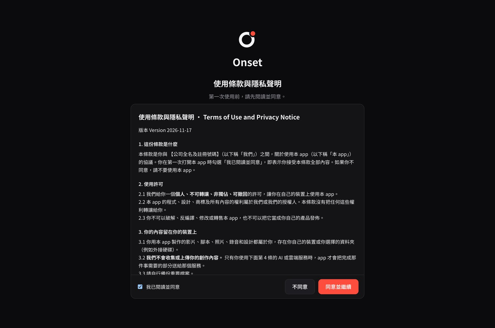
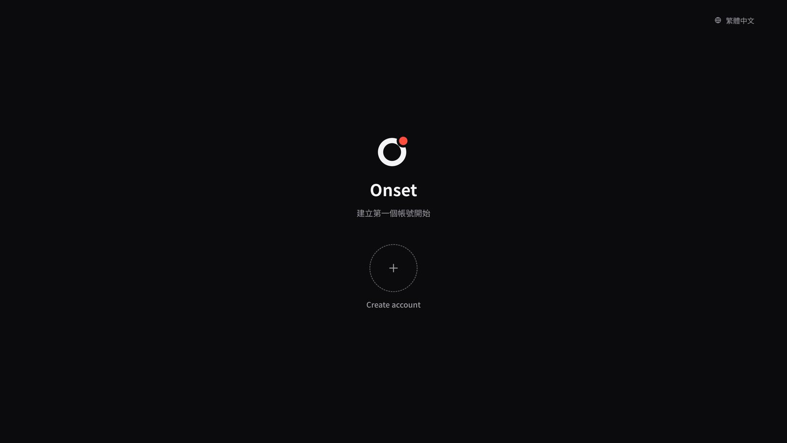
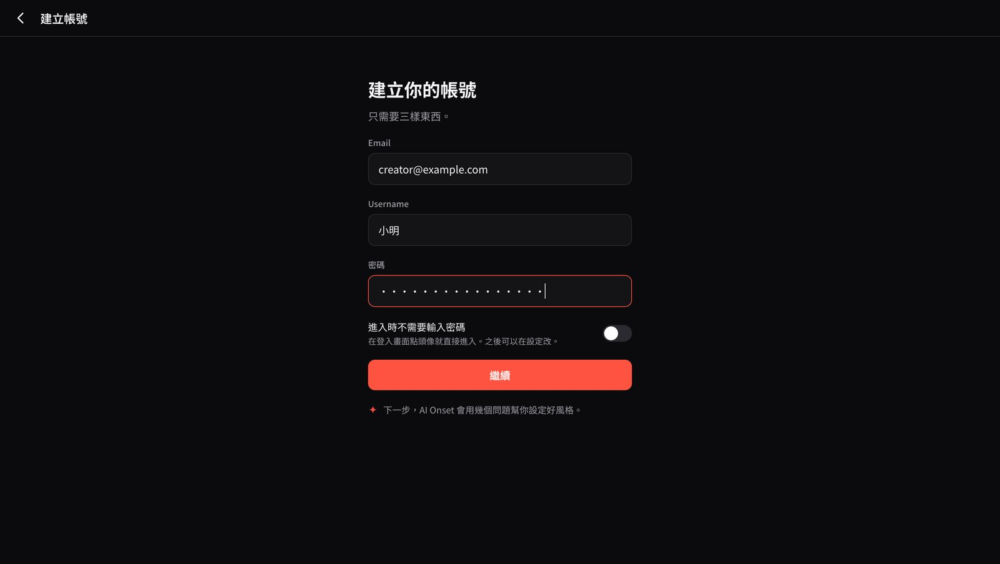
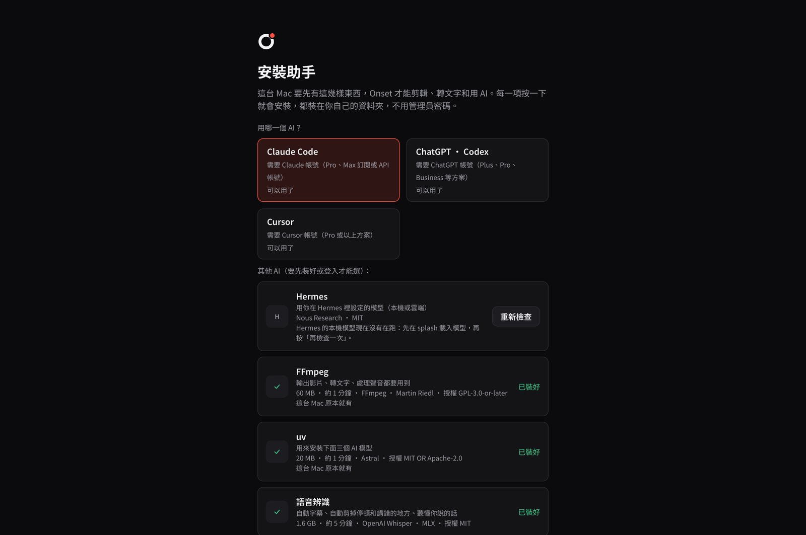
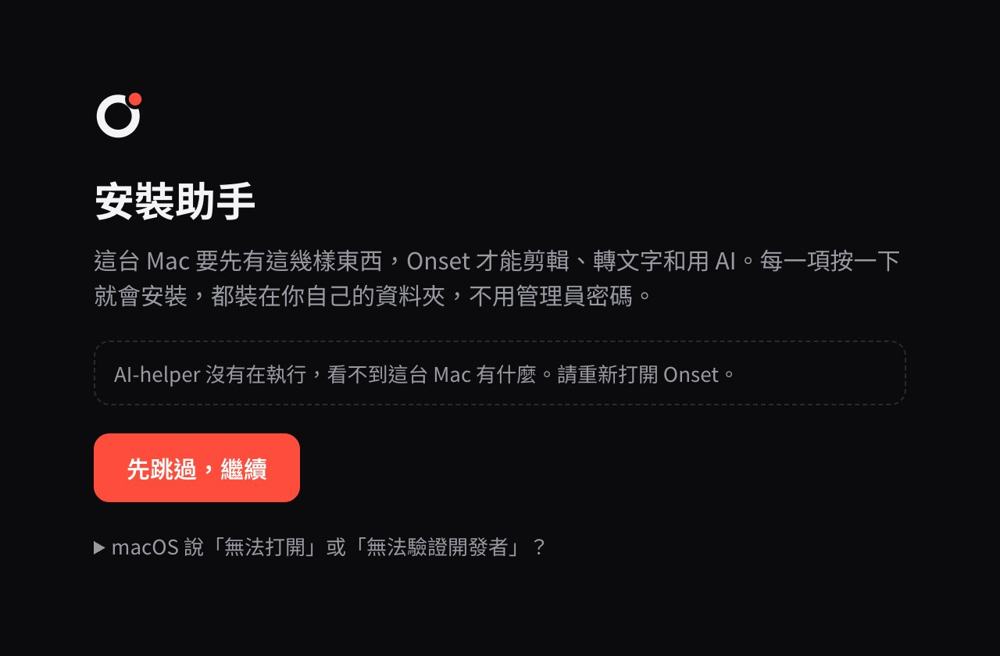
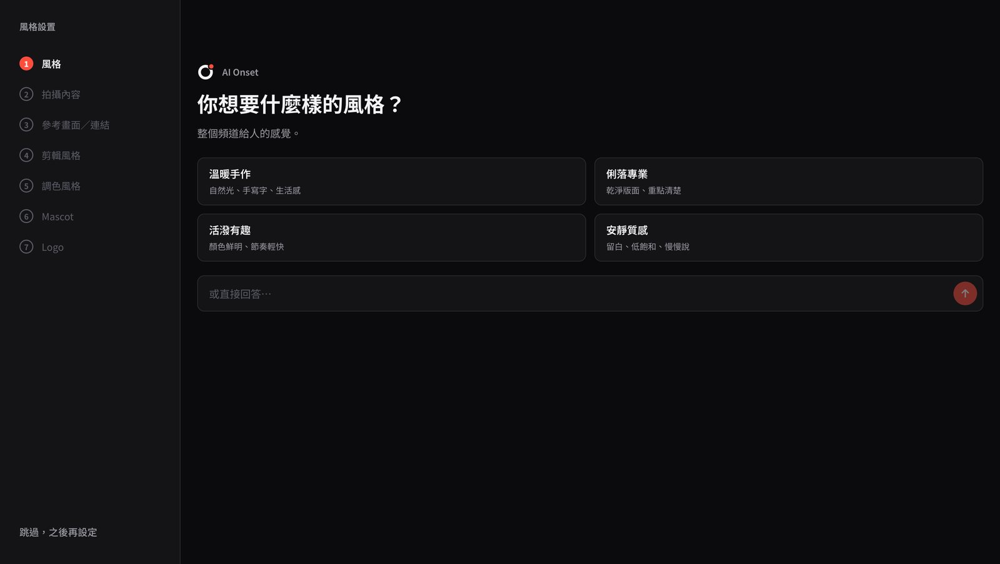
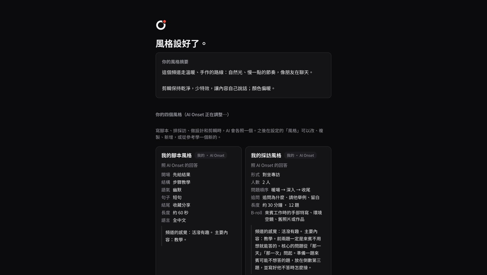
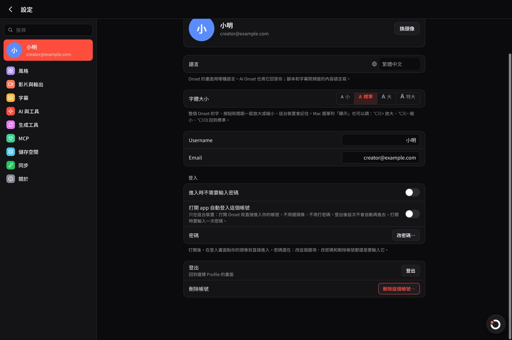
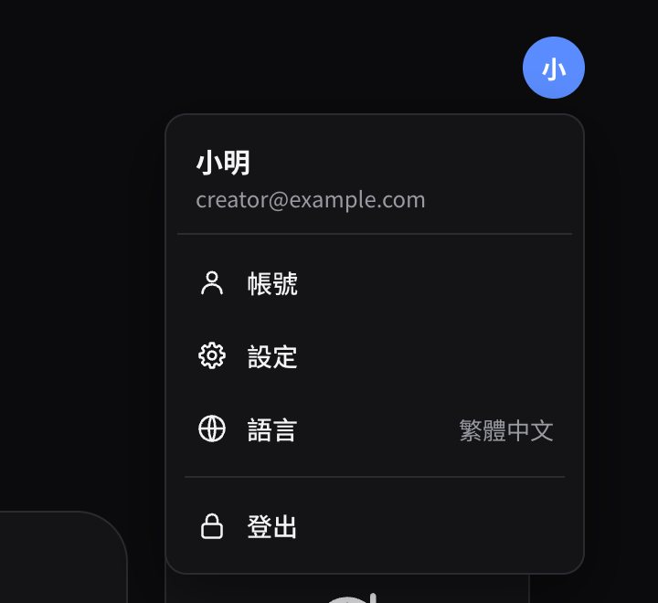

# 1. 安裝和第一次打開

## 1-1 把 Onset 裝到 Mac

1. 打開 Onset 的 `.dmg` 檔。
2. 把 **Onset** 拖進「應用程式」資料夾。
3. 到「應用程式」，**按右鍵點 Onset → 打開**（不要直接點兩下）。

### 看到「無法驗證開發者」怎麼辦？

第一次打開時，macOS 可能說「無法打開 Onset，因為無法驗證開發者」。這是因為 Onset 還沒有經過 Apple 公證，不是壞掉。

- **方法一：** 在 Onset 上按右鍵 → 「打開」→ 再按一次「打開」。
- **方法二：** 打開「系統設定」→「隱私權與安全性」→ 往下捲，看到 Onset 那一行 → 按「**仍要打開**」→ 輸入 Mac 的密碼。

只要做一次，之後就可以正常點兩下打開。

> 如果 macOS 說 Onset「已損毀」：請懂電腦的朋友在「終端機」執行
> `xattr -dr com.apple.quarantine /Applications/Onset.app`，再打開一次。

## 1-2 使用條款與隱私聲明

第一次打開，會先看到「**使用條款與隱私聲明**」（照 Mac 的語言顯示中文或英文）。

1. 往下讀一遍：你的影片和腳本都留在你自己的裝置上；只有你用 AI 或雲端服務時，才會把那件工作需要的內容送給那個服務。
2. 勾「**我已閱讀並同意**」。
3. 按「**同意並繼續**」。

按「不同意」就不能用 Onset。之後想再看一次：右上角頭像 →「設定」→「**關於**」→「使用條款與隱私聲明」。條款更新時，Onset 會請你再同意一次。

## 1-3 選語言、建立帳號（Profile）

同意條款後會看到這個畫面。

1. 右上角可以選介面語言：繁體中文、简体中文、English、Bahasa Melayu、日本語、한국어。
2. 按中間的 **＋「Create account」**。
3. 填三樣東西：**Email、Username（顯示的名字）、密碼**（至少 6 個字）。
4. 想要點頭像就進去、不用每次打密碼，可以勾「**進入時不需要輸入密碼**」。之後在設定也能改。
5. 按「**繼續**」。

> 帳號存在這台電腦裡。一台 Mac 可以有好幾個 Profile（例如你和助理各一個），之後打開會先讓你選頭像。
>
> 

## 1-4 安裝助手：選 AI、裝好工具

在新的 Mac 上第一次登入，會先出現「**安裝助手**」。它會檢查這台 Mac 有什麼，缺的東西按一下就裝，都裝在你自己的資料夾，不用管理員密碼。**只有你按了按鈕才會安裝**，不會在背景偷偷下載。

**第一步：用哪一個 AI？** AI Onset 的「大腦」可以選這幾個：

| AI | 需要什麼 |
|---|---|
| **Claude Code** | Claude 帳號（Pro、Max 訂閱或 API 帳號） |
| **ChatGPT · Codex** | ChatGPT 帳號（Plus、Pro、Business 等方案）。回答會整段出現，不會一個字一個字打出來 |
| **Cursor** | Cursor 帳號（Pro 或以上方案）。要查網路或看圖片時，會交給 Claude Code 代答（有裝好並登入的話），畫面會說 |
| **Hermes** | 不用另外的帳號：用你在 Hermes 裡設定的模型（本機或雲端）。本機模型免費，但比較慢，要多久看你的電腦 |

已經裝好並登入的 AI 會寫「可以用了」，點一下就選它。還沒裝的列在「其他 AI」下面：按「**安裝**」，再按「**登入**」，終端機會打開並帶你到瀏覽器登入，登入好這裡會自己更新。

**第二步：工具和模型。** 往下有 FFmpeg（輸出影片、轉文字要用）、uv（用來裝下面的模型）、語音辨識、AI 配音、人聲分離，每一項都寫了大小、大約幾分鐘和授權。「本機生成（選用）」有自己的安裝頁。

都好了，按「**都好了，開始**」。

> AI-helper 沒有在執行時，安裝助手看不到這台 Mac 有什麼，會說「請重新打開 Onset」。這時可以按「**先跳過，繼續**」，之後在「設定 → AI 與工具」再打開這頁。
>
> 

## 1-5 頻道風格問答（約 1 分鐘）

接著 AI Onset 會問你 7 個問題，幫你設定頻道的風格。每題點一個最接近的就好，也可以在下面的輸入框用自己的話回答。

| 步驟 | 問什麼 | 例子 |
|---|---|---|
| 1 風格 | 整個頻道給人的感覺 | 溫暖手作、俐落專業、活潑有趣、安靜質感 |
| 2 拍攝內容 | 你主要拍什麼 | Vlog、教學、產品介紹、訪談 |
| 3 參考畫面／連結 | 有沒有喜歡的影片或帳號 | 放截圖、貼連結，或「沒有參考」 |
| 4 剪輯風格 | 剪起來的節奏 | 快節奏、乾淨簡約、電影感、紀錄片 |
| 5 調色風格 | 畫面顏色 | 自然、暖色、冷色、底片感 |
| 6 Mascot | 有沒有吉祥物 | 放圖片，或「沒有」「之後再說」 |
| 7 Logo | 有沒有 Logo | 放圖片，或「沒有」「之後再說」 |

不想現在回答？按左下角「**跳過，之後再設定**」。

答完之後，AI Onset 會做出**四個風格**：腳本風格、採訪風格、設計風格、剪輯風格。之後寫腳本、剪輯、做封面時都會照著做。想改，到右上角頭像 →「設定」→「風格」。

## 1-6 要不要下載 AI 模型？

最後一步，Onset 會問要不要下載在這台 Mac 上跑的 AI 模型：

- **語音辨識**（Whisper，1.6 GB）：自動字幕、自動剪掉停頓和講錯的地方。**建議下載。**
- **AI 配音**（IndexTTS，2 GB）：照你錄的一段聲音念稿。
- **人聲分離**（Demucs，800 MB）：把背景音樂、吵雜聲拿掉。

用右邊的開關選要哪幾個，按「**同意並下載**」。不確定就按「**稍後再說**」，之後在「設定 → AI 與工具」也能裝或移除。

> 本機生成圖片和影片的模型（Qwen Image、MiniMax H3）很大（30～185 GB），不在這裡下載，之後到首頁的「本機生成」再決定。

## 1-7 換 AI、重新登入

想換 AI Onset 的大腦，或 AI 說還沒登入：

1. 右上角頭像 →「**設定**」→「**AI 與工具**」。
2. 最上面就是安裝助手：點另一個寫「可以用了」的 AI 就換過去。
3. 還沒登入的按「**登入**」，終端機會打開，照著在瀏覽器登入。
4. 回到 Onset，按「**重新檢查**」。

> 截圖是在測試環境拍的，哪些 AI「可以用了」要看你的 Mac 裝了什麼、登入了什麼。

## 1-8 打開 app 自動登入

不想每次打開都選頭像、打密碼：

1. 右上角頭像 →「設定」→ 點最上面你的名字，進到「**帳號**」。
2. 在「**登入**」那一區，打開「**打開 app 自動登入這個帳號**」。
3. 第一次打開這個選項要輸入一次密碼。

這個設定**只在這台裝置**有效。登出之後，這次不會自動再進去，下次打開 app 才會。

## 1-9 帳號選單

右上角的頭像可以打開：帳號、設定、語言、登出。

---

下一章：[首頁六個入口 →](02-home.md)
