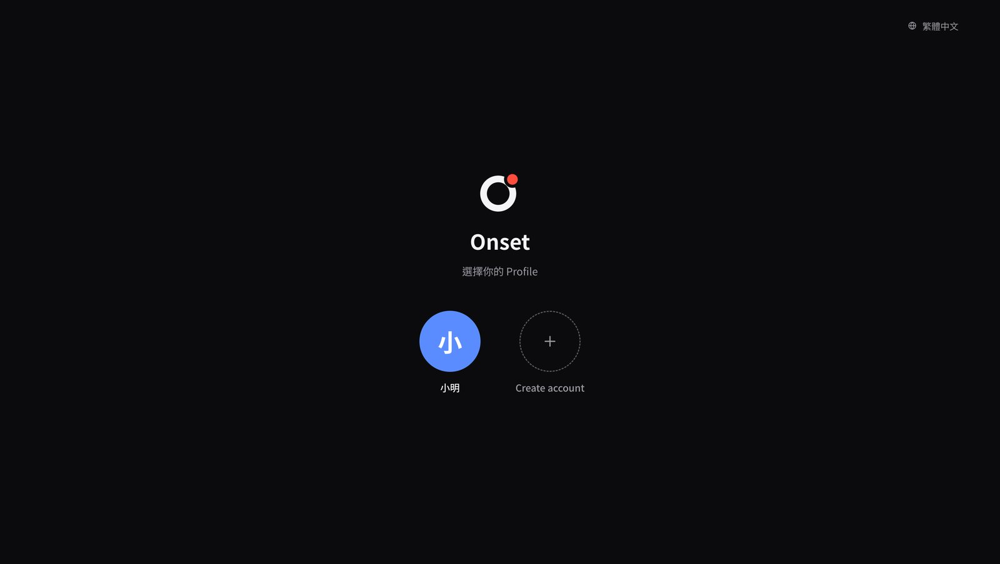
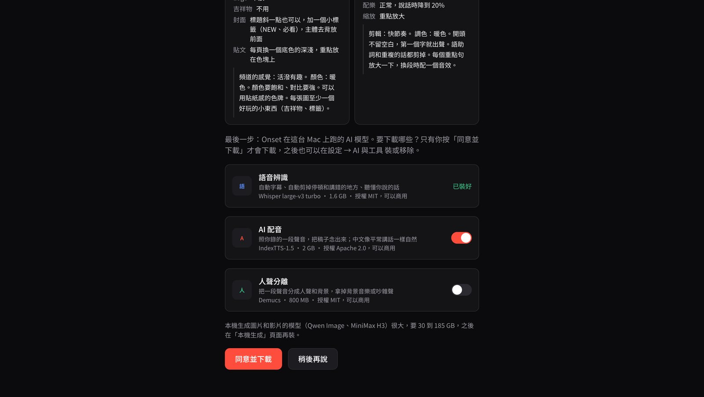
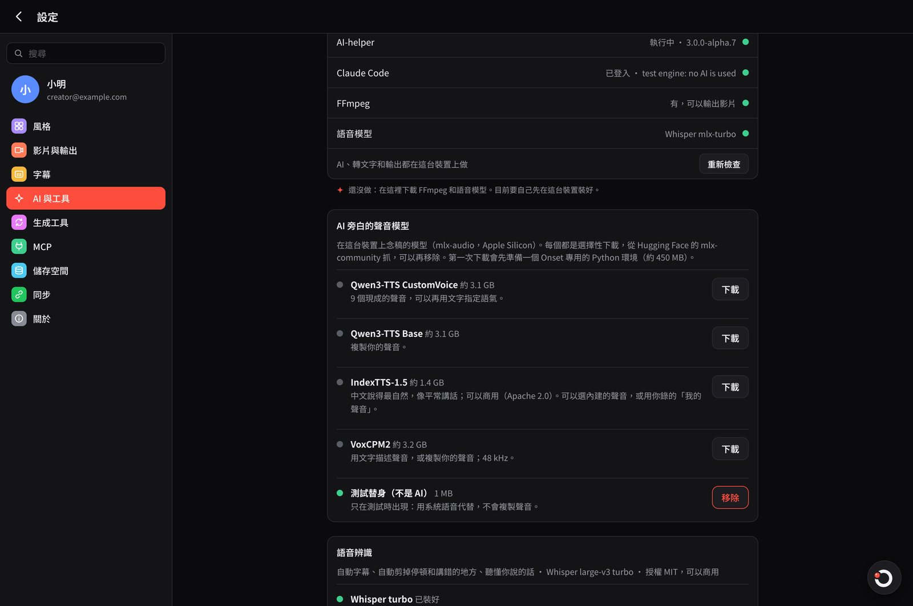

# 1. 安裝和第一次打開

## 1-1 把 Onset 裝到 Mac

1. 打開 Onset 的 `.dmg` 檔。
2. 把 **Onset** 拖進「應用程式」資料夾。
3. 到「應用程式」，**按右鍵點 Onset → 打開**（不要直接點兩下）。

### 看到「無法驗證開發者」怎麼辦？

第一次打開時，macOS 可能說「無法打開 Onset，因為無法驗證開發者」。這是因為 Onset 還沒有經過 Apple 公證，不是壞掉。

- **方法一：** 在 Onset 上按右鍵 → 「打開」→ 再按一次「打開」。
- **方法二：** 打開「系統設定」→「隱私權與安全性」→ 往下捲，看到 Onset 那一行 → 按「**仍要打開**」→ 輸入 Mac 的密碼。

只要做一次，之後就可以正常點兩下打開。

> 如果 macOS 說 Onset「已損毀」：請懂電腦的朋友在「終端機」執行
> `xattr -dr com.apple.quarantine /Applications/Onset.app`，再打開一次。

## 1-2 選語言、建立帳號（Profile）

第一次打開會看到這個畫面。

1. 右上角可以選介面語言：繁體中文、简体中文、English、Bahasa Melayu、日本語、한국어。
2. 按中間的 **＋「Create account」**。
3. 填三樣東西：**Email、Username（顯示的名字）、密碼**（至少 6 個字）。
4. 想要點頭像就進去、不用每次打密碼，可以勾「**進入時不需要輸入密碼**」。之後在設定也能改。
5. 按「**繼續**」。

> 帳號存在這台電腦裡。一台 Mac 可以有好幾個 Profile（例如你和助理各一個），之後打開會先讓你選頭像。
>
> 

## 1-3 頻道風格問答（約 1 分鐘）

接著 AI Onset 會問你 7 個問題，幫你設定頻道的風格。每題點一個最接近的就好，也可以在下面的輸入框用自己的話回答。

| 步驟 | 問什麼 | 例子 |
|---|---|---|
| 1 風格 | 整個頻道給人的感覺 | 溫暖手作、俐落專業、活潑有趣、安靜質感 |
| 2 拍攝內容 | 你主要拍什麼 | Vlog、教學、產品介紹、訪談 |
| 3 參考畫面／連結 | 有沒有喜歡的影片或帳號 | 放截圖、貼連結，或「沒有參考」 |
| 4 剪輯風格 | 剪起來的節奏 | 快節奏、乾淨簡約、電影感、紀錄片 |
| 5 調色風格 | 畫面顏色 | 自然、暖色、冷色、底片感 |
| 6 Mascot | 有沒有吉祥物 | 放圖片，或「沒有」「之後再說」 |
| 7 Logo | 有沒有 Logo | 放圖片，或「沒有」「之後再說」 |

不想現在回答？按左下角「**跳過，之後再設定**」。

答完之後，AI Onset 會做出**四個風格**：腳本風格、採訪風格、設計風格、剪輯風格。之後寫腳本、剪輯、做封面時都會照著做。想改，到右上角頭像 →「設定」→「風格」。

## 1-4 要不要下載 AI 模型？

最後一步，Onset 會問要不要下載在這台 Mac 上跑的 AI 模型：

- **語音辨識**（Whisper，1.6 GB）：自動字幕、自動剪掉停頓和講錯的地方。**建議下載。**
- **AI 配音**（IndexTTS，2 GB）：照你錄的一段聲音念稿。
- **人聲分離**（Demucs，800 MB）：把背景音樂、吵雜聲拿掉。

用右邊的開關選要哪幾個，按「**同意並下載**」。不確定就按「**稍後再說**」，之後在「設定 → AI 與工具」也能裝或移除。

> 本機生成圖片和影片的模型（Qwen Image、MiniMax H3）很大（30～185 GB），不在這裡下載，之後到首頁的「本機生成」再決定。

## 1-5 連接 AI（Claude Code）

AI Onset 用的是你自己 Mac 上的 **Claude Code**。第一次要登入一次：

1. 右上角頭像 →「**設定**」→「**AI 與工具**」。
2. 看「Claude Code」那一行：
   - 寫「已登入」就好了。
   - 寫「還沒登入」：按「**打開終端機登入**」。終端機會打開，接著會開瀏覽器，用你的 Claude 帳號登入就好。
3. 回到 Onset，按「**重新檢查**」。

同一頁也看得到：

- **AI-helper**：Onset 在背景幫忙的小程式。要顯示「執行中」。
- **FFmpeg**：輸出影片和轉文字要用。
- **語音模型**：轉文字（自動字幕）要用。

> 截圖是測試環境，所以 Claude Code 那行寫的是 test engine。你的 Mac 上會寫「已登入」或「還沒登入」。

> **之後會有安裝助手。** 新的 Mac 第一次打開時，會有一步一步的安裝助手幫你裝好 AI 和工具（FFmpeg 也會內建），不用自己開終端機。現在這一版還沒有，FFmpeg 和語音模型要先裝好；不會裝的話，請懂電腦的朋友幫忙，或問 AI Onset。

## 1-6 帳號選單

右上角的頭像可以打開：帳號、設定、語言、登出。

---

下一章：[首頁六個入口 →](02-home.md)
