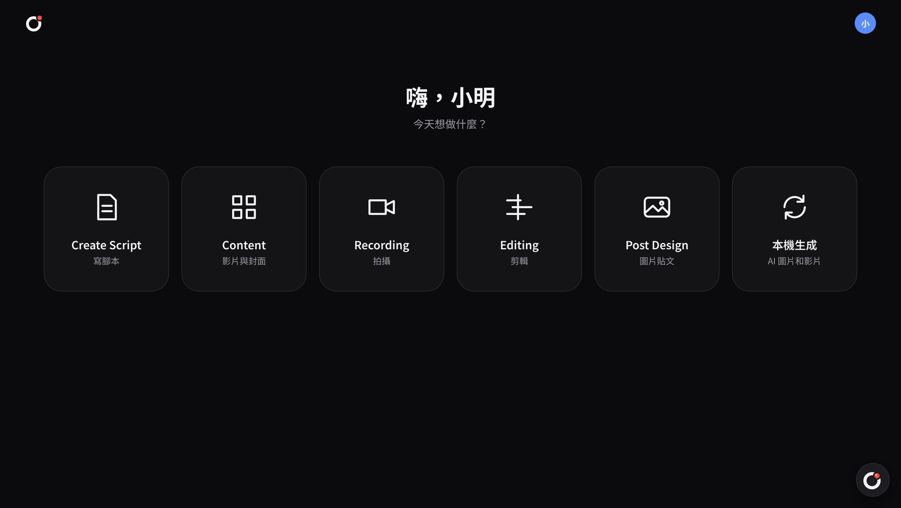
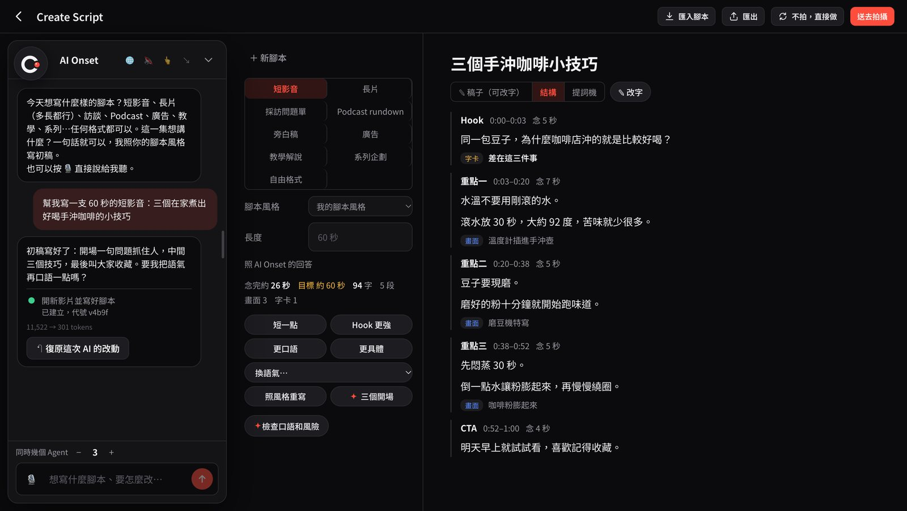
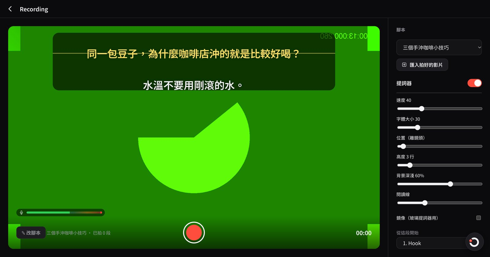
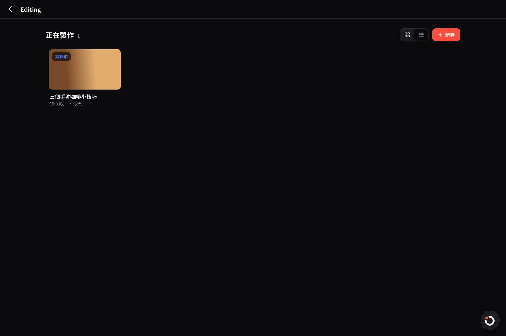

# 2. 首頁六個入口

登入後的首頁有六個大按鈕。一支影片通常是這樣走的：

**寫腳本 → 拍攝 → 剪輯 → 做封面和貼文 → 輸出**

沒空拍？用「**不拍，直接做**」（第 5 章），從腳本直接做成影片。

| 按鈕 | 做什麼 |
|---|---|
| **Create Script** 寫腳本 | 寫新腳本，或叫 AI 幫你寫 |
| **Content** 影片與封面 | 你所有的影片、它們做到哪一步、封面和貼文文字 |
| **Recording** 拍攝 | 用 Mac 或 iPhone 拍，有提詞機 |
| **Editing** 剪輯 | 剪片、字幕、音樂、調色、輸出 |
| **Post Design** 圖片貼文 | 做 IG、FB、小紅書等平台的圖片貼文 |
| **本機生成** | 用這台 Mac 生成 AI 圖片和影片（免費，但比較慢） |

左上角的 Onset 圖示可以隨時回到首頁。

---

## 2-1 Create Script（寫腳本）

1. 中間先選格式：**短影音、長片、採訪問題單、Podcast rundown、旁白稿、廣告、教學解說、系列企劃、自由格式**。
2. 選「腳本風格」（預設是你在問答做出來的「我的腳本風格」）和「長度」。
3. 右邊可以自己打，也可以叫 AI 寫：

**叫 AI 寫腳本：**

1. 點左上角的 AI Onset 圓形按鈕，打開對話框。
2. 一句話說這一集要講什麼，例如：「幫我寫一支 60 秒的短影音：三個在家煮出好喝手沖咖啡的小技巧」。
3. 按送出（或按 🎙 用說的）。

寫好後：

- 中間的按鈕可以再改：「短一點」「Hook 更強」「更口語」「更具體」「換語氣…」「照風格重寫」「三個開場」「檢查口誤和風險」。
- 會顯示「念完約幾秒」「目標」「幾個字」「幾段」。
- 右邊上方三個分頁：「**稿子（可改字）**」「**結構**」「**提詞機**」。

右上角：

- 「**匯入腳本**」：用已經寫好的檔案。
- 「**匯出**」：PDF、Word、Markdown、純文字。
- 「**不拍，直接做**」：不用拍，直接做成影片（第 5 章）。
- 「**送去拍攝**」：帶著這份腳本去 Recording。

---

## 2-2 Content（影片與封面）

所有影片都在這裡。上方可以按狀態篩選：**腳本、拍攝、剪輯、完成**，或按類型：**長片、短片、貼文**。

點一支影片，右邊會看到它的狀態、素材、輸出，和「**下一步**」要做什麼（例如「送去拍攝」或「不拍，直接做」）。

下面的按鈕：

- **腳本**：看或改腳本。
- **封面與貼文文字**：做封面、寫發文用的文字。
- **打包分享**：把整支影片的專案打包給別人。
- **刪除**。

### 做封面

在「封面與貼文文字」裡：

- 「**AI 設計**」：照你的設計風格自動做。
- 「**用一張圖當封面**」「**AI 生成圖片**」「**生成庫**」「**從版型開始**」。
- 「**AI 寫貼文文字**」：幫你寫發文的文案。
- 下面有「AI 製作紀錄」，看得到 AI 做了什麼、用了多少 tokens。

上方的「**匯入影片**」可以把已經拍好的影片直接加進來。

---

## 2-3 Recording（拍攝、提詞機）

從腳本按「送去拍攝」，或從首頁點 Recording。

> 截圖用的是測試用的假相機，所以畫面是綠色圖案。

1. 右邊「**腳本**」選要拍哪一份（也可以選「不用腳本」）。
2. 提詞機的字會疊在畫面上方。右邊可以調：
   - **速度、字體大小、位置（離鏡頭）、高度、背景深淺、閱讀線**
   - 「**自動捲動**」或「**跟著聲音**」：跟著聲音會聽你講到哪裡，自動往下捲。
   - 「**鏡像**」：用玻璃提詞器時勾。
   - 「**從這段開始**」：選從 Hook、重點一…哪一段開始拍；「只拍這一段」會在下一段開頭自動停。
3. 按中間的紅色圓鈕開始錄。

其他好用的設定：

- **倒數**：開始前倒數 3 秒，可以每秒嗶一聲。
- **語音指令**：用說的控制「開始 / 停止 / 暫停 / 繼續 / 重來 / 下一段 / 上一段」。
- **遙控器**：藍牙翻頁器、簡報器可以控制。
- **主聲音**：選 Mac 的麥克風；錄音介面有多個輸入時，可以每人一軌。

### 已經用相機或手機拍好了？

按「**匯入拍好的影片**」，選檔案就好。拍完（或匯入完）按右上角「**去剪輯**」。

### 用 iPhone 當相機

畫面來源的「**iPhone 攝影機**」：在 iPhone 的 Onset 打開錄影 → 設定 →「**當 Mac 的攝影機**」。要先配對、在同一個 Wi‑Fi（見第 7 章）。勾選的 iPhone 會和 Mac 一起開始、一起停止，錄完自動傳回 Mac，可以組成多機位的 Podcast 影片。

---

## 2-4 Editing（剪輯）

點 Editing 會先看到「**正在製作**」的影片，點一支就能開始剪；也可以按「**新建**」開一個空白的 16:9、9:16、1:1 或 Podcast 專案。

詳細請看 [第 3 章](03-editing.md)。

---

## 2-5 Post Design（圖片貼文）

1. 按「**新貼文**」，或跟左邊的 AI Onset 說要發在哪裡（Instagram 直式、方形、小紅書、Facebook、Threads、X）。
2. 進到編輯畫面：
   - 左邊：平台與尺寸、目的、內容來源、張數、設計風格，按「**照這些重新設計**」。
   - 中間：直接在圖上改。點一下選取、拖曳移動、拉角落改大小，**文字點兩下直接改**。上方可以加「文字」「一張圖」「AI 生成圖片」「生成庫」「形狀」。
   - 右邊：「**版型**」「**圖層**」「**背景**」「**風格**」「**檢查**」。版型可以「做成輪播」（封面頁＋每頁一個重點＋結尾頁）。
3. 「**複製到其他平台…**」可以一次做出其他尺寸。
4. 做好按右上角「**下載**」。會自動儲存。

---

## 2-6 本機生成（AI 圖片和影片）

在這台 Mac 上生成 AI 圖片和影片：**不上雲、不花錢，但比較慢，模型也很大。**

- 頁面上方會先檢查這台電腦：晶片、記憶體、硬碟剩多少，並告訴你**能做什麼、大約要多久**。
- 模型：
  - **Qwen Image 2.1 Turbo**：生成圖片。下載約 33 GB，一張圖約幾分鐘。
  - **MiniMax H3**（8-bit 或 4-bit）：生成有聲音的影片。下載 115 GB，安裝時最多要 185 GB 空間，5 秒影片約 35 分鐘。
- 每個模型都要先**勾同意授權**、按「安裝」才會下載。請看清楚授權（例如 Qwen 是研究授權，商業用途要先看條款）。
- 首頁按鈕下面如果寫「**只能生成圖片**」，表示這台 Mac 的記憶體或硬碟放不下影片模型，只能用圖片模型。
- 一台 Mac 一次只做一段，其他的會排隊。可以停止，做好的圖可以「加到參考圖庫」「用這張做影片」「放進影片…」。
- 只支援 Apple Silicon（M 系列晶片）的 Mac。

---

下一章：[Editing 剪輯 →](03-editing.md)
