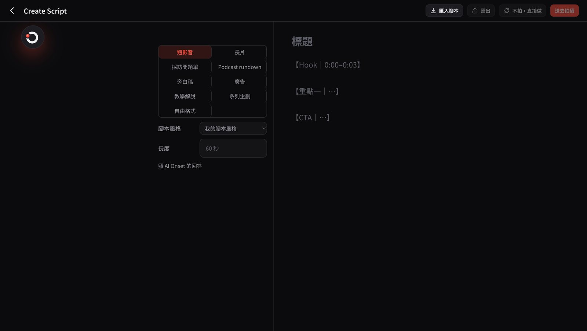
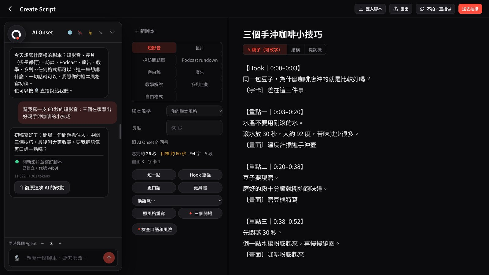
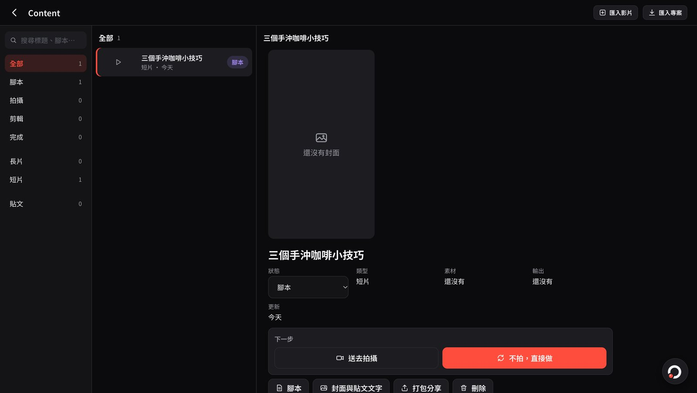
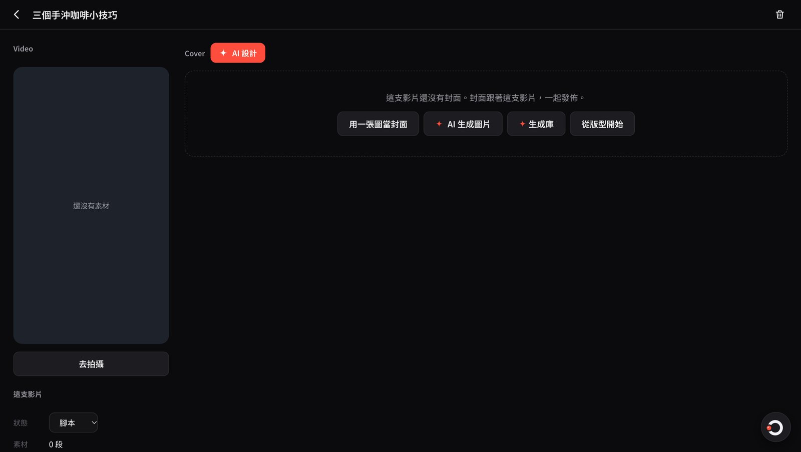
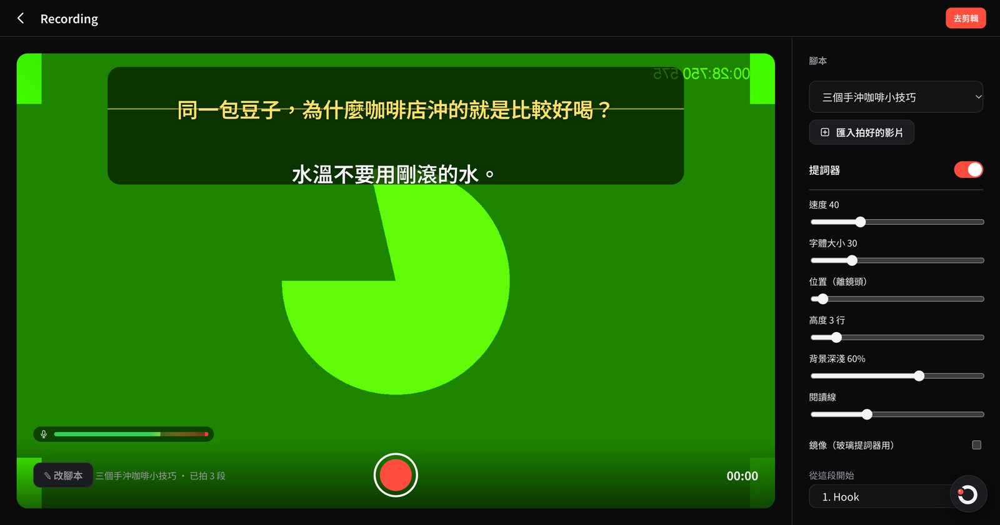
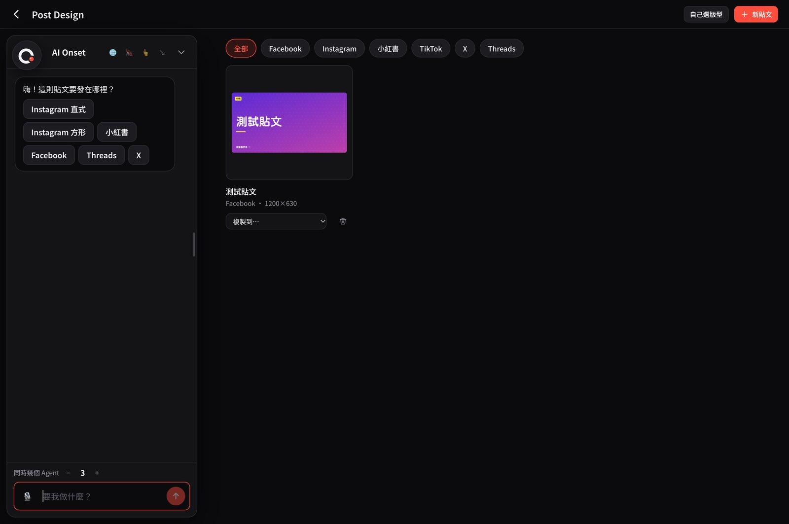
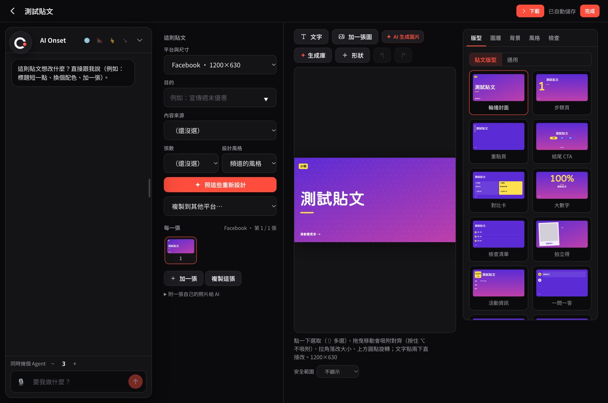
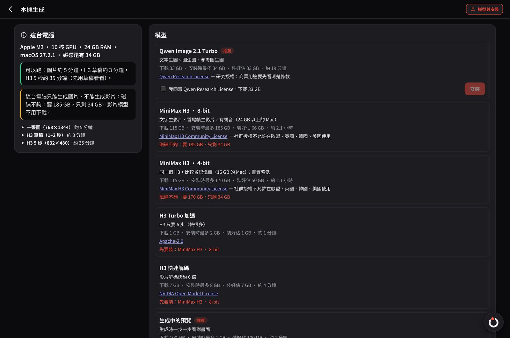

# 2. 首頁的入口

登入後的首頁分成上下兩排。一支影片通常是這樣走的：

**寫腳本 → 拍攝 → 剪輯 → 做封面和貼文 → 輸出**

沒空拍？用「**不拍，直接做**」（第 5 章），從腳本直接做成影片。

> 截圖是舊版的首頁。新版的排法照下面的表，按鈕的名字一樣。

**上排「做一支影片」：**

| 按鈕 | 做什麼 |
|---|---|
| **Content** 影片與封面 | 放在最前面：你所有的影片、它們做到哪一步、封面和貼文文字、做續集 |
| **1 Create Script** 寫腳本 | 寫新腳本，或叫 AI 幫你寫 |
| **2 Recording** 拍攝 | 用 Mac 或 iPhone 拍，有提詞機 |
| **3 Editing** 剪輯 | 剪片、字幕、音樂、調色、輸出 |

**下排「素材與動畫」：**

| 按鈕 | 做什麼 |
|---|---|
| **Design** 設計 | 海報、Banner、貼文、封面（以前叫 Post Design） |
| **AI 生成** | 用這台 Mac（本機 AI，免費）或雲端（雲端 AI，要花錢）生成圖片和影片（以前叫本機生成） |
| **動畫畫板** | 自己的動畫：手繪、logo、會動的角色（第 9 章） |

首頁還有一個「**繼續做「…」**」，一按就回到你最近在做的那支。

左上角的 Onset 圖示可以隨時回到首頁。

---

## 2-1 Create Script（寫腳本）

1. 中間先選格式：**短影音、長片、採訪問題單、Podcast rundown、旁白稿、廣告、教學解說、系列企劃、自由格式**。
2. 選「腳本風格」（預設是你在問答做出來的「我的腳本風格」）、「長度」和**畫面比例**（16:9 橫、9:16 直、1:1 方）。比例選一次就好：之後拍攝、不拍直接做、剪輯都照這個，AI 寫〔畫面〕時也會照直式或橫式來寫。
3. 右邊可以自己打，也可以叫 AI 寫：

**叫 AI 寫腳本：**

1. 打開 Create Script 時，AI Onset 會飛到旁邊。新的空白腳本，它會用按鈕一個一個問你：格式、主題、長度、風格。
2. 或直接說這一集要講什麼，例如：「幫我寫一支 60 秒的短影音：三個在家煮出好喝手沖咖啡的小技巧」。
3. 按送出（或按 🎙 用說的）。

寫好後：

- 中間的按鈕可以再改：「短一點」「Hook 更強」「更口語」「更具體」「換語氣…」「照風格重寫」「三個開場」「檢查口誤和風險」。
- 會顯示「念完約幾秒」「目標」「幾個字」「幾段」。
- 右邊上方三個分頁：「**稿子（可改字）**」「**結構**」「**提詞機**」。

右上角：

- 「**匯入腳本**」：用已經寫好的檔案。
- 「**匯出**」：PDF、Word、Markdown、純文字。
- 「**不拍，直接做**」：不用拍，直接做成影片（第 5 章）。
- 「**送去拍攝**」：帶著這份腳本去 Recording。

---

## 2-2 Content（影片與封面）

所有影片都在這裡。上方可以按狀態篩選：**腳本、拍攝、剪輯、完成**，或按類型：**長片、短片、貼文**。

點一支影片，右邊會看到它的狀態、素材、輸出，和「**下一步**」要做什麼（例如「送去拍攝」或「不拍，直接做」）。

下面的按鈕：

- **腳本**：看或改腳本。
- **封面與貼文文字**：做封面、寫發文用的文字。影片的封面圖上也會寫「**設計封面**」（還沒有封面）或「**改封面**」，點它就能做。
- **製作新版本**：現在的剪輯原封不動留著，另開一個新版本去 Editing 改。素材、腳本、封面兩邊共用。
- **做續集**：有腳本的影片都有這顆。按了 AI Onset 會先讀原片（腳本、結尾答應觀眾什麼、有沒有出鏡、比例和長度），再一個一個問你續集的方向、要不要出鏡拍、比例和長度、旁白和配樂。每個問題都可以按選項，也可以在下面那條「**或自己寫想要的…**」打自己的答案。
- **打包分享**：把整支影片的專案打包給別人。
- **刪除**。

### 做封面

在「封面與貼文文字」裡：

- 「**AI 設計**」：照你的設計風格自動做。
- 「**用一張圖當封面**」「**AI 生成圖片**」「**生成庫**」「**從版型開始**」。
- 「**AI 寫貼文文字**」：幫你寫發文的文案。
- 下面有「AI 製作紀錄」，看得到 AI 做了什麼、用了多少 tokens。

上方的「**匯入影片**」可以把已經拍好的影片直接加進來。

---

## 2-3 Recording（拍攝、提詞機）

從腳本按「送去拍攝」，或從首頁點 Recording。

> 截圖用的是測試用的假相機，所以畫面是綠色圖案。

1. 右邊「**腳本**」選要拍哪一份（也可以選「不用腳本」）。
2. 提詞機的字會疊在畫面上方。右邊可以調：
   - **速度、字體大小、位置（離鏡頭）、高度、背景深淺、閱讀線**
   - 「**自動捲動**」或「**跟著聲音**」：跟著聲音會聽你講到哪裡，自動往下捲。
   - 「**鏡像**」：用玻璃提詞器時勾。
   - 「**從這段開始**」：選從 Hook、重點一…哪一段開始拍；「只拍這一段」會在下一段開頭自動停。
3. 按中間的紅色圓鈕開始錄。

其他好用的設定：

- **倒數**：開始前倒數 3 秒，可以每秒嗶一聲。
- **語音指令**：用說的控制「開始 / 停止 / 暫停 / 繼續 / 重來 / 下一段 / 上一段」。
- **遙控器**：藍牙翻頁器、簡報器可以控制。
- **主聲音**：選 Mac 的麥克風；錄音介面有多個輸入時，可以每人一軌。

### 已經用相機或手機拍好了？

按「**匯入拍好的影片**」，選檔案就好。拍完（或匯入完）按右上角「**去剪輯**」。

### 用 iPhone 當相機

畫面來源的「**iPhone 攝影機**」：在 iPhone 的 Onset 打開錄影 → 設定 →「**當 Mac 的攝影機**」。要先配對、在同一個 Wi‑Fi（見第 7 章）。勾選的 iPhone 會和 Mac 一起開始、一起停止，錄完自動傳回 Mac，可以組成多機位的 Podcast 影片。

---

## 2-4 Editing（剪輯）

點 Editing 會先看到「**正在製作**」的影片，點一支就能開始剪；也可以按「**新建**」開一個空白的 16:9、9:16、1:1 或 Podcast 專案。

詳細請看 [第 3 章](03-editing.md)。

---

## 2-5 Design（海報、Banner、貼文）

以前叫 Post Design。除了社群貼文，現在也能做**海報**（A4、A3、2:3、方形）、**Banner**（網站橫幅、YouTube 頻道橫幅、Facebook 封面、LinkedIn、活動橫幅）和**其他**（簡報、名片、邀請卡、傳單、證書、直立展架）。

1. 按「**新貼文**」，或跟 AI Onset 說要做什麼、發在哪裡（Instagram、小紅書、Facebook、Threads、X，或某個海報、Banner 尺寸）。
2. 進到編輯畫面：
   - 左邊：平台與尺寸、目的、內容來源、張數、設計風格，按「**照這些重新設計**」。
   - 中間：直接在圖上改。點一下選取、拖曳移動、拉角落改大小，**文字點兩下直接改**。上方可以加「文字」「一張圖」「AI 生成圖片」「生成庫」「形狀」。
   - 右邊：「**版型**」「**圖層**」「**背景**」「**風格**」「**檢查**」。版型可以「做成輪播」（封面頁＋每頁一個重點＋結尾頁）。
3. 「**複製到其他平台…**」可以一次做出其他尺寸。
4. 做好按右上角「**下載**」。會自動儲存。

---

## 2-6 AI 生成（圖片和影片）

以前叫「本機生成」。頁面上可以選兩種方式：

- **本機 AI**：在這台 Mac 上生成，**不上雲、不花錢，但比較慢，模型也很大**。下面詳細說明。
- **雲端 AI**：用你加入的雲端服務（Theater、Higgsfield…）生成圖片或影片，快很多但要花錢。選圖片或影片、影片幾秒、哪個模型和大小，**先看價錢，按「確定生成」才會開始、才會扣點數或錢**。參考圖和本機 AI 共用同一個圖庫。詳見第 6 章。

兩種方式都有「**AI 優化**」：把你寫的想法改寫成好的 prompt，也會看你選的參考圖；不喜歡按「還原」。做好的圖和影片點一下會放大，可以縮放、‹ › 換下一張。打開這頁時 AI Onset 也會飛到旁邊。

### 本機 AI

- 頁面上方會先檢查這台電腦：晶片、記憶體、硬碟剩多少，並告訴你**能做什麼、大約要多久**。
- 模型：
  - **Qwen Image 2.1 Turbo**：生成圖片。下載約 33 GB。
  - **MiniMax H3**（8-bit 或 4-bit）：生成有聲音的影片。下載 115 GB，安裝時最多要 185 GB 空間。
- 本機生成：圖片用 Qwen Image 2.1，影片用 MiniMax H3，速度視你的電腦配置而定。
- 每個模型都要先**勾同意授權**、按「安裝」才會下載。請看清楚授權（例如 Qwen 是研究授權，商業用途要先看條款）。
- 首頁按鈕下面如果寫「**只能生成圖片**」，表示這台 Mac 的記憶體或硬碟放不下影片模型，只能用圖片模型。
- 一台 Mac 一次只做一段，其他的會排隊。可以停止，做好的圖可以「加到參考圖庫」「用這張做影片」「放進影片…」。
- 只支援 Apple Silicon（M 系列晶片）的 Mac。

## 2-7 動畫畫板

自己的動畫：手繪、logo 自己描出來、會走會跑會說話的角色、3D 字。詳見 [第 9 章](09-board.md)。

---

下一章：[Editing 剪輯 →](03-editing.md)
