# 3. Editing 剪輯

## 3-1 剪輯畫面長什麼樣

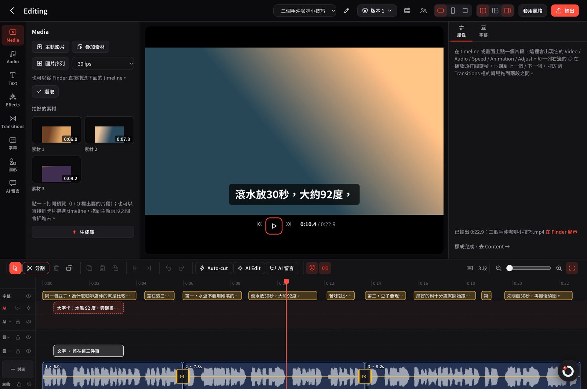

- **左邊：素材和工具。** 一排分頁：Media（素材）、Audio（聲音）、Text（文字）、Effects（效果）、Transitions（轉場）、字幕、圖形、AI 留言。
- **中間：預覽畫面。** 按 ▶ 播放。
- **右邊：屬性。** 點了一個片段，這裡就出現它的設定。
- **下面：時間軸（timeline）。** 影片從左到右排好。
- **最上面一排：** 影片名稱、「版本」、畫面比例（橫、直、方）、版面配置、「**套用風格**」、「**輸出**」。

## 3-2 時間軸的每一列

由上往下：

| 列 | 放什麼 |
|---|---|
| **字幕** | 自動字幕，一句一段 |
| **AI** | AI 留言條（寫給 AI 的備註，見 3-8） |
| **疊加** | 疊在畫面上的東西：文字、圖片、子母畫面 |
| **封面** | 這支影片的封面 |
| **主軌** | 主要的影片片段，從頭接到尾 |
| **旁白** | 你錄的或 AI 念的旁白 |
| **音樂** | 背景音樂 |
| **音效** | 叮、咻這類短的聲音 |

每一列左邊有 🔒（鎖住，不會被改到）和 👁 / 🔊（隱藏或靜音）。

## 3-3 基本剪接

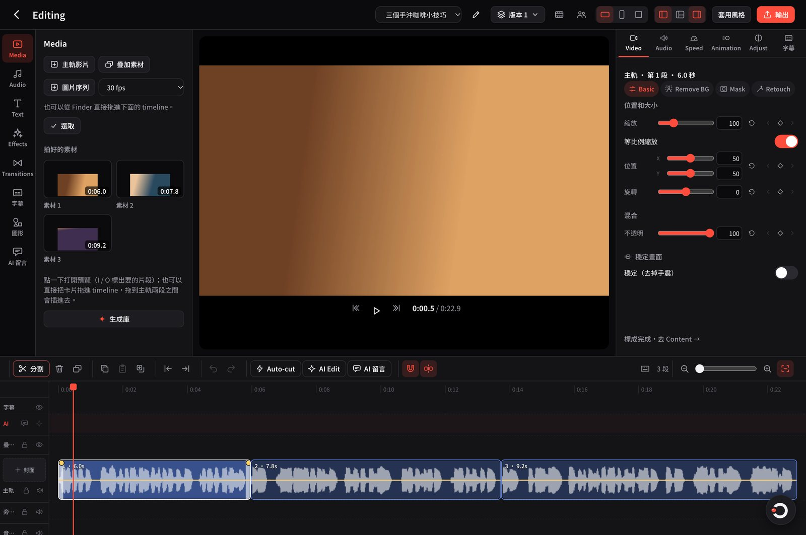

- **放素材：** 左邊 Media 的「拍好的素材」，**直接拖到時間軸**。拖到主軌兩段之間會插進去。也可以從 Finder 直接拖進來。
- **先挑一段再放：** 點素材卡片打開預覽，按 **I** 標開頭、**O** 標結尾。
- **選取：** 點一下片段。右邊會出現 **Video / Audio / Speed / Animation / Adjust** 這幾個分頁。
- **剪開（刀片）：** 按 **S**（或工具列的剪刀「分割」）換成刀片，滑鼠下面會出現一條紅色虛線。**在片段或圖層上點一下，就從點的地方切開**；會自動貼齊播放頭和片段邊緣，按住 **⌥** 就不貼齊。
- **回到點選：** 按 **A**、**Esc**，或刀片左邊的箭頭。點選工具可以選取、拖動片段。
- **在播放頭剪開：** 按 **⌘B**。（iPhone 上還是用「分割」按鈕在播放頭剪。）

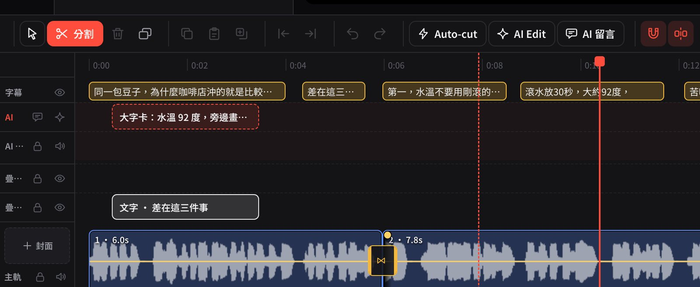

- **剪短：** 拖片段的左右邊緣。
- **換順序：** 把片段拖到別的位置。
- **刪除：** 選取後按垃圾桶。
- **復原：** 工具列的 ↶ ↷。
- 工具列右邊的磁鐵是「**主軌磁吸**」：開著時，片段之間不會留空隙。
- 右下的滑桿可以放大縮小時間軸（Mac 觸控板也可以兩指縮放）。

### 讓 AI 幫你剪

- **Auto-cut**：自動剪掉停頓。剪之前的樣子會存成版本「Auto-cut 前」。
- **AI Edit**：照你說的剪，例如「把講錯和重講的地方剪掉」。長片會一章一章做。

### 版本

最上面的「**版本**」可以另存一個版本再大改，改壞了切回舊版本就好。

## 3-4 片段的設定（右邊屬性）

- **Video › Basic**：位置和大小、縮放、旋轉、不透明度、混合模式、**穩定畫面**（去掉手震）。
- **Video › Remove BG / Mask / Retouch**：去背、遮罩、美顏。
- **Audio**：音量、淡入淡出、人聲增強、降噪。
- **Speed**：變速，或用速度曲線（蒙太奇、英雄時刻、子彈時間…）。
- **Animation**：進場、出場動畫。
- **關鍵幀**：每一列右邊的 ◇ 會在播放頭打一個關鍵幀，‹ › 跳到上一個、下一個。

## 3-5 文字和文字排版

1. 左邊點「**Text**」。
2. 點一下樣式（「文字」或一種「飛」字動畫），就會加到播放頭的位置。
3. 在預覽畫面上**拖曳移動、拉角落改大小、上方的圓點旋轉**。
4. 右邊「Video › Basic」改內容和排版。

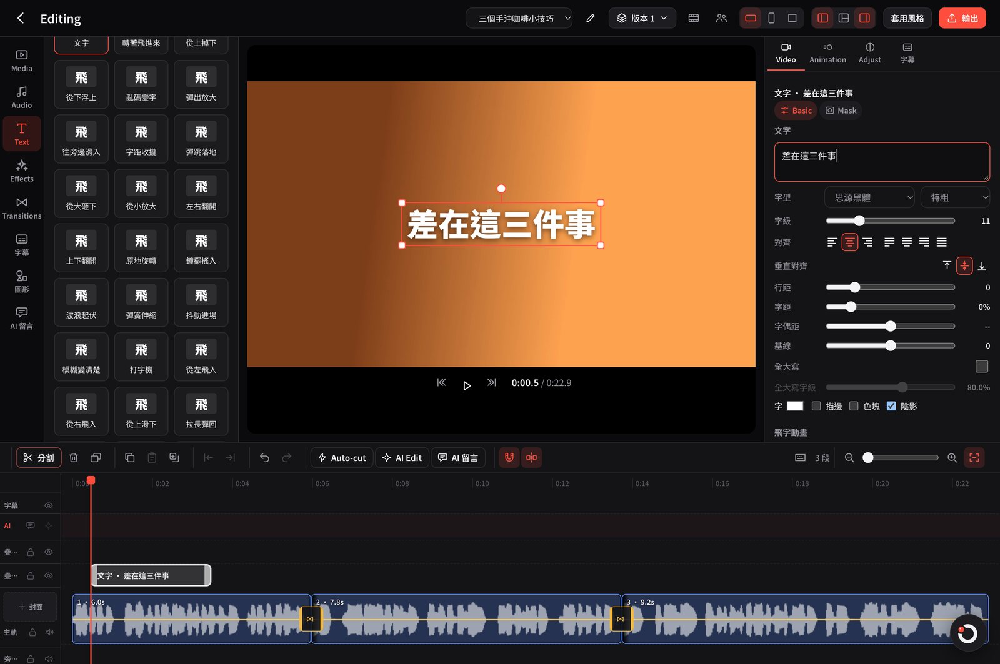

排版面板可以調：

- **文字**內容
- **字型**（思源黑體、粉圓體、芫荽手寫、明體、楷體、圓體…）和**樣式**（極細到特粗，可加斜體）
- **字級**
- **對齊**（靠左、置中、靠右、齊行）和**垂直對齊**
- **行距、字距、字偶距、基線**
- **全大寫**和全大寫字級
- **字**的顏色、**描邊**、**色塊**、**陰影**
- **飛字動畫**：40 多種，例如「轉著飛進來」「亂碼變字」「打字機」「彈跳落地」；可以整段一起動，或一個字、一個詞輪流動。

## 3-6 字幕

1. 左邊點「**字幕**」→「**轉文字（自動字幕）**」。
2. 等一下，字幕會一句一句出現在最上面的字幕列。
3. 打錯的字：在「句子（點一下修改）」清單裡點那一句直接改。
4. 樣式、字級、位置、字體、顏色：右邊的「**字幕**」面板。
5. 「**輸出時帶字幕**」決定輸出的影片要不要燒上字幕。

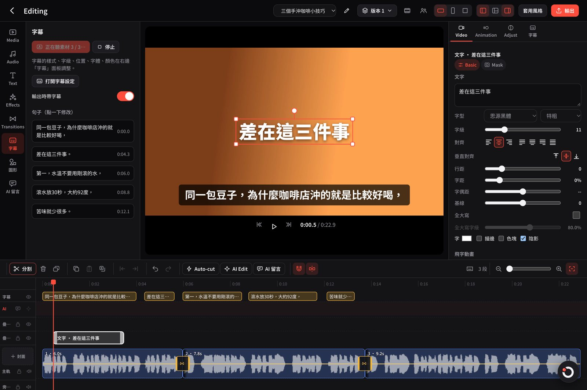

## 3-7 聲音：旁白、音樂、音效

左邊點「**Audio**」：

- 「**錄旁白**」：直接用麥克風錄。
- 「**聲音檔**」：放自己的音樂或聲音。拖進來先放在「音樂」列，右邊屬性可以改成旁白或音效。
- 「**AI 旁白**」：用 AI 念稿（要先在「設定 → AI 與工具」下載聲音模型）。
- 「**Onset 內建音樂與音效**」：全部免費、不用標作者。按 ▶ 試聽，按「**加入**」放到播放頭。

有人說話時，音樂可以自動變小（閃避）。

## 3-8 AI 留言條

想要一張圖卡、一段動畫，又不想自己做？寫一張「留言條」給 AI：

1. 左邊點「**AI 留言**」→「**AI 留言條**」。時間軸最上面的 AI 列會多一條。
2. 拖它的位置和長短，對準要出現的那幾秒。
3. 右邊寫這段要什麼，例如「大字卡：水溫 92 度，旁邊畫一個溫度計」。
4. 選「**工具**」：「自動（看文字判斷）」、Onset 圖卡、EffectCraft、Three.js、去背（字在人後面）…；付費的「**Higgsfield（付費生成）**」「**Theater（付費生成）**」要先在設定加入雲端（第 6 章）。
5. 按「**生成**」，或「**全部生成**」一次做完所有留言條。

做出來的圖層會放在留言條下面。留言條本身不會出現在影片裡。
「自動」永遠不會自己選付費工具；選了付費工具，也會先報價、問你才做。

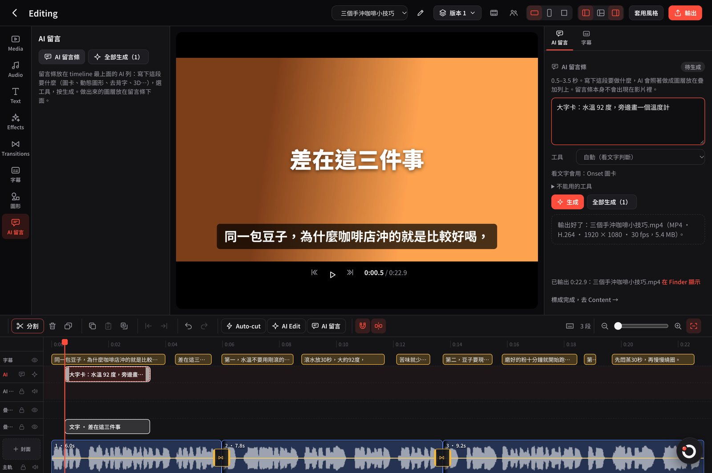

### 給 AI 留言條參考圖

想要 AI 照著某張圖的感覺做？給它參考圖，**最多 4 張**：

- 把圖拖到留言條文字下面的「**把參考圖拖進來（或點這裡選）**」，或點那裡選檔案，也可以貼上。
- 或直接把圖拖到 timeline 上的那條 AI 留言條上（會變成它的參考圖，不會變成新的圖層）。
- 每張圖右上角的 ✕ 可以拿掉。

用 **Theater** 生成時，會照著參考圖做。**Higgsfield 不收參考圖**，只有寫 prompt 的 AI 看得到；要照著圖做請選 Theater。

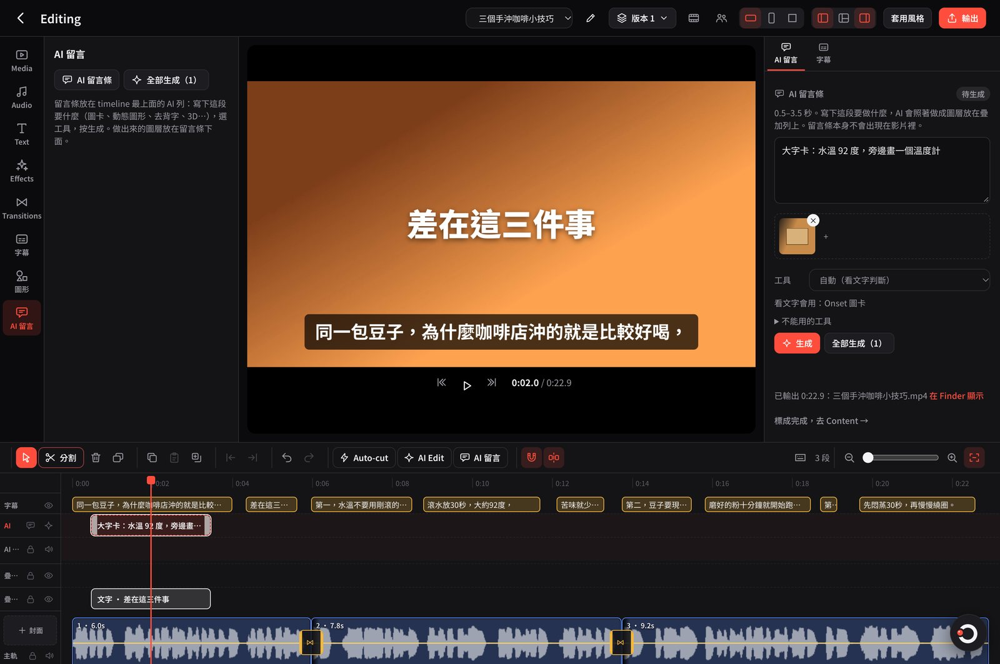

## 3-9 轉場

1. 左邊點「**Transitions**」。
2. 把喜歡的轉場**拖到時間軸兩段之間**。剪接點上會出現一個小方塊。
3. 拖小方塊的邊緣可以改長度；選取後按刪除可以拿掉。
4. 懶得一個個放：按最下面「**每個剪接點都加「交叉淡化」**」；「**全部移除**」可以一次拿掉。

共 39 種，分五組：淡化、推移、擦除、形狀、動態（例如甩鏡、故障、翻轉）。

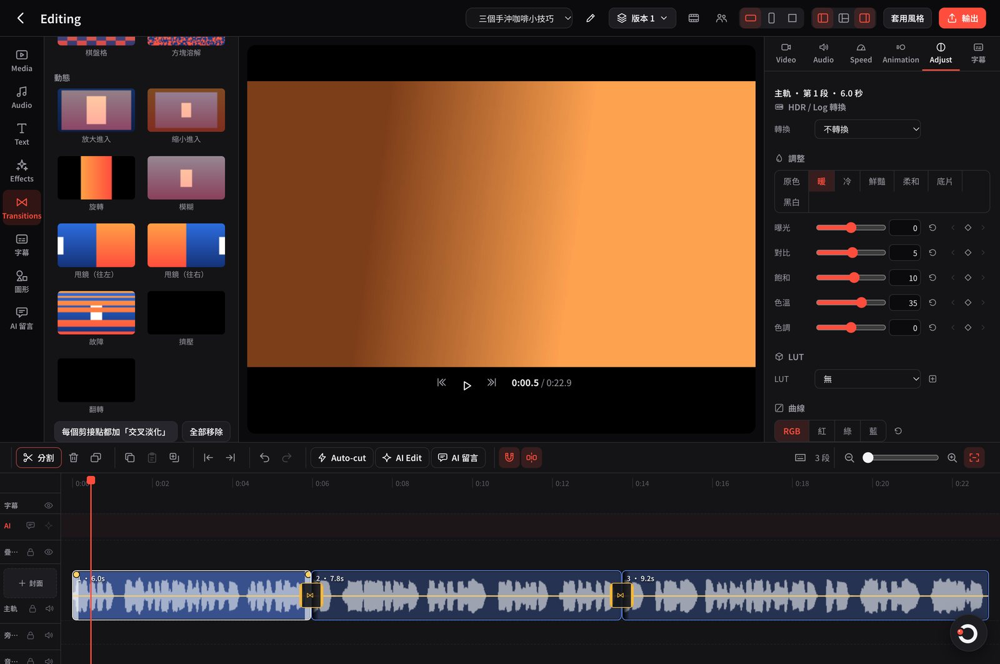

## 3-10 調色

選一個片段 → 右邊「**Adjust**」：

- **調整**：先點一個現成風格（原色、暖、冷、鮮豔、柔和、底片、黑白），再用滑桿微調曝光、對比、飽和、色溫、色調。
- **LUT**：內建暖色、冷色、底片、青橙、黑白、復古、高對比，也可以「匯入 .cube 檔…」。
- **曲線**、**色輪**（暗部、中間調、亮部）：進階用。
- **HDR / Log 轉換**：iPhone HDR、Apple Log、Sony S-Log3 拍的影片，轉成一般顏色。
- 「**套用到全部片段**」：一段調好，全部一樣。「**全部重設**」回到原本。

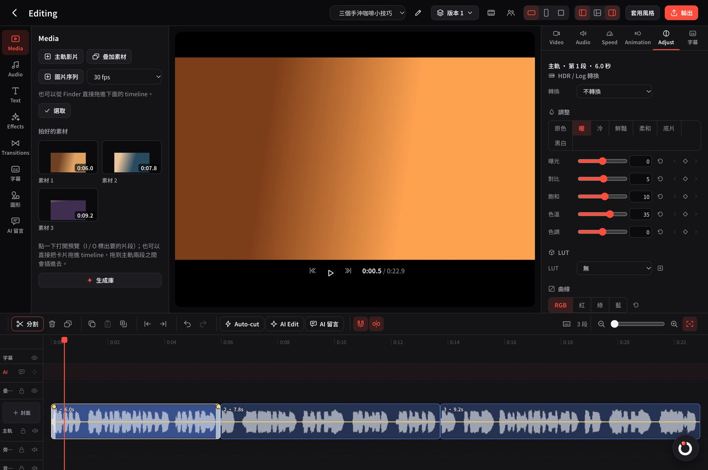

## 3-11 輸出

1. 右上角按「**輸出**」。
2. 「**預設**」直接選平台最簡單：
   - YouTube（MP4 · 1080p）
   - Reels / TikTok / Shorts（直的 1080×1920）
   - 小紅書
   - 存檔母帶（MOV · ProRes，檔案很大）
   - 小檔（傳訊息用，720p）
   - 只要聲音（MP3）
3. 想自己設，選「自訂」：格式（MP4、MOV、MP3、WAV、AAC）、編碼、解析度、幀率、碼率、畫質。
4. 只要一小段：勾「**只輸出一段**」。
5. 看「**存到**」：
   - 「**更改…**」選別的資料夾；「**在 Finder 顯示**」打開那個資料夾。
   - 勾「**每次輸出都問我存在哪裡、叫什麼名字**」：每次輸出前都會跳出存檔視窗。
6. 按「**輸出**」。上方會顯示「輸出中 xx%」，做完會出現「在 Finder 顯示」。

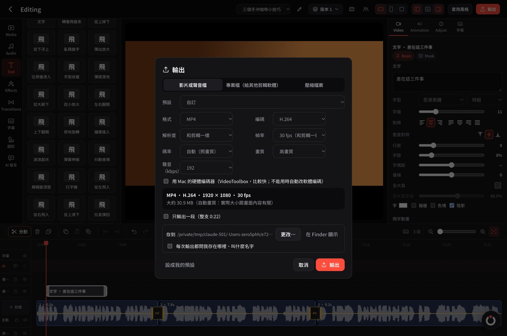

> 截圖是測試環境，所以「存到」顯示的是測試資料夾。你的 Mac 預設存在 **影片（Movies）→ Onset**；如果你在「設定 → 儲存空間」設了媒體資料夾，就存在媒體資料夾裡的「輸出」。

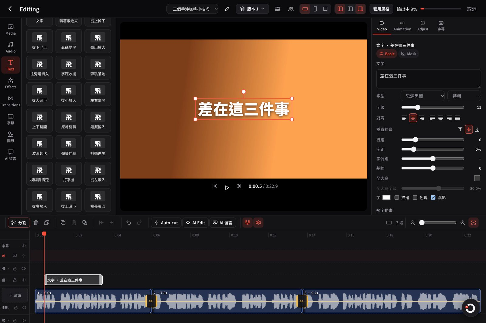

### 給其他剪輯軟體

輸出視窗的第二個分頁「**專案檔（給其他剪輯軟體）**」可以存成 FilmCraft、CapCut 草稿、Premiere / DaVinci（XML）、Final Cut Pro（FCPXML）。勾「把用到的原檔複製到專案旁邊」，整個資料夾就能搬走或傳給別人。

第三個分頁「**壓縮檔案**」可以做出比較小的檔案。

---

下一章：[AI Onset →](04-ai-onset.md)
