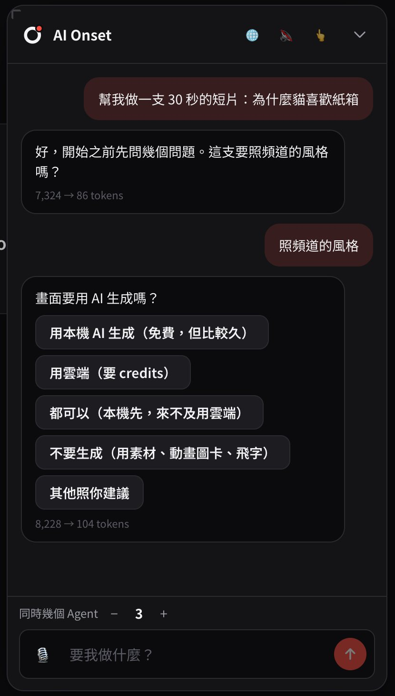
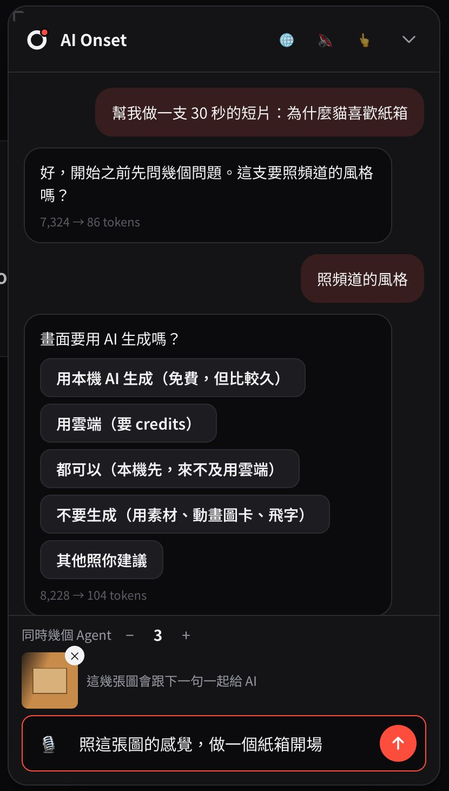

# 4. AI Onset：叫 AI 幫你做事

## 4-1 怎麼叫它

- 每次打開 Onset，**AI Onset 的圓形按鈕都在右下角**。點它就打開對話框。
- 或在任何畫面按 **⌘J**。
- 用打的，或按 **🎙** 用說的：按著說話放開就送出；或點一下開始說，停 2 秒沒說話會自動送出。

可以叫它做的事，例如：

- 「幫我寫一支講今天科技新聞的 Reel 腳本」
- 「顏色統一一點，重點句放大，轉場換成閃白」
- 「把這支長片拆成幾支短影音」
- 「這個是什麼？」（先按 👆 再點畫面上的東西）

## 4-2 做新東西之前，它會先問你

叫它做新的內容（新影片、腳本、不拍直接做、飛字或動態字、封面、貼文、拆短影音）時，AI Onset 會**先問幾個問題，一次一個，每個都有按鈕**：

1. **出鏡拍，還是不拍直接做**：做新影片（包括續集）時，你沒說「不拍」，它一定先問這個。
2. **風格**：照頻道的風格、不套用（自由發揮）、或其他（告訴它是什麼風格）。
3. **要不要 AI 生成畫面**：用本機 AI（免費但比較久）、用雲端（要 credits）、都可以（本機先）、或不要生成（用素材、動畫圖卡、飛字）。
4. **畫面比例**（緊接在出鏡問題之後）和還沒說的**長度**（直的 9:16、橫的 16:9、方的 1:1）。
5. 不拍直接做時：要不要 **AI 旁白、配樂**。

按按鈕回答就好。選項都不對的話，每個問題下面都有一條「**或自己寫想要的…**」，打你自己的答案。你這次已經說過的，它不會再問。

在 AI 生成、動畫畫板、封面、Design、Editing 這些頁面，AI Onset 也會先問那一頁該問的問題，再一次交給 AI 做。
不想一直回答？按「**其他照你建議**」，剩下的它照最好的判斷直接做。

想要這次不照頻道風格，也可以直接說「**這次不要照我的風格**」。它會一直照這個設定，直到你再說「照我的頻道風格」。

## 4-3 給它看參考圖

想讓 AI 照某張圖的感覺做？

- 把圖片**拖到 AI Onset 的對話框**上，或拖到角落的圓形按鈕上。
- 或複製圖片後，在對話框按 **⌘V** 貼上。

圖會出現在輸入框上面（右上角的 ✕ 可以拿掉），**跟你下一句話一起交給 AI** 當參考。

想給某一條 AI 留言條參考圖，請看 [第 3 章 3-8](03-editing.md)。

## 4-4 上方的小圖示

| 圖示 | 意思 |
|---|---|
| 🌐 | 能不能上網查資料。點一下切換：需要時自動查 → 每次都可以查（🌐!）→ 關 |
| 🔇 / 🔊 | 回答要不要念出來 |
| 👆 | 「指一下」：再點畫面上任何東西問它（也可以按住 ⌥⇧ 點一下） |
| ↘ | 把對話框收回角落（在剪輯頁旁邊時才有） |

## 4-5 它做的每一步都看得到

叫它做事後，對話框裡會列出它要做的**每一步**，做完一步打一個綠點，旁邊寫做了什麼。

- 做的時候下面有「**❚❚ 暫停**」和「**⏹ 停止**」，隨時可以按。暫停後按「▶ 繼續」。
- 對話框收起來時，畫面上會有一條小狀態列「Onset 正在做：…」，上面也有暫停和停止。
- 時間軸、畫面會跟著動，你可以看著它改。
- 做完會出現「**↶ 復原這次 AI 的改動**」。不滿意一鍵退回。
- 它做的時候你也可以繼續打字，新的話會排在它這一步做完之後處理。
- 每一頁的對話都會留著。做到一半 App 關掉或被停下來，下次說「**繼續**」，它會從停下來的地方接著做。

### 它會飛到旁邊

在 Create Script、Editing、Design、AI 生成、動畫畫板、封面設計這些頁面，AI Onset 會從角落飛過來，停在頁面旁邊自己的一欄。按 ↘ 收回角落。

## 4-6 同時幾個 Agent

對話框下方有「**同時幾個 Agent − 3 +**」。

- Agent 就是同時一起工作的 AI 幫手。數字越大，大工作（例如「不拍，直接做」整支影片）做得越快，但電腦也越忙。
- 可以設 1 到 10 個；Onset 會看這台電腦的狀況，太多時會告訴你「這台電腦現在最多同時幾個」。
- 「不拍，直接做」時，每個 Agent 會自己寫鏡頭、自己找素材，章節的字卡、動畫、飛字、字幕也平均分給每一個 Agent 做。
- 好幾個 Agent 一起工作時：
  - 時間軸上方有**彩色帶子**，標出每個 Agent 正在處理哪一段（寫著「名字 · 步驟」）。
  - **每個 Agent 有自己顏色的游標**，會飛到它正在改的地方：某個片段、字幕列、音樂或旁白列、AI 列，調色時飛到預覽畫面上。
  - 可以「全部暫停」「全部繼續」「全部停止」，也可以只停其中一個。

> 測試環境沒有真的 AI，所以這一節沒有多 Agent 彩色游標的截圖。

## 4-7 換 AI Onset 的大腦

AI Onset 可以用這四個 AI 當大腦：**Claude Code、ChatGPT · Codex、Cursor、Hermes**。在「設定 → AI 與工具」最上面（也就是安裝助手）選。哪些要帳號、怎麼登入，請看 [第 1 章 1-4](01-install.md)。

- 只有已經裝好、可以用的 AI 才能選。
- 選的 AI 做不到的事（例如 Cursor 不能查網路、看圖片），會交給 Claude Code 代答，畫面會說「這次由 Claude Code 代答」；Claude Code 也沒有的話，會直接告訴你做不了。

> 想用 Cursor 或 ChatGPT 的方案**生成圖片**？那是另外一件事：在「設定 → 生成工具」把它們加進雲端清單，見 [第 6 章 6-5](06-cloud.md)。

## 4-8 讓外部 AI 操作 Onset（進階）

「設定 → MCP」可以「允許外部 AI 在 Onset 裡工作」，例如讓 Claude Desktop 或 Claude Code 直接操作 Onset。外部 AI 做的每一步也會出現在 AI Onset 裡，標「🔌 外部 AI」，一樣能停止。外部 AI 不能拍攝、刪除或發佈。

---

下一章：[不拍，直接做 →](05-no-shoot.md)
