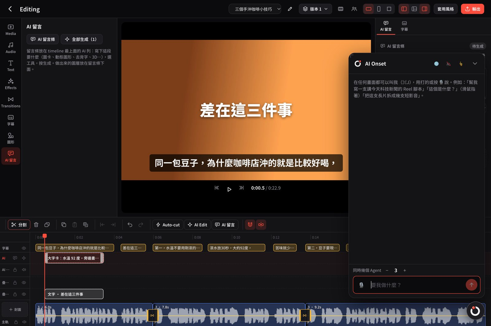
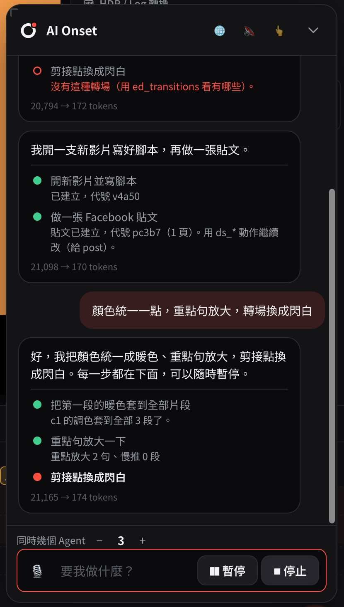
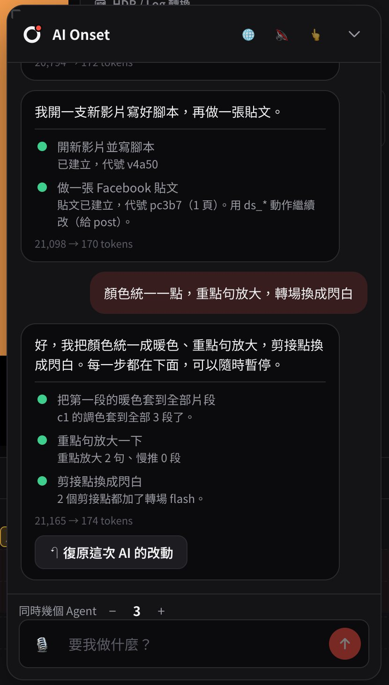

# 4. AI Onset：叫 AI 幫你做事

## 4-1 怎麼叫它

- 點畫面角落的 **AI Onset 圓形按鈕**（寫腳本、貼文頁在左上，剪輯頁在右下）。
- 或在任何畫面按 **⌘J**。
- 用打的，或按 **🎙** 用說的：按著說話放開就送出；或點一下開始說，停 2 秒沒說話會自動送出。

可以叫它做的事，例如：

- 「幫我寫一支講今天科技新聞的 Reel 腳本」
- 「顏色統一一點，重點句放大，轉場換成閃白」
- 「把這支長片拆成幾支短影音」
- 「這個是什麼？」（先按 👆 再點畫面上的東西）

## 4-2 上方的小圖示

| 圖示 | 意思 |
|---|---|
| 🌐 | 能不能上網查資料。點一下切換：需要時自動查 → 每次都可以查（🌐!）→ 關 |
| 🔇 / 🔊 | 回答要不要念出來 |
| 👆 | 「指一下」：再點畫面上任何東西問它（也可以按住 ⌥⇧ 點一下） |
| ↘ | 把對話框收回角落（在剪輯頁旁邊時才有） |

## 4-3 它做的每一步都看得到

叫它做事後，對話框裡會列出它要做的**每一步**，做完一步打一個綠點，旁邊寫做了什麼。

- 做的時候下面有「**❚❚ 暫停**」和「**⏹ 停止**」，隨時可以按。暫停後按「▶ 繼續」。
- 對話框收起來時，畫面上會有一條小狀態列「Onset 正在做：…」，上面也有暫停和停止。
- 時間軸、畫面會跟著動，你可以看著它改。
- 做完會出現「**↶ 復原這次 AI 的改動**」。不滿意一鍵退回。

## 4-4 同時幾個 Agent

對話框下方有「**同時幾個 Agent − 3 +**」。

- Agent 就是同時一起工作的 AI 幫手。數字越大，大工作（例如「不拍，直接做」整支影片）做得越快，但電腦也越忙。
- 可以設 1 到 10 個；Onset 會看這台電腦的狀況，太多時會告訴你「這台電腦現在最多同時幾個」。
- 好幾個 Agent 一起工作時：
  - 時間軸上方有**彩色帶子**，標出每個 Agent 正在處理哪一段（寫著「名字 · 步驟」）。
  - **每個 Agent 有自己顏色的游標**，會飛到它正在改的地方：某個片段、字幕列、音樂或旁白列、AI 列，調色時飛到預覽畫面上。
  - 可以「全部暫停」「全部繼續」「全部停止」，也可以只停其中一個。

> 測試環境沒有真的 AI，所以這一節沒有多 Agent 彩色游標的截圖。

## 4-5 讓外部 AI 操作 Onset（進階）

「設定 → MCP」可以「允許外部 AI 在 Onset 裡工作」，例如讓 Claude Desktop 或 Claude Code 直接操作 Onset。外部 AI 做的每一步也會出現在 AI Onset 裡，標「🔌 外部 AI」，一樣能停止。外部 AI 不能拍攝、刪除或發佈。

---

下一章：[不拍，直接做 →](05-no-shoot.md)
