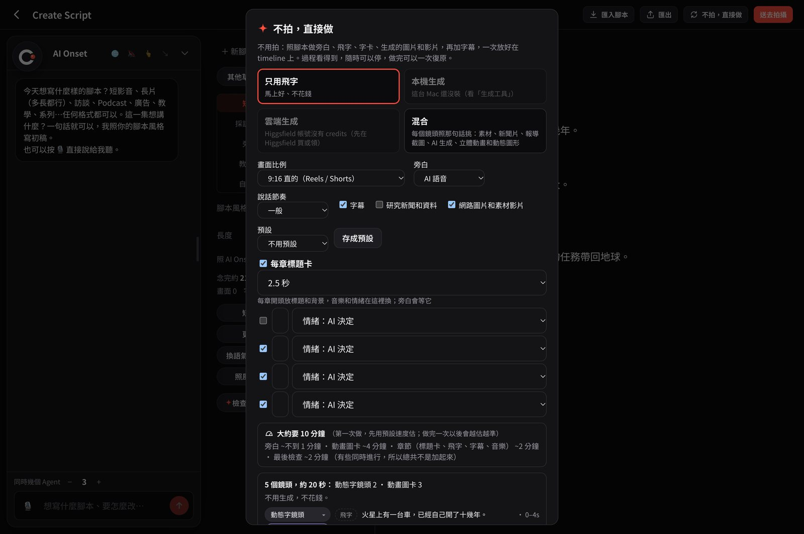
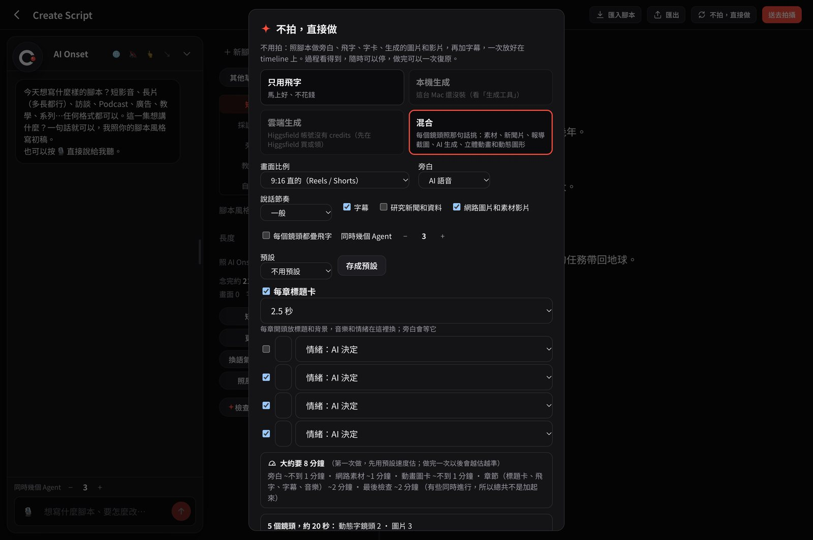
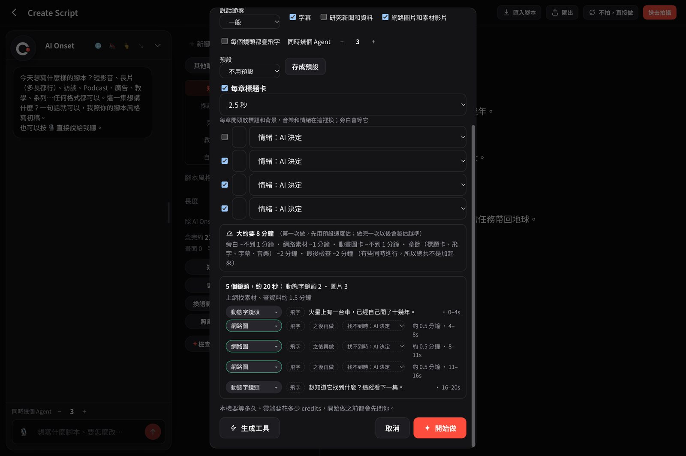
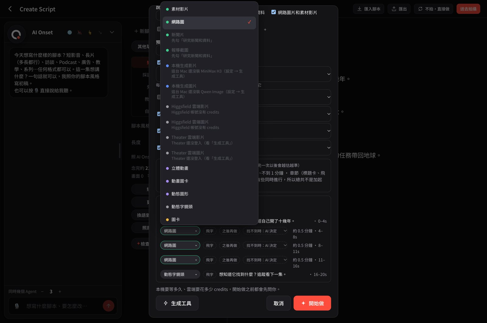

# 5. 不拍，直接做

沒時間拍、或這個題目根本拍不到（例如火星探測車）？只要有腳本，Onset 可以幫你做出整支影片：**旁白、飛字、字卡、網路素材、生成的圖片和影片，再加字幕**，一次放好在時間軸上。

過程看得到，隨時可以停，做完可以一次復原。

## 5-1 從哪裡開始

- **Create Script** 右上角的「**不拍，直接做**」。
- **Content** 選一支影片，「下一步」裡的「**不拍，直接做**」。
- 或直接跟 AI Onset 說：「這支不拍，直接做成影片」。

> 這支影片已經有拍好的素材時，按鈕會變灰色。

## 5-2 選怎麼做

上面四個大按鈕選一個：

| 選項 | 說明 |
|---|---|
| **只用飛字** | 馬上好、不花錢。畫面用文字動畫和圖卡 |
| **本機生成** | 用這台 Mac 生成圖片和影片。免費，但每段要幾分鐘 |
| **雲端生成** | 用 Higgsfield 或 Theater 生成。要花錢，**每一段都先報價** |
| **混合** | 每個鏡頭照那句話自動挑：素材、新聞片、報導截圖、AI 生成、立體動畫、動態圖形 |

不能用的選項會變灰，並寫原因（例如「這台 Mac 還沒裝」「帳號沒有 credits」）。

接著設定：

- **畫面比例**：16:9 橫的（YouTube）、9:16 直的（Reels / Shorts）、1:1 方的。
- **旁白**：AI 語音，或不要旁白。
- **說話節奏**：緊、一般、慢。
- 勾選：「**字幕**」「**研究新聞和資料**」「**網路圖片和素材影片**」「**每個鏡頭都疊飛字**」。
- **同時幾個 Agent**：越多越快（見第 4 章）。
- **每章標題卡**：每章開頭放標題和背景，可以選每章的情緒（緊張、好奇、感動、平靜、反思）。
- 常用的設定可以「**存成預設**」。

## 5-3 看時間、看分鏡

往下捲：

- **時間計算器**：「大約要 X 分鐘」，還有每個階段（旁白、網路素材、動畫圖卡、本機生成、雲端生成、最後檢查）各要多久。第一次用預設速度估，做過幾次後會越估越準。
- **分鏡清單**：每個鏡頭一行，寫著那句話、幾秒、用什麼做。

## 5-4 每個鏡頭的來源

每一行最左邊的按鈕可以換這個鏡頭用什麼做：

| 來源 | 是什麼 |
|---|---|
| **素材影片** | 網路上免費的素材影片 |
| **網路圖** | 網路上找到、授權可以用的圖片 |
| **新聞片 / 報導截圖** | 新聞影片、新聞網頁截圖（要先勾「研究新聞和資料」） |
| **本機生成影片 / 圖片** | 這台 Mac 用 MiniMax H3 / Qwen Image 生成 |
| **Higgsfield 雲端影片 / 圖片** | 用你的 Higgsfield 帳號生成（花 credits） |
| **Theater 雲端影片 / 圖片** | 用你的 Theater 帳號生成（先報價） |
| **立體動畫** | 3D 動畫 |
| **動畫圖卡** | 會動的資訊圖卡 |
| **動態圖形** | EffectCraft 做的動態圖形 |
| **動態字鏡頭** | 一拍一個大字、背景換色、鏡頭推拉甩 |
| **圖卡** | 靜態圖卡 |

每一行還有：

- 「**飛字**」開關：要不要在畫面上疊文字。
- 「**優先 / 之後再做**」：重要的先做。
- 「**找不到時：**」網路找不到素材怎麼辦（AI 決定、免費素材片、立體動畫、AI 生成圖片、動畫圖卡）。

## 5-5 主角參考圖

腳本裡如果有一個「長得固定」的主角（例如某台探測車、你的產品），AI 生成的每張圖應該都長得一樣。Onset 會自動處理：

1. AI 從腳本找出最多 3 個主角。
2. 上網找授權可以用的真實照片，去背後存進「**本機生成 → 參考圖庫**」，名字是「參考：名字」。
3. 之後畫 AI 圖、做本機影片、用 Theater 生成時，都會照著這張參考圖畫。

想換掉或刪掉：到「本機生成」的參考圖庫。下一支同主題的影片會沿用。

## 5-6 本機時間上限

選「本機生成」或「混合」時，會多一個「**本機最多**」：10、30、60 或 120 分鐘。

本機生成很慢（一段影片可能半小時）。時間用完時，剩下還沒做的鏡頭會**自動改成動畫圖卡**，不會一直等。本機正在忙別的工作時，也會直接用動畫圖卡。

## 5-7 要花錢的，先問你

畫面最下面寫著：「本機要等多久、雲端要花多少 credits，開始做之前都會先問你。」

- **Higgsfield**：先報 credits，例如「雲端生成 N 段，報價共 X credits，要花這些 credits 嗎？」按「不要」，這幾段會改成飛字。
- **Theater**：先估價，例如「估價共 US$…，要做嗎？」

## 5-8 開始做、做完之後

1. 按「**開始做**」。
2. 可以去做別的事。AI 會在背景一章一章做：一章旁白念好，那一章的動畫、飛字、字幕、配樂就開始做。
3. 做好的東西直接出現在剪輯的時間軸上，跟自己剪的一樣，可以再改。
4. 想重來：跟 AI Onset 說「**重做**」。舊的剪輯會先存成版本「重做前 日期」。
5. 中途關掉 Onset 也沒關係，下次打開剪輯頁會問「**接著做**」還是「不用了」。

### 旁白有一句念得不好？

旁白每一句是一個獨立的片段。在那一句上按「**重念 #n 這句**」，會用同一個聲音再念一次，後面的片段和字幕會自動對好。

---

下一章：[雲端生成 →](06-cloud.md)
