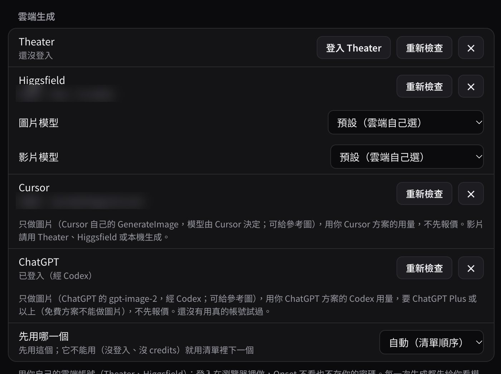

# 6. 雲端生成：Higgsfield 和 Theater

本機生成免費但很慢，有些 Mac 也跑不動影片模型。**雲端生成**用你自己的雲端帳號，在別人的電腦上生成，快很多，但要花錢。

Onset 可以接兩家：**Higgsfield** 和 **Theater**。兩家可以都加，每個鏡頭各自選用哪一家。

## 6-1 加入雲端服務

1. 右上角頭像 →「**設定**」→「**生成工具**」，往下捲到「**雲端生成**」。（「不拍，直接做」視窗左下的「**生成工具**」也會帶你到這裡。）
2. 按「**＋ 加入雲端服務**」→「選一個…」→ 選 Theater 或 Higgsfield。
3. 按「**登入 Theater**」或「**登入 Higgsfield**」：
   - **Theater**：不用裝東西，按了會打開 Theater 的登入頁，在瀏覽器登入。
   - **Higgsfield**：要先裝 Higgsfield 的小工具（畫面會給一行安裝指令，請懂電腦的朋友幫忙貼到終端機），再按「登入 Higgsfield」在瀏覽器登入。
4. 回到 Onset 按「**重新檢查**」，看到「已登入」就好了。

Onset 不看也不存你的密碼，登入都在瀏覽器裡做。

> 截圖中 Higgsfield 那一行的帳號狀態已遮掉。

不想用了，按那一行的 **✕**「從清單拿掉」。

## 6-2 先用哪一個

「**先用哪一個**」：

- **自動（清單順序）**：先用清單上面那一個；它不能用（沒登入、沒 credits）就用下一個。
- 或指定一家。

## 6-3 選模型和畫素

登入後，每一家下面會出現：

- 「**圖片模型**」「**影片模型**」：預設是「預設（雲端自己選）」，也可以指定一個。
- 選了模型後，可以再選「**畫素**」（解析度）。畫素越高通常越貴。

## 6-4 Higgsfield credits 和 Theater 報價有什麼不同？

| | Higgsfield | Theater |
|---|---|---|
| 怎麼付錢 | 用帳號裡的 **credits**（要先在 Higgsfield 買或領） | 照每次的**報價**，從你的 Theater 帳號扣 |
| Onset 看得到餘額嗎 | 看得到，例如「已登入（方案，N credits）」 | 看不到，以 Theater 帳號為準 |
| 開始前會問什麼 | 「報價共 X credits，要花這些 credits 嗎？」 | 影片：「估價共約 US$…，要做嗎？」；圖片寫「Theater 先報價」 |
| 不答應會怎樣 | 那幾段改成飛字 | 不做 |

**兩家都是你答應才會花錢。**

## 6-5 哪裡會用到雲端生成

- **不拍，直接做**：選「雲端生成」或「混合」，或在分鏡清單把某個鏡頭換成「Higgsfield 雲端影片」「Theater 雲端圖片」等（第 5 章）。
- **AI 留言條**：「工具」選「Higgsfield（付費生成）」或「Theater（付費生成）」。按生成會先顯示「報價中…」，再問「要做嗎？」（第 3 章）。
- 「自動」選工具時，**永遠不會自己選付費的**。

### 參考圖

給 AI 留言條或 AI Onset 的參考圖（第 3、4 章）：**Theater 會照著參考圖做**；**Higgsfield 不收參考圖**，只有寫 prompt 的 AI 看得到。要照著圖做，請選 Theater。

> 測試時不花真的錢，所以這一章沒有實際報價視窗的截圖。

---

下一章：[iPhone app 和同步 →](07-iphone.md)
