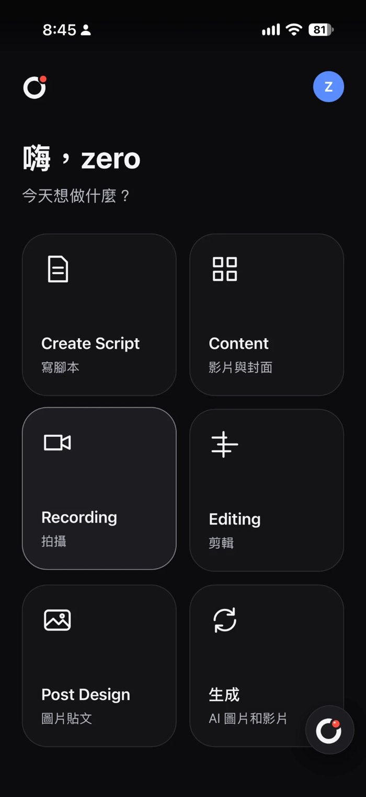
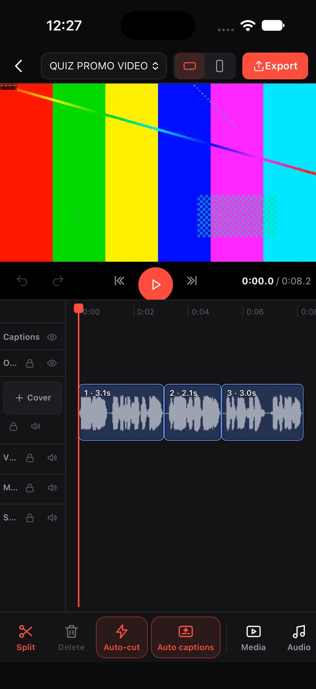
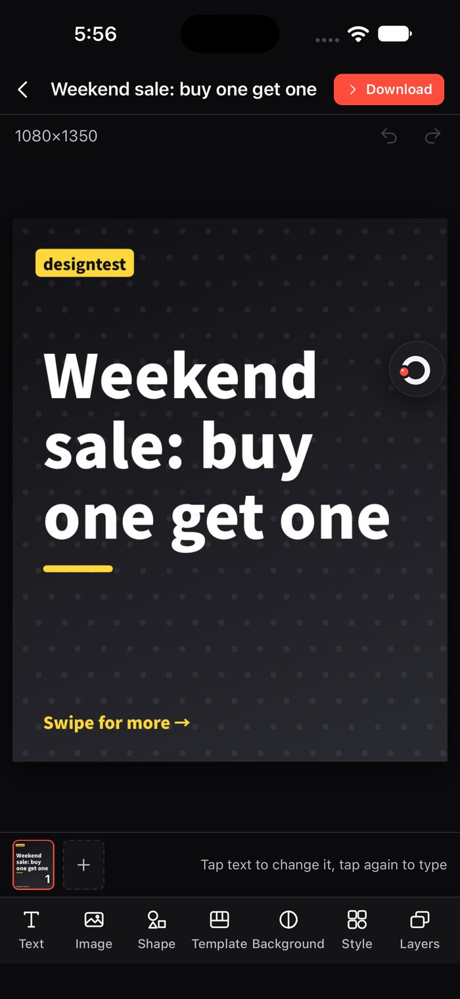
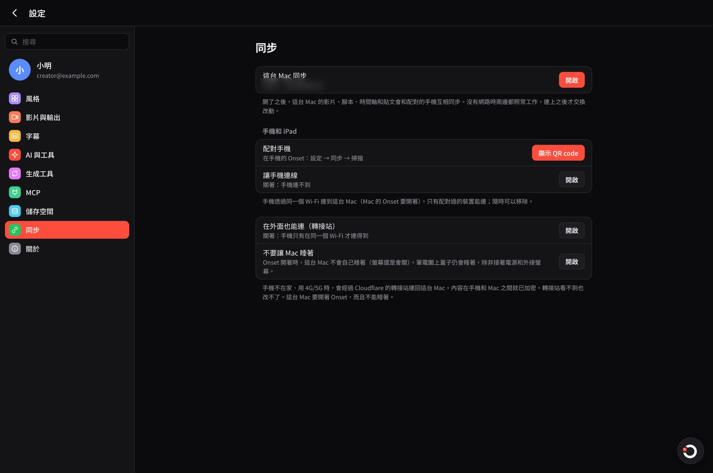
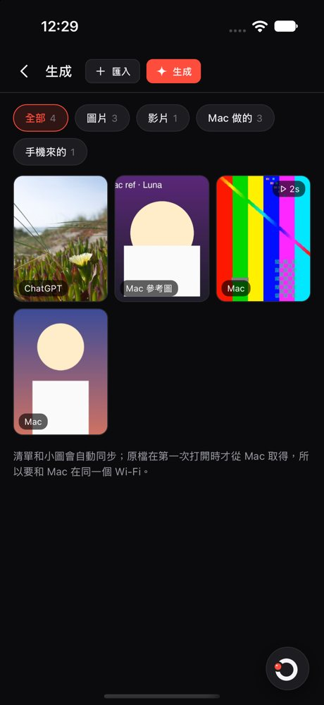

# 7. iPhone app 和同步

Onset 也有 iPhone / iPad 版。手機和 Mac 配對後，影片、腳本、時間軸和貼文會互相同步。

> 第一張是真的 iPhone 上的首頁。其他幾張手機截圖是之前在 iPhone 模擬器測試時拍的，可能跟現在的版本有一點不一樣。

## 7-1 手機上能做什麼

手機的首頁跟 Mac 一樣有六個入口：Create Script、Content、Recording、Editing、Post Design，第六個是「**生成**」（AI 圖片和影片）。右下角一樣是 AI Onset 的圓形按鈕。

**手機自己就能做：**

- 匯入影片和照片（從照片圖庫、拍照或錄影、檔案）
- 整個剪輯：剪、分割、修剪、排順序、字幕和字幕樣式、轉場、圖層、音樂和旁白、調色
- 語音轉文字（用 Apple 的語音辨識）
- 輸出 9:16 或 16:9 的 MP4（存到「檔案 → Onset」和「照片」）
- 拍攝，有提詞機
- 圖片貼文設計
- 「生成」：看 Mac 生成過的圖片和影片；用 Apple 的 Image Playground 畫圖；或讓 AI 幫你寫好給 ChatGPT / Gemini / Grok 的 prompt，照步驟去那邊生成、再匯入（不會花 Onset 的錢）

 

**要 Mac 才能做（手機會幫你交給 Mac）：**

- AI Onset 的大部分動作、AI Edit
- 很長的影片、Podcast 多機位
- 去背、遮罩、美顏、聲音工具、HDR 轉換
- 其他輸出格式
- 本機生成

手機做不了的事，按「**交給 Mac 做**」，要求會留在那支影片上，Mac 連上後就看得到。

完全沒網路時，剪輯和輸出照常可以做。

## 7-2 和 Mac 配對

第一次配對要在**同一個 Wi‑Fi**，而且 Mac 的 Onset 要開著。

**在 Mac：**

1. 右上角頭像 →「設定」→「**同步**」。
2. 「這台 Mac 同步」按「**開啟**」。
3. 「讓手機連線」按「**開啟**」。
4. 「配對手機」按「**顯示 QR code**」。

**在 iPhone：**

1. 第一個畫面按「**和 Mac 配對**」（或「設定 → 同步」）。
2. 「**掃描 Mac 上的 QR code**」。

配好了。之後不用再掃。要移除某支手機，在 Mac 的「設定 → 同步」移除。

## 7-3 同步怎麼運作

- **離線也能用：** 每台裝置都有完整的資料。沒網路時照常工作，連上之後才交換改動。
- **兩邊都改了同一份？** 腳本或時間軸兩邊都改過時，兩個版本都會留著（另一個時間軸會出現在「版本」裡）。
- **影片檔：** 手機先拿 720p 的預覽檔，剪起來比較順。要輸出 1080p 時，按「**下載原檔**」。手機自己拍的影片，會用原檔傳回 Mac。
- **生成庫：** Mac 本機生成的圖片和影片會同步到手機的「生成」，先傳小預覽，打開時才下載完整檔案。手機做的也會傳回 Mac。

## 7-4 在外面也能連（轉接站）

人不在家、手機用 4G / 5G 時，也能連回家裡的 Mac：

- 配對第一支手機後會**自動打開**「**在外面也能連（轉接站）**」。在 Mac 的「設定 → 同步」看得到。
- 手機會經過 Onset 的轉接站連回 Mac。內容在手機和 Mac 之間就已經加密，轉接站看不到也改不了。
- 手機上的狀態會寫「在家（直連）」或「在外面（經過轉接站）」。
- **在外面只同步專案、腳本、封面、貼文。** 大的影片檔要回家、連上同一個 Wi‑Fi 才傳。
- 家裡的 Mac 要**開著 Onset，而且不能睡著**。建議打開「**不要讓 Mac 睡著**」。筆電闔上蓋子還是會睡（除非接著電源和外接螢幕）。

## 7-5 iPhone 當 Mac 的攝影機

拍 Podcast 或訪談時，iPhone 可以當 Mac 的第二台、第三台相機：

1. iPhone 的 Onset 打開錄影 → 設定 →「**當 Mac 的攝影機**」。
2. Mac 的 Recording 頁，「畫面來源」的「**iPhone 攝影機**」勾選這支 iPhone。
3. 在 Mac 按錄影，兩邊一起開始、一起停止。
4. 錄好的檔案自動傳回 Mac，每顆鏡頭一個檔案，自動對齊聲音，組成多機位影片。

這個功能要**同一個 Wi‑Fi**，不經過轉接站。

---

下一章：[常見問題 →](08-faq.md)
