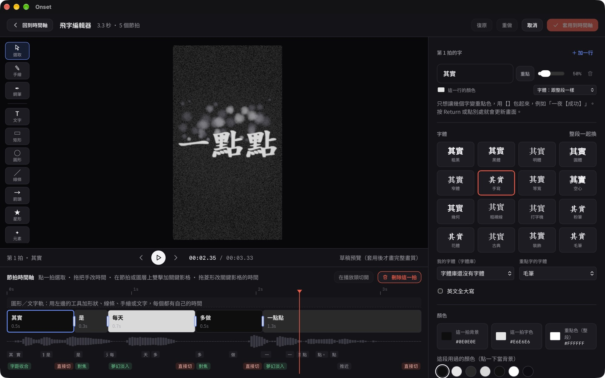

# 8. 動態字、飛字編輯器和包裝風格

這一章講讓文字動起來的工具，還有你頻道自己的片頭、片尾、名條這些「包裝」。

## 8-1 動態字鏡頭

一拍一個大字、背景跳色、鏡頭推拉甩，像預告片那樣的文字動畫，Onset 叫「**動態字鏡頭**」。

做法：

- 跟 AI Onset 說，例如「把這句做成動態字：一夜之間，全部改變」。
- 在 AI 留言條寫你要的動態字，按生成（第 3 章 3-8）。
- 「不拍，直接做」選「**只用飛字**」，每一句旁白都會變成一個動態字鏡頭，配上音樂和音效（第 5 章）。

Onset 有 **52 種飛字風格**，每種都有自己的字體、配色、進出場、鏡頭、3D 道具、背景和音效。沒指定時，會照那句話的情緒挑。

字講到水、火、煙、冰、電、風、雪、愛心這些，會自動加上對應的元素：說「燃燒」就有火焰和熱浪，說「像水一樣」就有水滴和漣漪。有幾種風格（例如銀河、雷雨、水滴、像素）的背景本身就會動。

## 8-2 飛字編輯器：不重新生成，自己改

做好的動態字鏡頭，在時間軸上**雙擊**它，或在 AI 留言條按「**編輯飛字**」，就會打開「**飛字編輯器**」。

- **改字**：每一拍的字、重點字、大小，每一行可以有自己的顏色和字體（字體庫的字體也能用）。
- **每一拍的時間**：下面的時間條可以拖邊緣改長短、切開、刪掉。
- **動作**：進場、鏡頭、出場、元素、排版、3D 道具都能換。
- **關鍵影格**：在時間條上雙擊加一個，拖菱形移動時間；關鍵影格可以帶顏色（字慢慢變色）。
- **加東西**：文字、形狀、線條、箭頭、手繪筆畫、元素粒子，各自有時間、進出場和關鍵影格。
- 改好按「**套用到時間軸**」，會畫好放回原來的位置，一次就能復原。
- 喜歡這個樣子？可以存成你自己的**飛字風格**，之後做飛字時可以選，也能放進風格包分享。

AI Onset 也能做編輯器裡的每一件事，直接說「第三拍的字改成金色」就好。

## 8-3 包裝風格：片頭、片尾、名條

「**包裝風格**」是你頻道自己的一套包裝，有六個部分：**片頭、片尾、名條、章節卡、邊框、浮水印**。

1. 右上角頭像 →「**設定**」→「**風格**」→「**包裝風格**」。
2. 按「**新包裝風格**」，會先給你一套用頻道顏色做的基本款。
3. 點一個部分打開設計器，用形狀、文字、手繪、元素、關鍵影格改成你要的樣子。也可以請 AI Onset 幫你設計。
4. 文字裡可以放空格，套到影片時自動換成那支影片的內容：`{title}` 影片標題、`{name}` 你的名字、`{channel}` 頻道名、`{chapter}` 章節標題、`{n}` 第幾章。

放到影片上：在 Editing 上方按「**套用包裝…**」選一個。片頭蓋在開頭幾秒、片尾在最後、每一章開頭有章節卡，邊框和浮水印整支都有。換另一套，或按「**拿掉包裝**」，舊的會一起拿掉。

## 8-4 自訂元素、我的版型、風格包

- **自訂元素**：一張小圖（自己畫或匯入），加上它怎麼動（升起、落下、爆開、飄、旋轉），可以用在飛字和包裝裡。在「設定 → 風格 → 自訂元素」管理。
- **我的版型**：封面或貼文設計好之後，在「版型」分頁存起來，下次換字換圖就能直接用。
- **風格包**：把你的風格、飛字風格、包裝風格、元素、版型和字體打包給別人。打開別人的風格包時，會先播給你看長什麼樣子，按加入才會放進你的帳號。

---

下一章：[動畫畫板 →](09-board.md)
