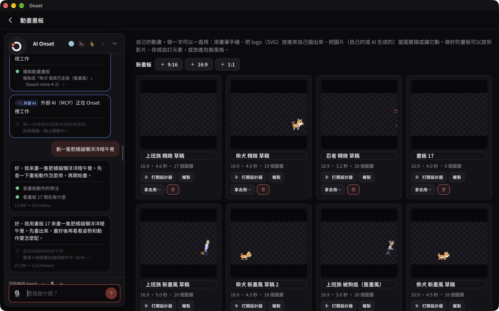
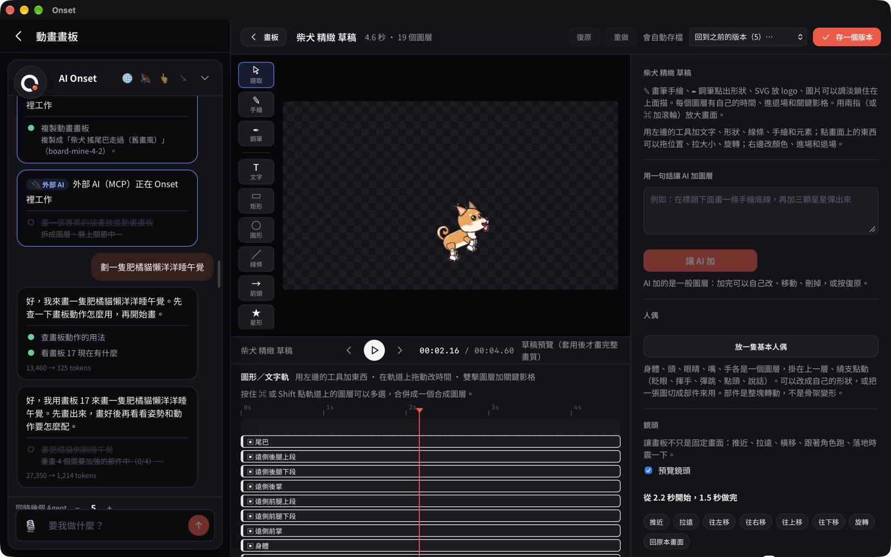

# 9. 動畫畫板

「**動畫畫板**」是你自己的動畫，做一次可以一直用：手繪、logo 自己描出來、會走會跑的角色、3D 字。做好可以放進影片、存成自訂元素，或放進包裝風格。

從首頁下排的「**動畫畫板**」進去。打開一個畫板，AI Onset 會飛過來停在旁邊，你可以邊做邊叫它幫忙。

## 9-1 新畫板

按「新畫板」，選比例（9:16、16:9、1:1）和長度（最長 20 秒）。底色可以選顏色，也可以透明（疊在影片上用）。

畫面下面是**圖層軌道**，一個圖層一條，左右拖動時間、拉邊緣改長短。同一條軌道上時間重疊的圖層會各自佔一列。

## 9-2 畫出來的東西

- **六種畫筆**：鋼筆、麥克筆、蠟筆、鉛筆、水彩、墨水，有壓力感應。播放時會照你畫的方向一筆一筆「描出來」。
- **錨點鋼筆**：點出錨點畫形狀，錨點可以再拖。
- **Logo（SVG）**：把 SVG 檔放進來，每個形狀變成一個圖層，一個接一個描出來，logo 就自己畫出來。
- **圖片**：自己的圖或生成庫的圖，可以當圖層讓它動，也可以調淡鎖住，只當**描圖底**（成品裡看不到）。
- **3D**：形狀、logo、文字可以推成立體（金屬、玻璃、黏土、霧面），也可以放 .glb 的 3D 模型。
- **圖樣**：一個圖層重複鋪成方格、磚牆、圓圈或散落，可以捲動或忽大忽小。
- **逐格**：像翻頁動畫，一格一格畫，看得到上一格的淡影，可以設每秒幾格、循環或停在最後一格。
- **陰影**：每個圖層可以有一個陰影（柔和、硬、長影、浮起來、發光），拖小太陽改光的方向。

## 9-3 叫 AI 畫角色

在畫板旁邊的 AI Onset 說你要什麼，例如「畫一個穿西裝、提著公文包趕上班的上班族，扁平插畫風」。

- AI 會先規劃姿勢、配色和部件，幾個部件同時畫，畫完自己看一次，畫得不好的地方重畫。
- 畫好的角色會**拆成部件**（頭、眼睛、嘴、手臂、腿…），每個部件一個圖層，關節已經掛好，眼睛會眨、嘴會說話。
- 想要特定畫風，給它參考圖（拖進對話框），比用文字描述準。參考圖只學畫法，不會照抄角色。
- 畫到一半停了（或 App 關了），說「**繼續**」，它只畫還沒畫的部件。

### 畫一個像你的角色

給它你的照片，它會畫出看得出是你的卡通：臉型、髮型、眼鏡、膚色、衣服、身材都照照片，畫完還會拿照片對照檢查兩次。

- 照片可以從生成庫選、自己選檔案，或拖進對話框。
- 也可以直接說「用『某支影片』第 12 秒的我」，它會自己從影片抓那一格。
- 畫好會自動多畫閉眼和閉、半開、開三種嘴型，一放上影片就會眨眼、跟著旁白說話。
- 照片只留在這台 Mac，只交給你本來就在用的那個 AI 去畫。

## 9-4 讓角色動起來

**骨架動作**：跟 AI Onset 說「跑 0–8 秒，3–5 秒邊跑邊看錶」，角色的腿真的會跑、手真的會舉起來。有 50 多種動作：

- 移動：走、快走、跑、衝刺、踮腳、跳、爬樓梯…
- 日常：看錶、講電話、喝水、打字、坐下、伸懶腰…
- 情緒：揮手、點頭、搖頭、聳肩、歡呼、捂臉、比讚、比心…
- 說話：講話手勢、攤手解說、數手指、指自己、指觀眾…

動作可以疊在一起。腳會踩穩地面不會滑。動物有自己的骨架：四腳動物（走、小跑、奔跑、搖尾巴、吠）、鳥（起飛、拍翅、滑翔）、魚（游、竄出、轉身）、兔子這類會跳的。

其他：

- **柔軟關節**：膝蓋、手肘彎成一條，不是兩塊硬片，適合軟萌畫風、動物、袖子褲管。
- **換圖**：同一個部件的其他樣子，例如閉眼、張嘴、握拳、頭轉 3/4 側面。AI 可以照原本的圖幫你畫。
- **對嘴**：嘴巴有閉、半開、開三張圖時，放到影片上會跟著聲音開合。也可以跟 AI Onset 說「讓他跟著第 3 句旁白說話」，嘴巴只跟那一段旁白，角色會自動放在那句開始的地方。
- **人偶**：沒有角色時，可以先放一隻基本人偶，再把部件換成你自己的圖。

## 9-5 鏡頭

畫板本來是固定畫面，也可以加運鏡：推近、拉遠、橫移、上下移、微微旋轉；鏡頭**跟著角色**跑；落地時**震一下**；遠景近景有**景深視差**；字幕或 logo 可以固定在螢幕上不跟鏡頭動。

## 9-6 整理、存檔、版本

- **合成圖層**：按住 ⌘ 或 Shift 點幾個圖層，按「**合併成合成圖層**」，整組一起移動、旋轉、加關鍵影格，裡面各自的動畫都還在。「拆開」就分回去。
- **自動存檔**：每次改完會自己存。
- **版本**：AI 改之前、你按「**存一個版本**」時，都會留一個版本。上方「**回到之前的版本**」可以退回去，現在的樣子也會先存起來。

## 9-7 放進影片

- 在 Editing 上方按「**放動畫畫板…**」選一個，會放在播放頭的位置，背景透明疊在影片上。
- 畫板改過之後再放一次，會在原地換成新的樣子。
- 也可以「**存成自訂元素**」（用在飛字裡）或「**放進包裝風格**」當片頭、名條（第 8 章）。

### 在 iPhone 上

手機也能打開畫板。軌道可以用手指捲動；要移動圖層，**按住約 0.3 秒**（會震一下）再拖。

---

下一章：[常見問題 →](10-faq.md)
