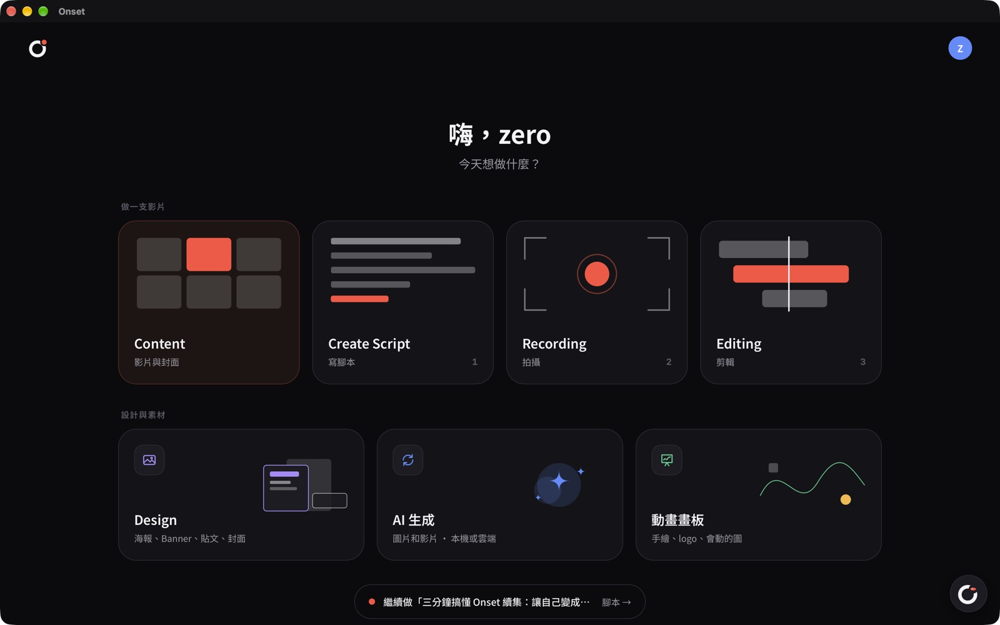

# Onset 新手使用手冊

**網頁版：** https://zero5phh-ops.github.io/onset-handbook/

**繁體中文** · [English](en/README.md)

給第一次用 Onset 的創作者。不用懂程式，照著做就好。

Onset 是一個從「寫腳本」到「拍」「剪」「做封面和貼文」都在同一個地方完成的 app。
它有一個 AI 助手叫 **AI Onset**，你用說的或打字叫它做事，它做的每一步你都看得到，也能隨時暫停。

## 目錄

1. [安裝和第一次打開](01-install.md)
2. [首頁六個入口](02-home.md)：寫腳本、影片與封面、拍攝、剪輯、圖片貼文、本機生成
3. [Editing 剪輯](03-editing.md)：時間軸、文字排版、轉場、調色、輸出
4. [AI Onset：叫 AI 幫你做事](04-ai-onset.md)
5. [不拍，直接做](05-no-shoot.md)：只有腳本也能做出影片
6. [雲端生成：Higgsfield 和 Theater](06-cloud.md)
7. [iPhone app 和同步](07-iphone.md)
8. [常見問題](08-faq.md)

## 先知道三件事

- **每個畫面右下角的圓形按鈕就是 AI Onset。** 不知道怎麼做的時候，直接問它。鍵盤按 ⌘J 也能叫它。
- **AI 改過的東西都能復原。** 每次 AI 做完，都有一顆「↶ 復原這次 AI 的改動」。
- **要花錢的事一定先問你。** 雲端生成會先報價，你按同意才做。

## 關於這本手冊的截圖

截圖是在測試環境拍的（測試帳號「小明」、用 Mac 語音念的假影片、不連真的 AI）。
所以有些畫面的文字會跟你看到的不一樣，例如儲存位置顯示的是測試資料夾、AI 的回答比較短。按鈕和位置都是一樣的。
