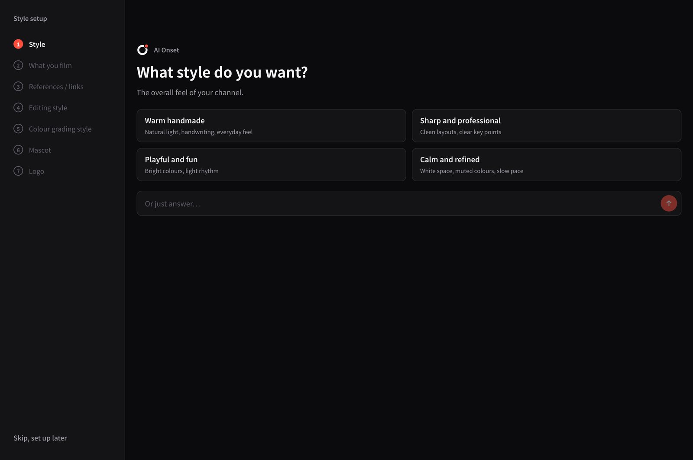
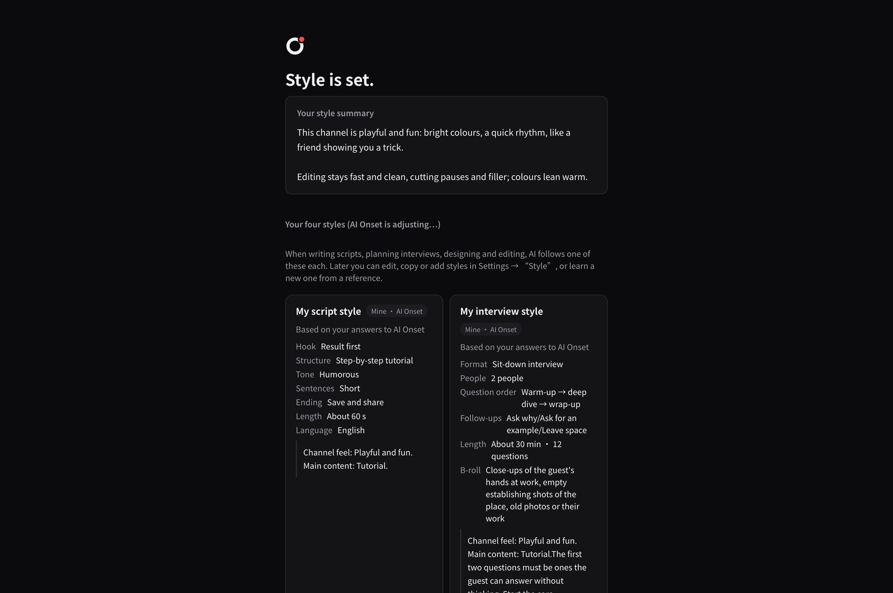

# 1. Installing and opening Onset for the first time

## 1-1 Put Onset on your Mac

1. Open the Onset `.dmg` file.
2. Drag **Onset** into the Applications folder.
3. In Applications, **right-click Onset → Open** (don't just double-click it).

### "Apple could not verify the developer"?

The first time, macOS may say Onset can't be opened because the developer can't be verified. That's because Onset hasn't been notarised by Apple yet. Nothing is broken.

- **Option 1:** Right-click Onset → "Open" → click "Open" again.
- **Option 2:** Open System Settings → Privacy & Security → scroll down to the line about Onset → click **"Open Anyway"** → enter your Mac password.

You only do this once. After that, Onset opens with a normal double-click.

> If macOS says Onset "is damaged": ask a tech-savvy friend to run
> `xattr -dr com.apple.quarantine /Applications/Onset.app` in Terminal, then open it again.

## 1-2 Pick a language and create your account (Profile)

This is the first screen you'll see.

1. Pick the app language at the top right: 繁體中文, 简体中文, English, Bahasa Melayu, 日本語, 한국어.
2. Click **＋ "Create account"** in the middle.
3. Fill in three things: **Email, Username (the name shown), Password** (at least 6 characters).
4. To go straight in by clicking your avatar, without typing a password each time, tick **"No password needed to sign in"**. You can change this later in Settings.
5. Click **"Continue"**.

> Accounts live on this computer. One Mac can have several Profiles (for example one for you and one for your assistant), and Onset asks you to pick an avatar when it opens.
>
> 

## 1-3 Channel style questions (about 1 minute)

Next, AI Onset asks you 7 questions to set up your channel's style. Click the closest answer for each, or type your own answer in the box below.

| Step | Question | Examples |
|---|---|---|
| 1 Style | The overall feel of your channel | Warm handmade, Sharp and professional, Playful and fun, Calm and refined |
| 2 What you film | What you mostly make | Vlog, Tutorial, Product review, Interview |
| 3 References / links | Videos or accounts you like | Add screenshots, paste links, or "No reference" |
| 4 Editing style | The pace of your edits | Fast-paced, Clean and simple, Cinematic, Documentary |
| 5 Colour grading style | The colour of your picture | Natural, Warm, Cool, Film look |
| 6 Mascot | Do you have a mascot? | Add a picture, or "No" / "Later" |
| 7 Logo | Do you have a logo? | Add a picture, or "No" / "Later" |

Don't want to answer now? Click **"Skip, set up later"** at the bottom left.

When you're done, AI Onset creates **four styles**: a script style, an interview style, a design style and an edit style. It follows them whenever it writes scripts, edits or designs covers. To change them, go to your avatar at the top right → "Settings" → "Styles".

## 1-4 Download the AI models?

The last step asks which AI models should run on this Mac:

- **Speech recognition** (Whisper, 1.6 GB): automatic captions, cutting pauses and retakes. **Recommended.**
- **AI voice-over** (IndexTTS, 2 GB): reads your script in the voice of a sample you record.
- **Voice separation** (Demucs, 800 MB): takes out background music and noise.

Use the switches on the right to choose, then click **"Agree and download"**. Not sure? Click **"Maybe later"**. You can add or remove them later in Settings → AI & tools.

> The models that make pictures and videos on this Mac (Qwen Image, MiniMax H3) are large (30–185 GB). They aren't downloaded here: decide later on the "Local AI Studio" page.

## 1-5 Connect the AI (Claude Code)

AI Onset uses **Claude Code** on your own Mac. Sign in once:

1. Avatar at the top right → **"Settings"** → **"AI & tools"**.
2. Look at the "Claude Code" line:
   - "Signed in" means you're all set.
   - If it says you're not signed in, click **"Sign in in Terminal"**. Terminal opens, then your browser opens: sign in with your Claude account.
3. Back in Onset, click **"Check again"**.

The same page also shows:

- **AI-helper**: a small program Onset runs in the background. It should say "Running".
- **FFmpeg**: needed for exporting video and for transcription.
- **Speech model**: needed for transcription (automatic captions).

> This screenshot is from the test setup, so the Claude Code line says "test engine". On your Mac it will say whether you're signed in.

> **A setup assistant is coming.** On a new Mac, a step-by-step setup assistant will install the AI and tools for you (with FFmpeg built in), so you won't need Terminal. It isn't in this version yet: FFmpeg and the speech model need to be installed first. If you're not sure how, ask a tech-savvy friend, or ask AI Onset.

## 1-6 The account menu

Your avatar at the top right opens: Account, Settings, Language, Sign out.

---

Next: [The six buttons on the home screen →](02-home.md)
