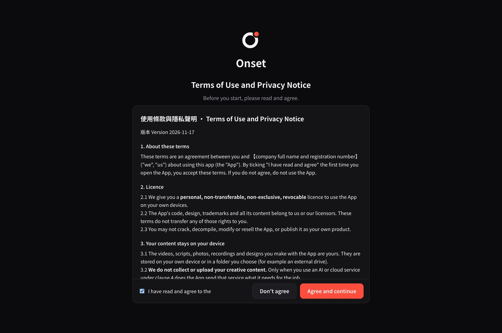
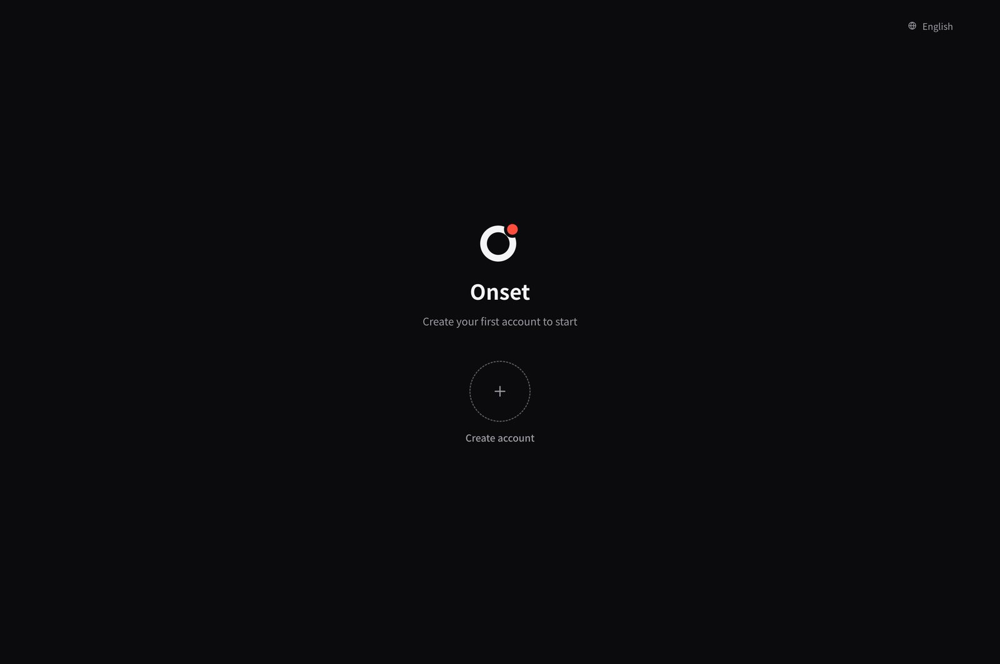
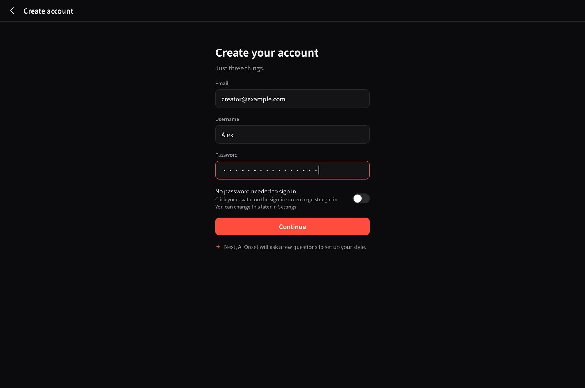
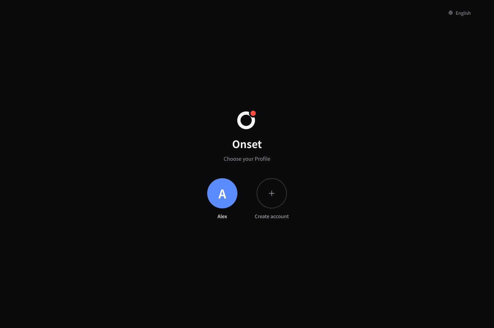
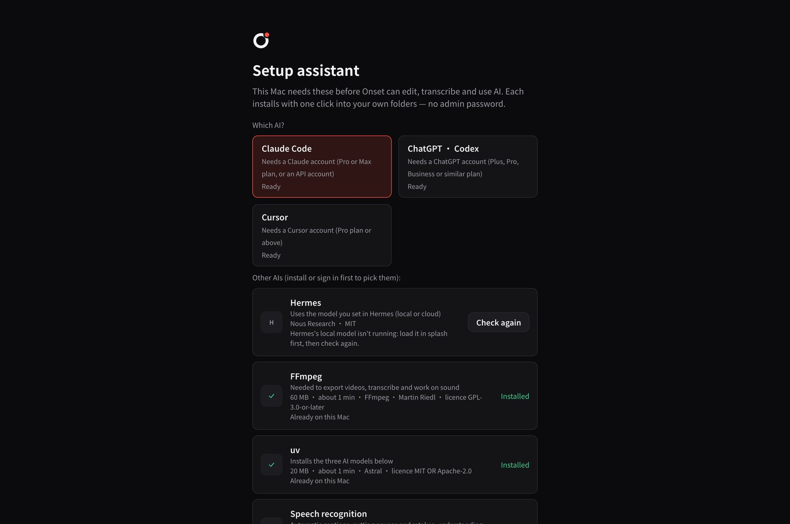
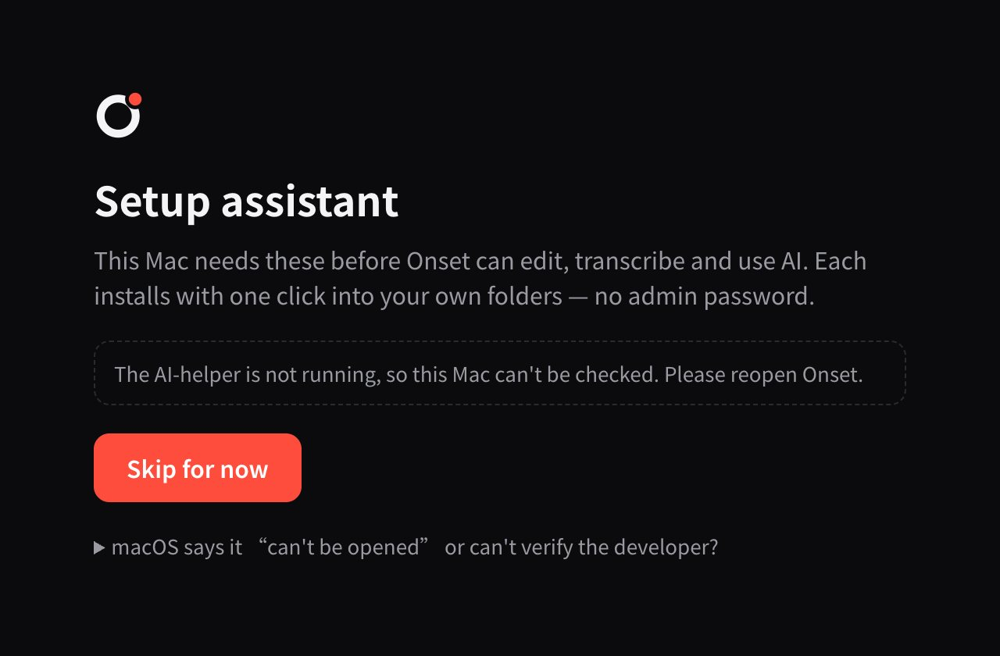
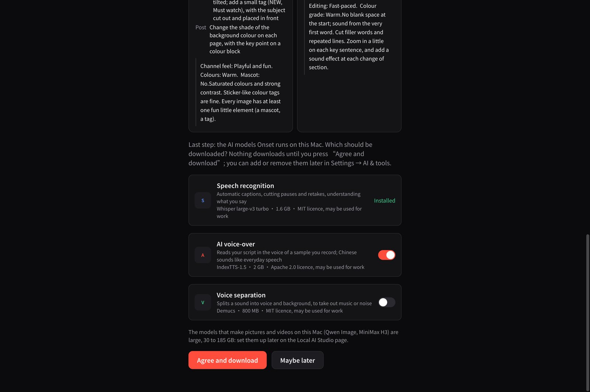
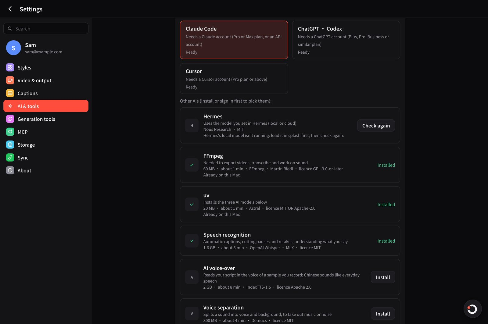
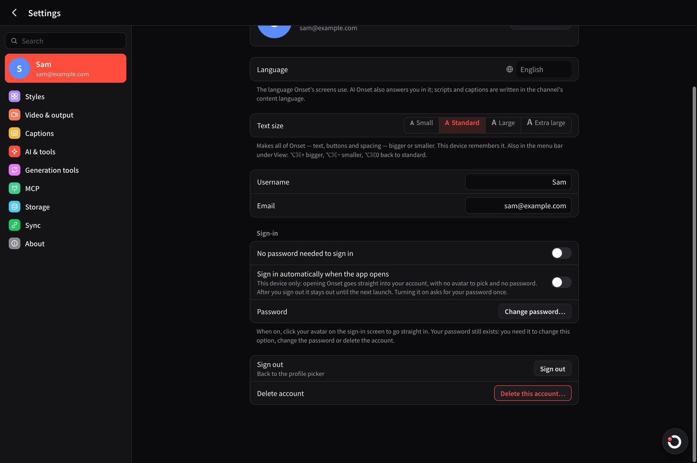
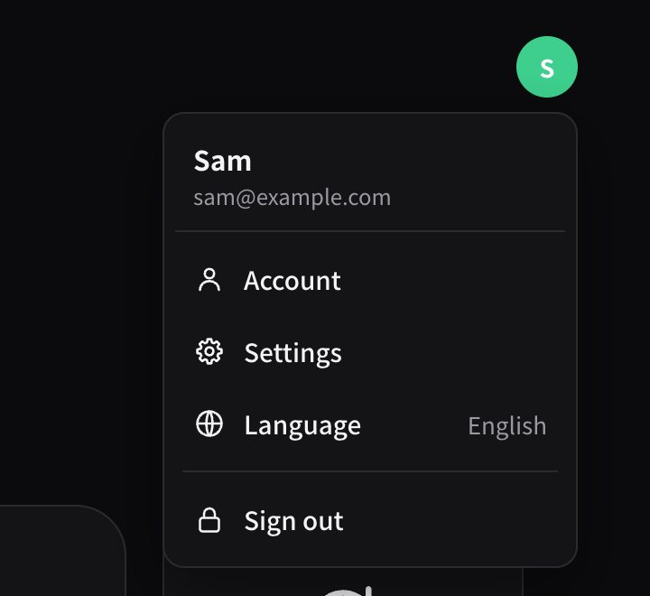

# 1. Installing and opening Onset for the first time

## 1-1 Put Onset on your Mac

1. Open the Onset `.dmg` file.
2. Drag **Onset** into the Applications folder.
3. In Applications, **right-click Onset → Open** (don't just double-click it).

### "Apple could not verify the developer"?

The first time, macOS may say Onset can't be opened because the developer can't be verified. That's because Onset hasn't been notarised by Apple yet. Nothing is broken.

- **Option 1:** Right-click Onset → "Open" → click "Open" again.
- **Option 2:** Open System Settings → Privacy & Security → scroll down to the line about Onset → click **"Open Anyway"** → enter your Mac password.

You only do this once. After that, Onset opens with a normal double-click.

> If macOS says Onset "is damaged": ask a tech-savvy friend to run
> `xattr -dr com.apple.quarantine /Applications/Onset.app` in Terminal, then open it again.

## 1-2 Terms of Use and Privacy Notice

The first time you open Onset, you'll see the "**Terms of Use and Privacy Notice**" (in English or Chinese, following your Mac's language).

1. Read it through: your videos and scripts stay on your own device; only when you use an AI or cloud service does Onset send that service what the job needs.
2. Tick "**I have read and agree**".
3. Click "**Agree and continue**".

If you click "Don't agree", you can't use Onset. To read the terms again later: avatar at the top right → "Settings" → "**About**" → "Terms of Use and Privacy Notice". When the terms change, Onset asks you to agree again.

## 1-3 Pick a language and create your account (Profile)

After agreeing, you'll see this screen.

1. Pick the app language at the top right: 繁體中文, 简体中文, English, Bahasa Melayu, 日本語, 한국어.
2. Click **＋ "Create account"** in the middle.
3. Fill in three things: **Email, Username (the name shown), Password** (at least 6 characters).
4. To go straight in by clicking your avatar, without typing a password each time, tick **"No password needed to sign in"**. You can change this later in Settings.
5. Click **"Continue"**.

> Accounts live on this computer. One Mac can have several Profiles (for example one for you and one for your assistant), and Onset asks you to pick an avatar when it opens.
>
> 

## 1-4 The setup assistant: pick an AI, install the tools

The first time you sign in on a new Mac, the "**Setup assistant**" comes first. It checks what this Mac already has; anything missing installs with one click into your own folders, with no admin password. **Nothing installs until you press its button**, and nothing downloads in the background.

**First: which AI?** AI Onset's "brain" can be one of these:

| AI | What it needs |
|---|---|
| **Claude Code** | A Claude account (Pro or Max plan, or an API account) |
| **ChatGPT · Codex** | A ChatGPT account (Plus, Pro, Business or similar plan). Answers appear all at once instead of word by word |
| **Cursor** | A Cursor account (Pro plan or above). Web searches and pictures are handed to Claude Code (if it's installed and signed in), and the screen says so |
| **Hermes** | No extra account: it uses the model you set in Hermes (local or cloud). A local model is free but slower; how slow depends on your computer |

An AI that's installed and signed in says "Ready": click it to choose it. The others are listed under "Other AIs": click "**Install**", then "**Sign in**". Terminal opens and takes you to the browser to sign in, and the page updates by itself when you're done.

**Then: tools and models.** Further down are FFmpeg (for exporting and transcription), uv (installs the models below), speech recognition, AI voice-over and voice separation, each with its size, roughly how long it takes, and its licence. "Local generation (optional)" has its own install page.

When you're ready, click "**All set — start**".

> If the AI-helper isn't running, the setup assistant can't check this Mac and asks you to reopen Onset. You can click "**Skip for now**" and open this page again later in Settings → AI & tools.
>
> 

## 1-5 Channel style questions (about 1 minute)

Next, AI Onset asks you 7 questions to set up your channel's style. Click the closest answer for each, or type your own answer in the box below.

| Step | Question | Examples |
|---|---|---|
| 1 Style | The overall feel of your channel | Warm handmade, Sharp and professional, Playful and fun, Calm and refined |
| 2 What you film | What you mostly make | Vlog, Tutorial, Product review, Interview |
| 3 References / links | Videos or accounts you like | Add screenshots, paste links, or "No reference" |
| 4 Editing style | The pace of your edits | Fast-paced, Clean and simple, Cinematic, Documentary |
| 5 Colour grading style | The colour of your picture | Natural, Warm, Cool, Film look |
| 6 Mascot | Do you have a mascot? | Add a picture, or "No" / "Later" |
| 7 Logo | Do you have a logo? | Add a picture, or "No" / "Later" |

Don't want to answer now? Click **"Skip, set up later"** at the bottom left.

When you're done, AI Onset creates **four styles**: a script style, an interview style, a design style and an edit style. It follows them whenever it writes scripts, edits or designs covers. To change them, go to your avatar at the top right → "Settings" → "Styles".

## 1-6 Download the AI models?

The last step asks which AI models should run on this Mac:

- **Speech recognition** (Whisper, 1.6 GB): automatic captions, cutting pauses and retakes. **Recommended.**
- **AI voice-over** (IndexTTS, 2 GB): reads your script in the voice of a sample you record.
- **Voice separation** (Demucs, 800 MB): takes out background music and noise.

Use the switches on the right to choose, then click **"Agree and download"**. Not sure? Click **"Maybe later"**. You can add or remove them later in Settings → AI & tools.

> The models that make pictures and videos on this Mac (Qwen Image 2.1, MiniMax H3) are large (30–185 GB). They aren't downloaded here: decide later on the "Local AI Studio" page.

## 1-7 Switch AI, or sign in again

To change AI Onset's brain, or if the AI says it isn't signed in:

1. Avatar at the top right → "**Settings**" → "**AI & tools**".
2. The setup assistant is at the top: click another AI that says "Ready" to switch to it.
3. If one isn't signed in, click "**Sign in**": Terminal opens, then sign in in the browser.
4. Back in Onset, click "**Check again**".

> These screenshots come from a test setup. Which AIs say "Ready" depends on what's installed and signed in on your Mac.

## 1-8 Sign in automatically when the app opens

Tired of picking your avatar and typing your password every time?

1. Avatar at the top right → "Settings" → click your name at the top to open "**Account**".
2. Under "**Sign-in**", turn on "**Sign in automatically when the app opens**".
3. Turning it on asks for your password once.

This works **on this device only**. After you sign out, it stays out until the next time you open the app.

## 1-9 The account menu

Your avatar at the top right opens: Account, Settings, Language, Sign out.

---

Next: [The home screen →](02-home.md)
