# 2. The six buttons on the home screen

After you sign in, the home screen has six big buttons. A video usually goes like this:

**Write the script → Film → Edit → Make the cover and posts → Export**

No time to film? Use "**No shoot, just make it**" (chapter 5) to turn a script straight into a video.

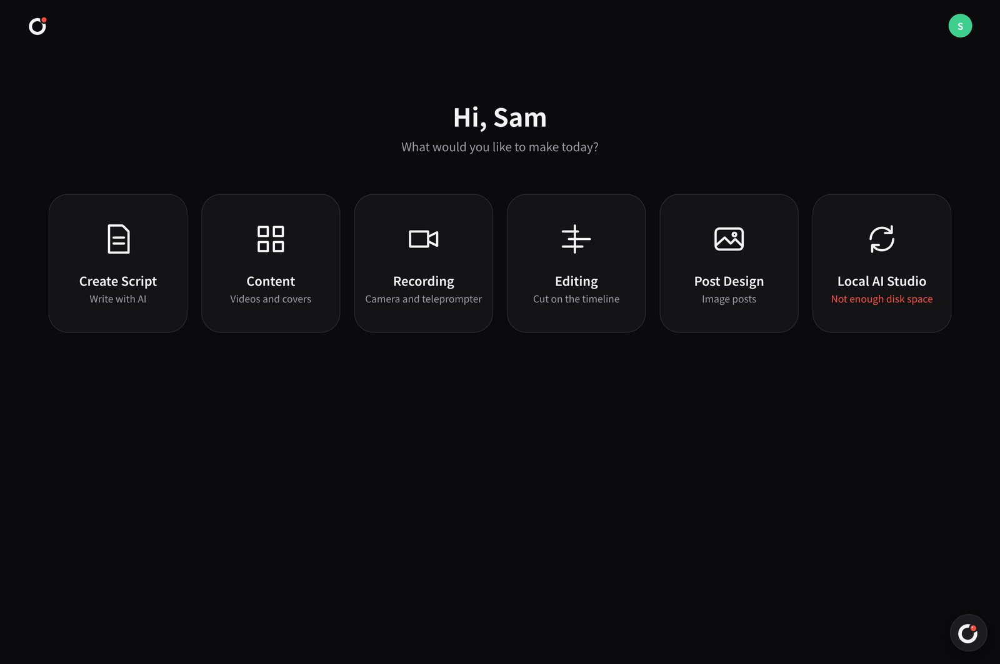

| Button | What it's for |
|---|---|
| **Create Script** | Write a new script, or have the AI write it |
| **Content** | All your videos, how far along each one is, covers and post captions |
| **Recording** | Film with the Mac or an iPhone, with a teleprompter |
| **Editing** | Cutting, captions, music, colour, export |
| **Post Design** | Image posts for Instagram, Facebook, Xiaohongshu (RED) and more |
| **Local AI Studio** | Make AI pictures and videos on this Mac (free; pictures use Qwen Image 2.1, videos use MiniMax H3, and the speed depends on your computer) |

The Onset logo at the top left always takes you back home.

> Under the Local AI Studio button you may see a short status such as "Pictures only" or "Not enough disk space". See 2-6.

---

## 2-1 Create Script

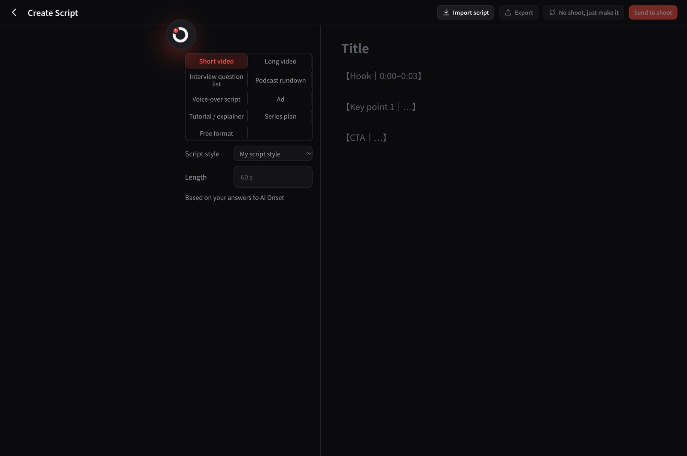

1. In the middle, pick a format: **Short video, Long video, Interview question list, Podcast rundown, Voice-over script, Ad, Tutorial / explainer, Series plan, Free format**.
2. Pick a "Script style" (the default is "My script style" from your answers) and a "Length".
3. Type on the right yourself, or have the AI write it:

**Have the AI write the script:**

1. Click the round AI Onset button at the top left to open the chat.
2. Say in one sentence what this episode is about, for example "Write a 60-second short: three tips for better pour-over coffee at home".
3. Send it (or press 🎙 and say it).

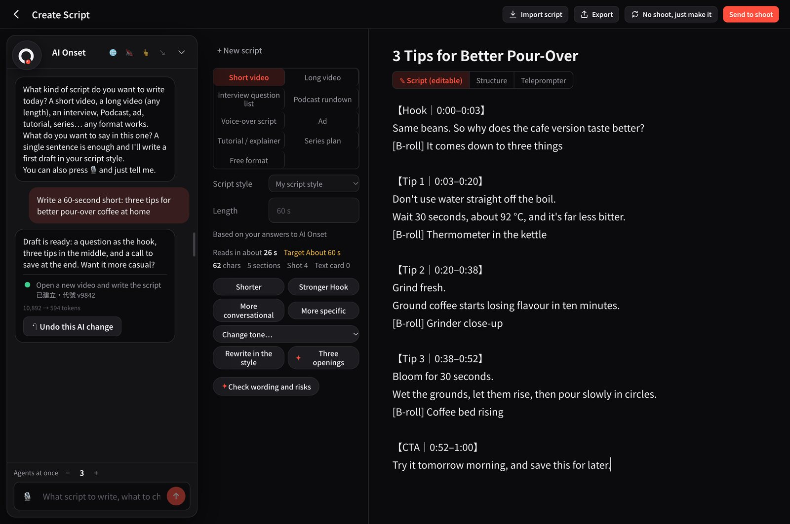

Once it's written:

- The buttons in the middle refine it: "Shorter", "Stronger Hook", "More conversational", "More specific", "Change tone…", "Rewrite in the style", "Three openings", "Check wording and risks".
- You'll see how long it takes to read, the target length, the character count and the number of sections.
- Three tabs above the script: **"Script (editable)"**, **"Structure"**, **"Teleprompter"**.

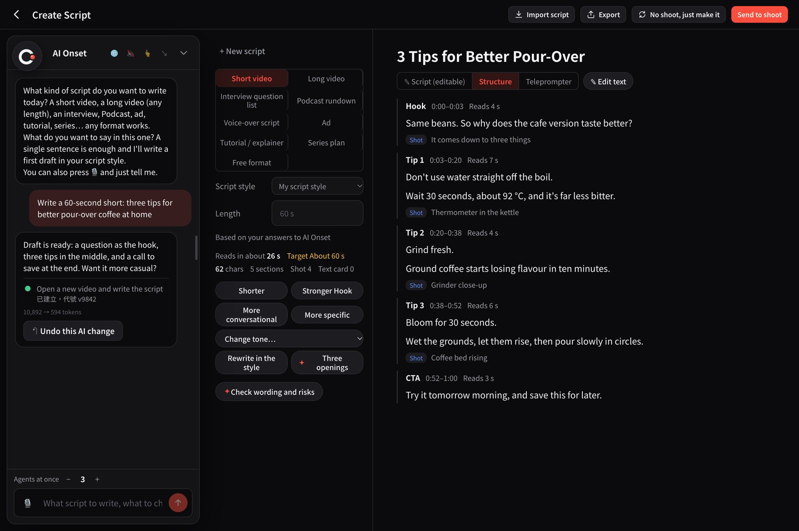

> Sections are marked with headings like `【Hook｜0:00–0:03】`, and shot notes start with `[B-roll]`. The AI writes them this way for you.

Top right:

- **"Import script"**: use a file you've already written.
- **"Export"**: PDF, Word, Markdown, plain text.
- **"No shoot, just make it"**: turn it into a video without filming (chapter 5).
- **"Send to shoot"**: take this script to Recording.

---

## 2-2 Content (videos and covers)

All your videos are here. Filter by stage at the top: **Script, Shoot, Edit, Done**, or by type: **Long, Short, Posts**.

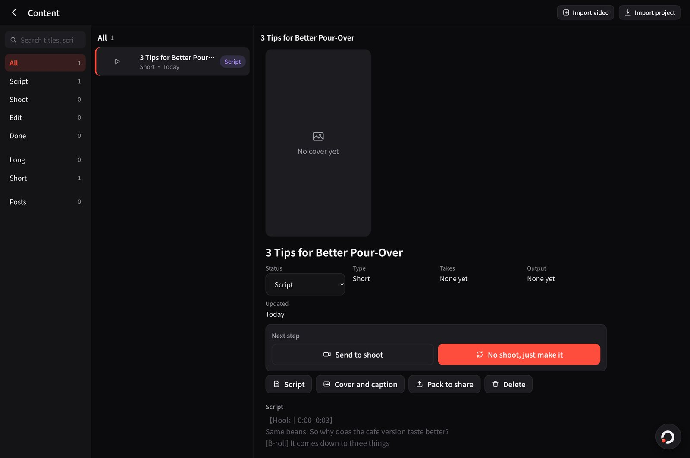

Click a video to see its status, takes and exports on the right, plus the **"Next step"** (for example "Send to shoot" or "No shoot, just make it").

Buttons below:

- **Script**: read or edit the script.
- **Cover and caption**: make the cover and write the post caption.
- **Pack to share**: package the whole project to give to someone else.
- **Delete**.

### Making a cover

Inside "Cover and caption":

- Let the AI design one in your design style, or start from **"Use a picture as the cover"**, an AI-generated picture, the **"AI library"**, or **"Start from a template"**.
- **"AI write post caption"** writes the text for your post.
- An AI log underneath shows what the AI did and how many tokens it used.

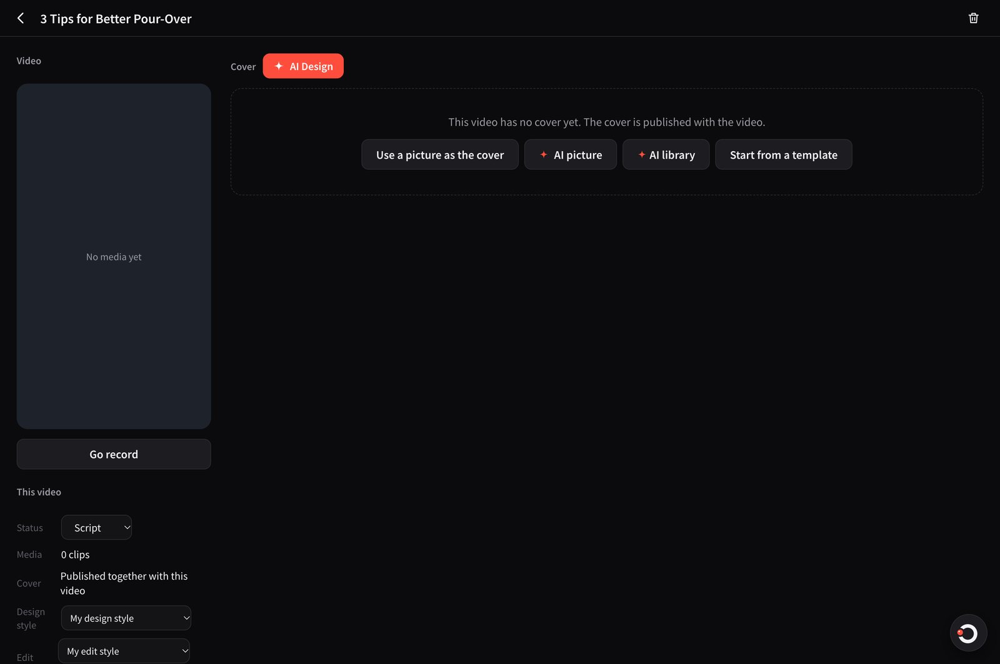

**"Import video"** at the top adds videos you've already filmed.

---

## 2-3 Recording (camera and teleprompter)

Click "Send to shoot" on a script, or Recording on the home screen.

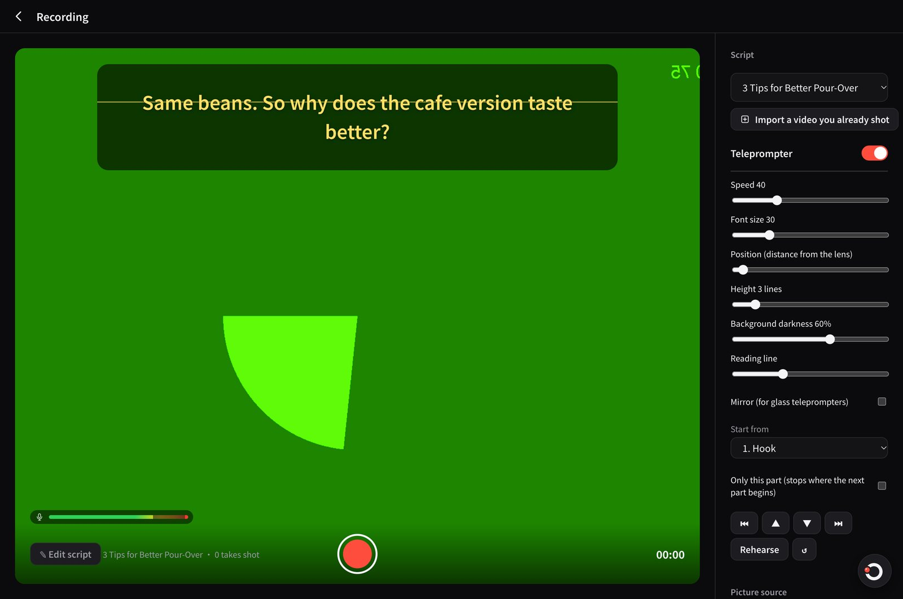

> The screenshot uses a fake test camera, which is why the picture is a green pattern.

1. On the right, under **"Script"**, choose what to film (or "No script").
2. The teleprompter text sits at the top of the picture. On the right you can adjust:
   - **Speed, Font size, Position (distance from the lens), Height, Background darkness, Reading line**
   - **"Auto scroll"** or **"Follow voice"**: Follow voice listens to where you are and scrolls along.
   - **"Mirror"**: tick it for a glass teleprompter.
   - **"Start from"**: start at the Hook, Tip 1, and so on. "Only this part" stops where the next part begins.
3. Click the red button in the middle to record.

Other useful settings:

- **Countdown**: count down 3 seconds before starting, with a beep each second if you like.
- **Voice commands**: say "start / stop / pause / resume / retake / next section / previous section".
- **Remote**: Bluetooth page turners and presenters work.
- **Main sound**: choose the Mac's microphone; with an audio interface, one track per input (one mic per person).

### Already filmed with a camera or phone?

Click **"Import a video you already shot"** and choose the files. When you're done filming (or importing), click **"Go to Editing"** at the top right.

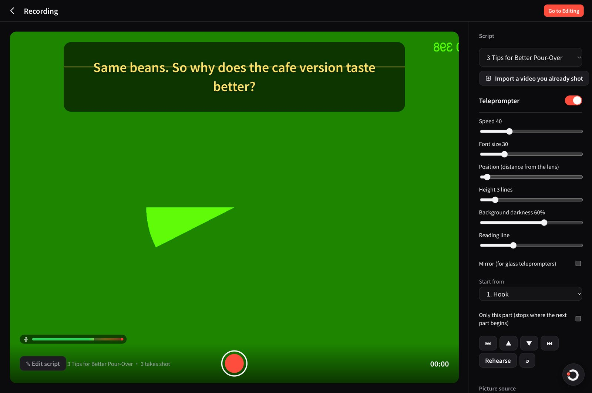

### Use an iPhone as a camera

Under the picture source, **"iPhone cameras"**: on the iPhone, open Recording in Onset → Settings → **"Be the Mac's camera"**. Pair the phone first and use the same Wi‑Fi (see chapter 7). Ticked iPhones start and stop with the Mac, send their files back when done, and can be put together as a multi-camera podcast video.

---

## 2-4 Editing

Editing first shows the videos that are **"In progress"**. Click one to start cutting, or click **"New"** for an empty 16:9, 9:16, 1:1 or Podcast project.

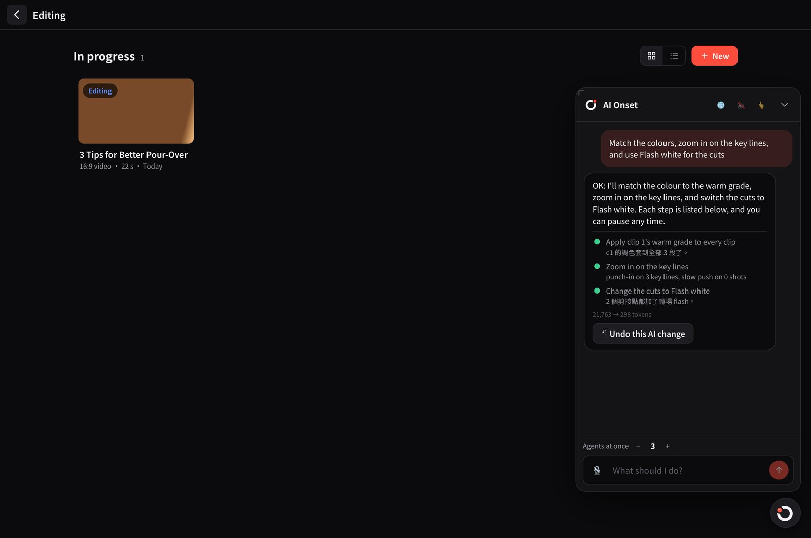

See [chapter 3](03-editing.md) for the details.

---

## 2-5 Post Design (image posts)

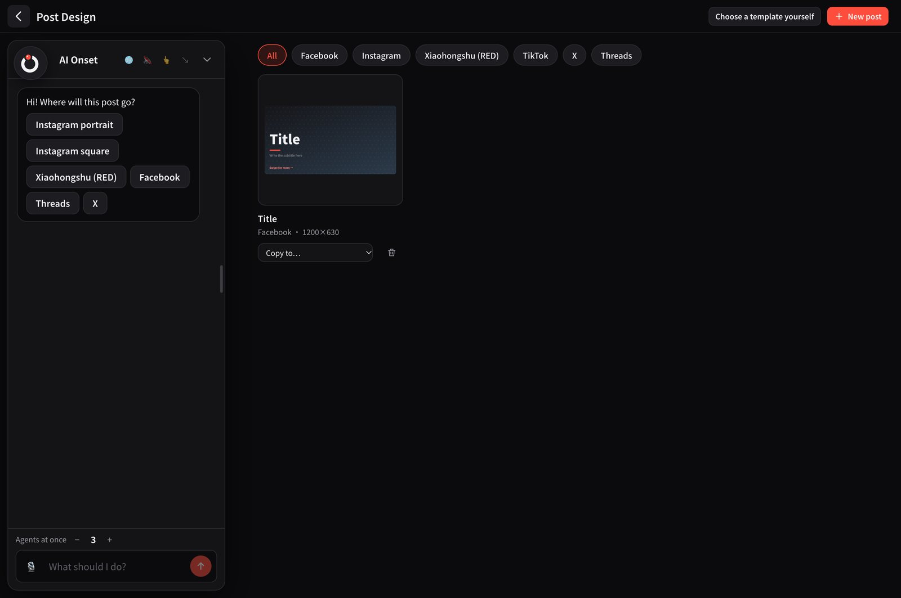

1. Click **"New post"**, or tell AI Onset on the left where the post will go. It asks a few questions (purpose, where the content comes from, how many slides, design style) and then designs it.
2. In the editor:
   - Left: platform and size, purpose, content source, slides, design style, then **"Design from these"** / **"Redesign from these"**.
   - Middle: edit right on the picture. Click to select, drag to move, pull a corner to resize, and **double-click text to edit it**. The toolbar adds "Text", "Add a picture", "AI picture", "AI library", "Shape".
   - Right: **Template, Layers, Background, Style, Check**. Templates include a carousel (cover slide + one point per slide + an end slide).
3. **"Copy to another platform…"** makes the other sizes for you.
4. Click **"Download"** at the top right when it's ready. It saves automatically.

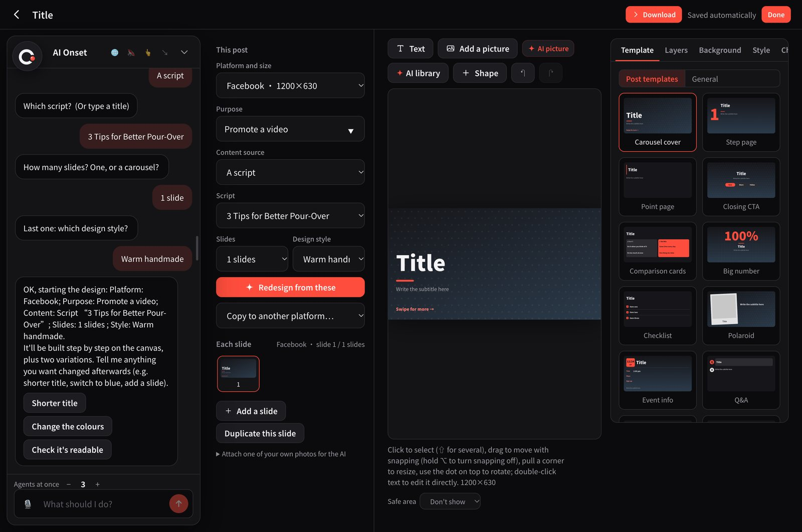

---

## 2-6 Local AI Studio (AI pictures and videos)

Make AI pictures and videos on this Mac: **no cloud, no cost, but slower, and the models are big.**

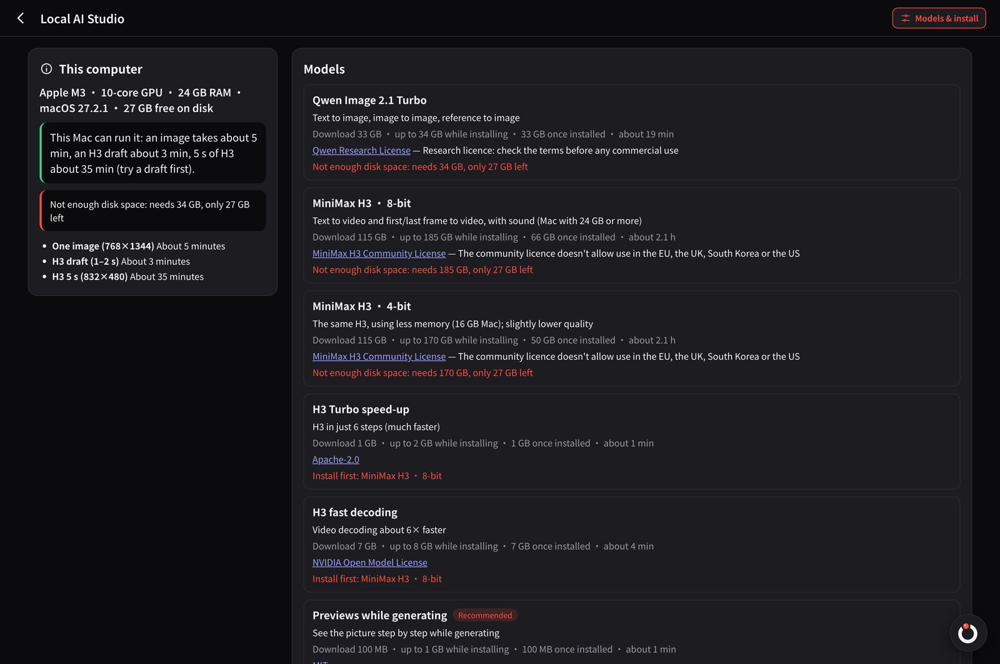

- The page first checks this computer (chip, memory, free disk space) and tells you **what it can make and roughly how long it takes**.
- Models:
  - **Qwen Image 2.1 Turbo**: pictures. About a 33 GB download.
  - **MiniMax H3** (8-bit or 4-bit): videos with sound. A 115 GB download, needing up to 185 GB free while installing.
- Local generation: pictures use Qwen Image 2.1, videos use MiniMax H3, and the speed depends on your computer.
- Each model only downloads after you **agree to its licence** and click "Install". Read the licence carefully (Qwen's is a research licence, for example: check it before using it for work).
- If the home button says **"Pictures only"**, this Mac doesn't have the memory or disk space for the video model and can only make pictures. **"Not enough disk space"** means even the picture model doesn't fit yet.
- One Mac makes one thing at a time; the rest wait in a queue. You can stop a job. Finished pictures can be added to the reference library ("Add to reference library"), turned into a video ("Make a video from this"), or put in a video ("Put in a video…").
- Only for Macs with Apple Silicon (M-series chips).

---

Next: [Editing →](03-editing.md)
