# 3. Editing

## 3-1 The editing screen

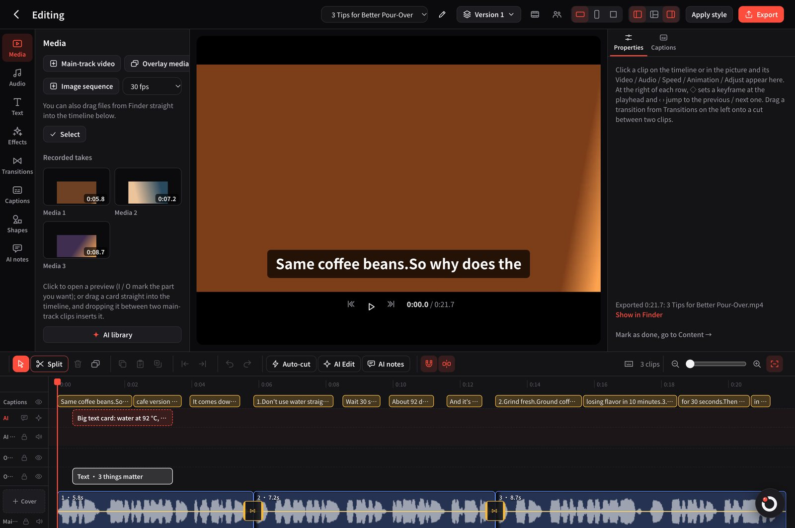

- **Left: media and tools.** Tabs: Media, Audio, Text, Effects, Transitions, Captions, Shapes, AI notes.
- **Middle: the preview.** Press ▶ to play.
- **Right: properties.** Click a clip and its settings appear here.
- **Bottom: the timeline.** Your video, laid out from left to right.
- **Top bar:** the video name, "Version", the shape (wide, tall, square), panel layout, **"Apply style"**, **"Export"**.

## 3-2 The rows of the timeline

From top to bottom:

| Row | What goes there |
|---|---|
| **Captions** | Automatic captions, one sentence per block |
| **AI** | AI note cards (notes to the AI, see 3-8) |
| **Overlay** | Things on top of the picture: text, images, picture-in-picture |
| **Cover** | This video's cover |
| **Main track** | The main video clips, end to end |
| **Voice-over** | Voice-over you recorded or the AI read |
| **Music** | Background music |
| **Sound effects** | Short sounds like a ding or a whoosh |

Each row has 🔒 on the left (lock it so nothing changes it) and 👁 / 🔊 (hide or mute it).

## 3-3 Basic cutting

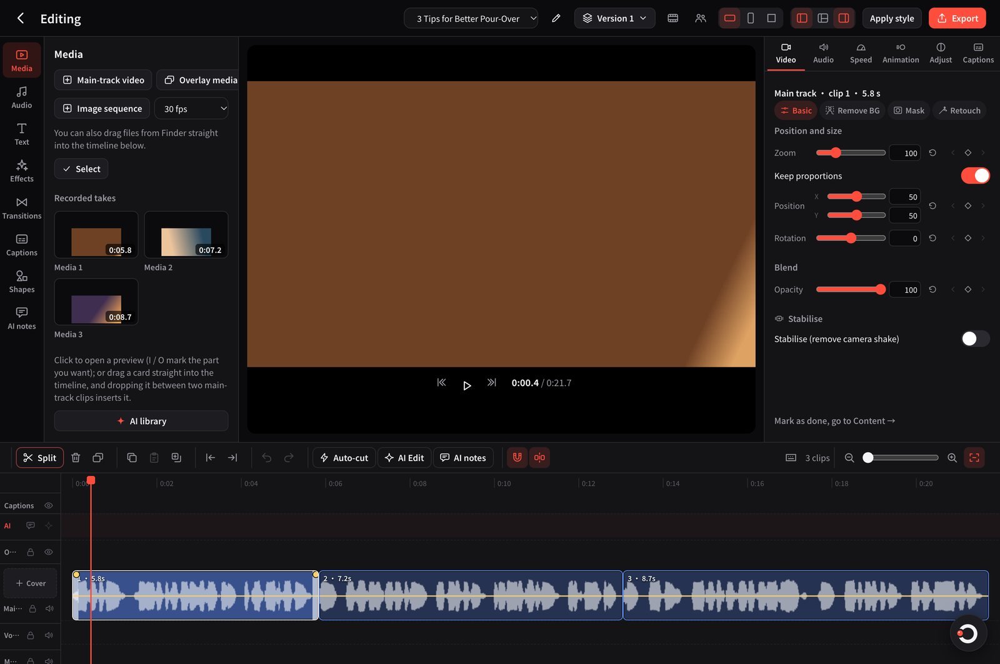

- **Add media:** under Media → "Recorded takes", **drag a card onto the timeline**. Drop it between two main-track clips to insert it. You can also drag files straight in from Finder.
- **Pick a part first:** click a card to open a preview, press **I** to mark the start and **O** to mark the end.
- **Select:** click a clip. The tabs **Video / Audio / Speed / Animation / Adjust** appear on the right.
- **Cut (blade):** press **S** (or the scissors "Split" button) to switch to the blade; a red dashed line follows the mouse. **Click a clip or layer to cut it right there.** It snaps to the playhead and clip edges; hold **⌥** to stop snapping.
- **Back to selecting:** press **A**, **Esc**, or click the arrow left of the blade. The select tool picks and drags clips.
- **Cut at the playhead:** press **⌘B**. (On the iPhone, the "Split" button still cuts at the playhead.)

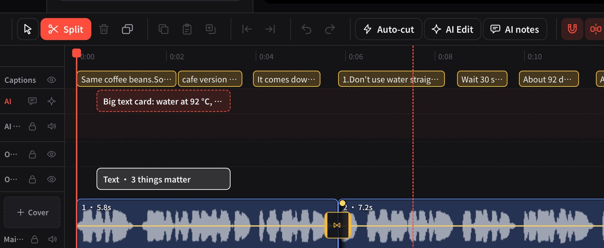

- **Shorten:** drag the left or right edge of a clip.
- **Reorder:** drag a clip to a new place.
- **Delete:** select it and click the bin.
- **Undo:** ↶ ↷ on the toolbar.
- The magnet on the toolbar is the main-track magnet: when it's on, clips close up with no gaps.
- The slider at the bottom right zooms the timeline (or pinch with two fingers on a Mac trackpad).

### Let the AI cut for you

- **Auto-cut**: cuts out the pauses automatically. The version before it is kept as "Before Auto-cut".
- **AI Edit**: cuts the way you describe, for example "cut out the mistakes and the retakes". Long videos are done chapter by chapter.

### Versions

Use **"Version"** in the top bar to save a copy before a big change. If it goes wrong, switch back to the old version.

## 3-4 Clip settings (the properties on the right)

- **Video › Basic**: position and size, scale, rotation, opacity, blend mode, **"Stabilise (remove camera shake)"**.
- **Video › Remove BG / Mask / Retouch**: background removal, masks, skin retouching.
- **Audio**: volume, fades, voice enhancement, noise reduction.
- **Speed**: change the speed, or use a speed curve (montage, hero moment, bullet time…).
- **Animation**: entrance and exit animations.
- **Keyframes**: the ◇ at the right of each row sets a keyframe at the playhead; ‹ › jump to the previous or next one.

## 3-5 Text and typography

1. Click **"Text"** on the left.
2. Click a style ("Text" or one of the "Fly" animations) to add it at the playhead.
3. In the preview, **drag to move it, pull a corner to resize, and use the dot on top to rotate**.
4. Edit the words and the typography on the right under "Video › Basic".

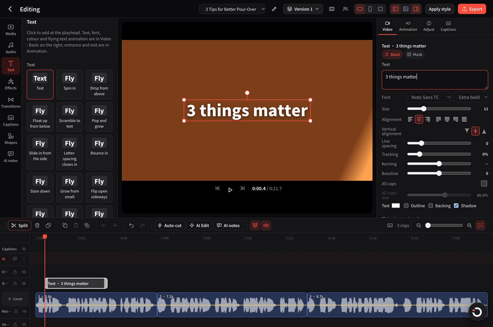

The typography panel has:

- **Text**
- **Font** (Noto Sans TC, Huninn, Iansui, Ming, Kai, Round…) and weight (Thin to Extra bold, with italics)
- **Size**
- **Alignment** (left, centre, right, justified) and **Vertical alignment**
- **Line spacing, Tracking, Kerning, Baseline**
- **All caps** and all-caps size
- **Text** colour, **Outline**, **Backing**, **Shadow**
- **Flying text animation**: over 40 kinds, such as "Spin in", "Scramble to text", "Bounce in", "Slam down". The whole block can move together, or one letter or word at a time.

## 3-6 Captions

1. Click **"Captions"** on the left → **"Transcribe (auto captions)"**.
2. Wait a moment: the captions appear sentence by sentence on the Captions row.
3. To fix a word, click the sentence in the "Sentences (click to edit)" list and type.
4. Look, size, place, font and colour are in the **Captions** panel on the right.
5. **"Include captions on export"** decides whether the captions are burned into the exported video.

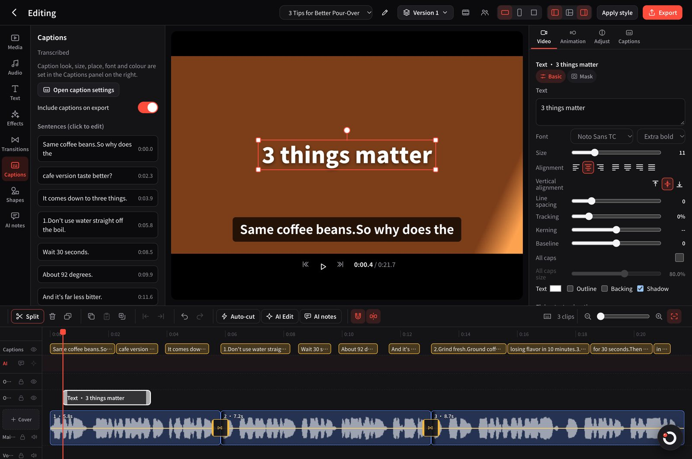

## 3-7 Sound: voice-over, music, sound effects

Click **"Audio"** on the left:

- **"Record voice-over"**: record straight from your microphone.
- **"Audio file"**: add your own music or sounds. They go on the Music row first; you can change them to voice-over or sound effects in the properties on the right.
- **"AI voice-over"**: the AI reads your script (download a voice model first under Settings → AI & tools).
- **Onset's built-in music and sound effects**: all free, no credit needed. Press ▶ to listen and "Add" to put it at the playhead.

Music can duck (get quieter) automatically while someone is talking.

## 3-8 AI note cards

Want a graphic card or an animation without making it yourself? Leave the AI a note card:

1. Click **"AI notes"** on the left → **"AI note card"**. A card appears on the AI row at the top of the timeline.
2. Drag it into place and stretch it over the seconds it should cover.
3. On the right, write what this part needs, for example "Big text card: water at 92 °C, with a thermometer drawn next to it".
4. Pick a **"Tool"**: "Automatic (decided from the text)", Onset card, EffectCraft, Three.js, "Remove background (text behind the person)"…; the paid **"Higgsfield (paid)"** and **"Theater (paid)"** need a cloud service set up first (chapter 6).
5. Click **"Generate"**, or **"Generate all"** to make every note card at once.

What it makes goes on the rows under the note card. The note card itself never appears in the video.
"Automatic" never picks a paid tool on its own, and a paid tool always shows a quote and asks before it does anything.

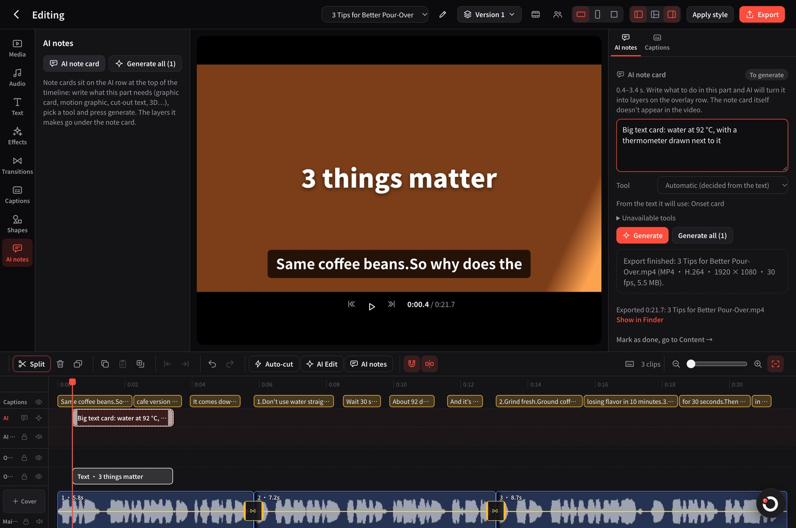

### Give an AI note card reference pictures

Want the AI to follow the feel of a picture? Give the note reference pictures, **up to 4**:

- Drag pictures onto "**Drag reference pictures here (or click to pick)**" under the note's words, click there to pick files, or paste.
- Or drop a picture straight onto the AI note on the timeline (it becomes the note's reference, not a new layer).
- The ✕ on each picture removes it.

**Theater** makes from the reference pictures. **Higgsfield doesn't take reference pictures**: only the AI writing the prompt sees them. To make from a picture, choose Theater.

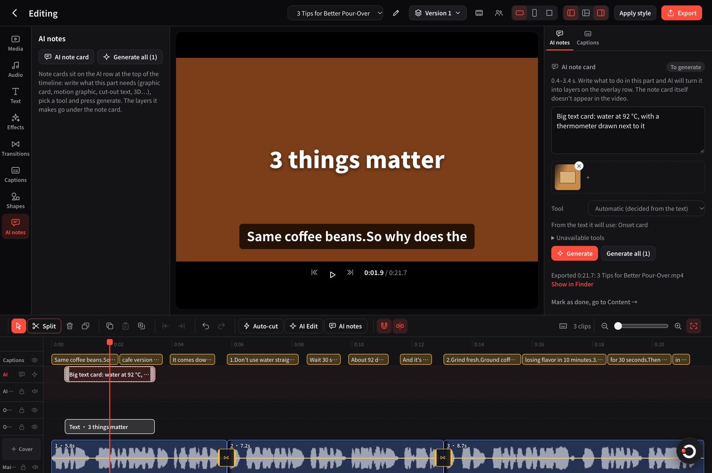

## 3-9 Transitions

1. Click **"Transitions"** on the left.
2. **Drag a transition onto the cut between two clips.** A small box appears on the cut.
3. Drag the box's edge to change the length; select it and press ⌫ to remove it.
4. To do every cut at once: **"Add “Cross fade” to every cut"** at the bottom. **"Remove all"** takes them all off.

There are 39 in five groups: Fade, Push, Wipe, Shape and Motion (for example Whip pan, Glitch, Flip).

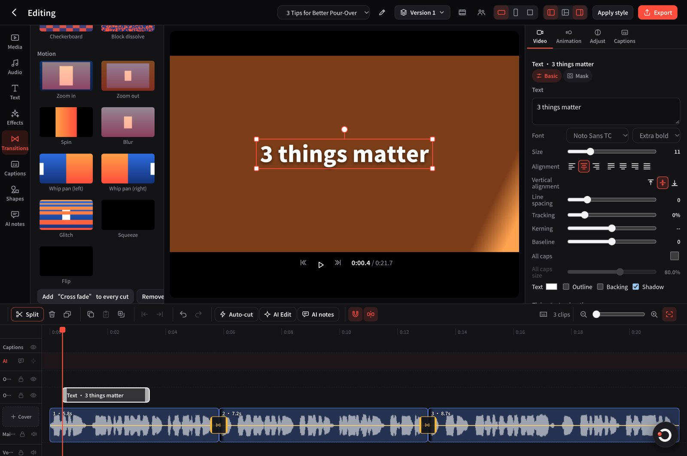

## 3-10 Colour

Select a clip → **"Adjust"** on the right:

- **Adjust**: start with a look (Original, Warm, Cool, Vivid, Soft, Film, Black and white), then fine-tune Exposure, Contrast, Saturation, Temperature and Tint.
- **LUT**: built-in Warm, Cool, Film, Teal & orange, Black & white, Vintage, High contrast, or "Import .cube file…".
- **Curve** and **Colour wheels** (shadows, midtones, highlights): for more control.
- **HDR / Log conversion**: turns iPhone HDR, Apple Log or Sony S-Log3 footage into normal colour.
- **"Apply to all clips"**: grade one clip, match the rest. **"Reset all"** puts it back.

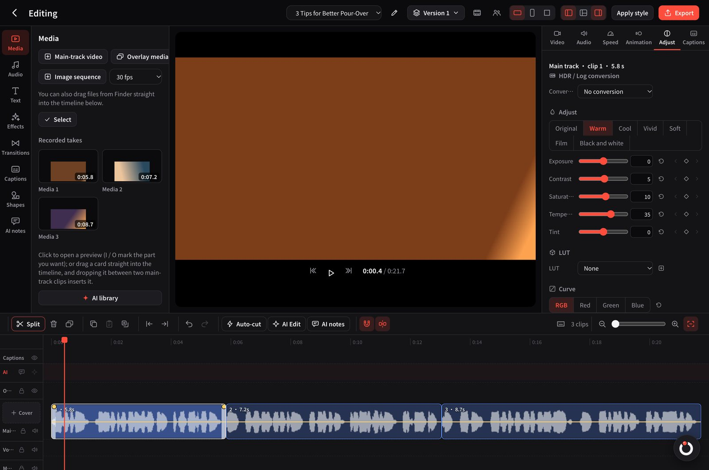

## 3-11 Export

1. Click **"Export"** at the top right.
2. The easiest way is a **"Preset"**:
   - YouTube (MP4 · 1080p)
   - Reels / TikTok / Shorts (tall 1080×1920)
   - Xiaohongshu (RED)
   - Archive master (MOV · ProRes, very large files)
   - Small file (for messaging, 720p)
   - Audio only (MP3)
3. To set it yourself, choose "Custom": format (MP4, MOV, MP3, WAV, AAC), codec, resolution, frame rate, bitrate, quality.
4. Only need a part? Tick **"Export only a part"**.
5. Check **"Save to"**:
   - **"Change…"** picks another folder; **"Show in Finder"** opens the folder.
   - Tick **"Ask me where to save it and what to call it every time"** to get a save window before every export.
6. Click **"Export"**. "Exporting xx%" shows at the top, and "Show in Finder" appears when it's done.

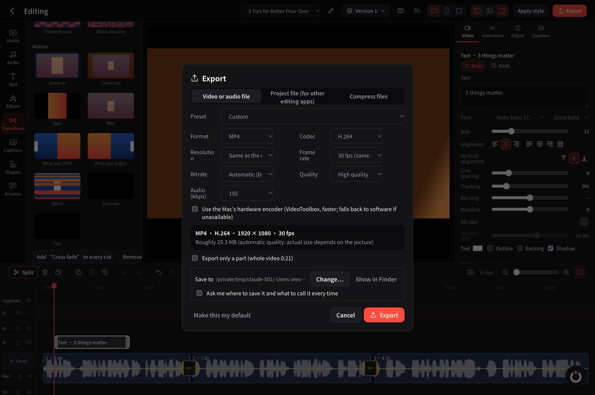

> This screenshot is from the test setup, so "Save to" shows a test folder. On your Mac the default is **Movies → Onset**; if you set a media folder in Settings → Storage, it's the "Export" folder inside it.

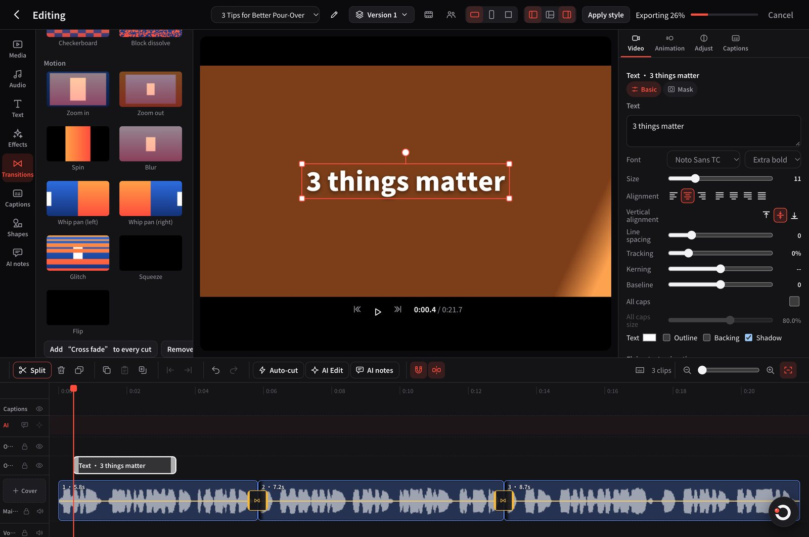

### For other editing apps

The second tab of the export window, **"Project file (for other editing apps)"**, saves for FilmCraft, a CapCut draft, Premiere / DaVinci (XML) or Final Cut Pro (FCPXML). Tick the option to copy the original files next to the project, and the whole folder can be moved or sent to someone else.

The third tab, **"Compress files"**, makes smaller files.

---

Next: [AI Onset →](04-ai-onset.md)
