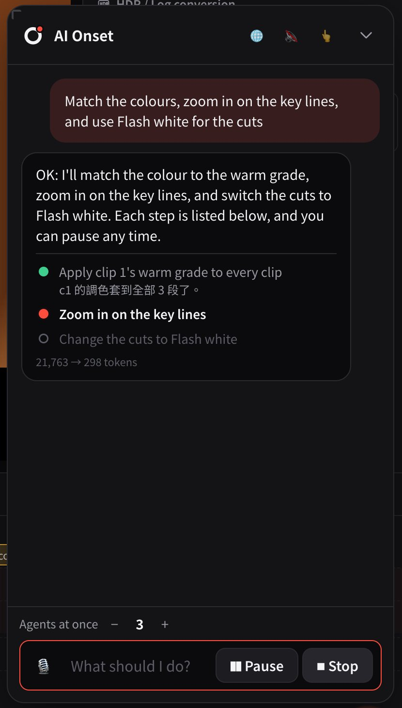

# 4. AI Onset: let the AI do the work

## 4-1 How to call it

- Click the **round AI Onset button** in the corner (top left on the script and post pages, bottom right in Editing).
- Or press **⌘J** on any screen.
- Type, or press **🎙** to speak: "Hold to talk" sends when you let go, or click once and it sends after 2 seconds of silence.

Things you can ask it, for example:

- "Write a Reel script about today's tech news"
- "Match the colours, zoom in on the key lines, and use Flash white for the cuts"
- "Split this long video into a few shorts"
- "What's this?" (press 👆 first, then click something on the screen)

## 4-2 The small icons at the top

| Icon | Meaning |
|---|---|
| 🌐 | Whether it can search the web. Click to switch: search automatically when needed → can search every time (🌐!) → off |
| 🔇 / 🔊 | Whether answers are read aloud |
| 👆 | "Point": click anything on the screen to ask about it (or ⌥⇧-click) |
| ↘ | "Back to corner": tuck the chat back into the corner (only when it sits next to the editor) |

## 4-3 You can see every step

When you ask it to do something, the chat lists **every step** it will take. Each finished step gets a green dot and a note of what it did.

- While it works, **"Pause"** and **"Stop"** sit at the bottom; use them any time. After pausing, press "Resume".
- When the chat is folded away, a small status bar shows "Onset is doing: …", also with pause and stop.
- The timeline and the picture change as it goes, so you can watch it edit.
- When it's done, **"↶ Undo this AI change"** appears. Not happy? One click takes it all back.

## 4-4 Agents at once

Under the chat there's **"Agents at once − 3 +"**.

- Agents are AI helpers working at the same time. More agents finish big jobs faster (such as "No shoot, just make it" for a whole video), but keep the computer busier.
- You can set 1 to 10. Onset checks what this computer can handle and tells you if it can only take fewer at once.
- When several agents are working:
  - **Coloured bands** above the timeline show which part each agent is working on ("name · step").
  - **Each agent has its own coloured cursor** that flies to whatever it's changing: a clip, the Captions row, the Music or Voice-over row, the AI row, or the preview when it's grading colour.
  - "Pause all", "Resume all" and "Stop all" control them together, and each one can be stopped on its own.

> The test setup has no real AI, so this section has no screenshot of several agents with coloured cursors.

## 4-5 Let an outside AI use Onset (advanced)

Settings → MCP can "Let outside AI work inside Onset", for example so Claude Desktop or Claude Code can drive Onset directly. Every step an outside AI takes also shows in AI Onset, marked "🔌 outside AI", and can be stopped the same way. An outside AI can't film, delete or publish.

---

Next: [No shoot, just make it →](05-no-shoot.md)
