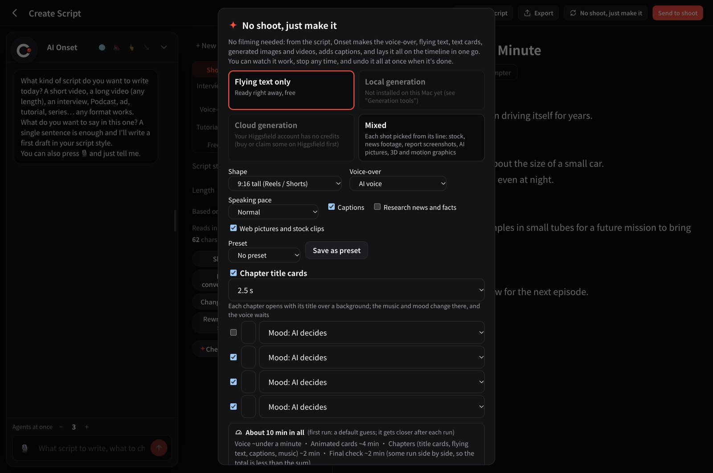
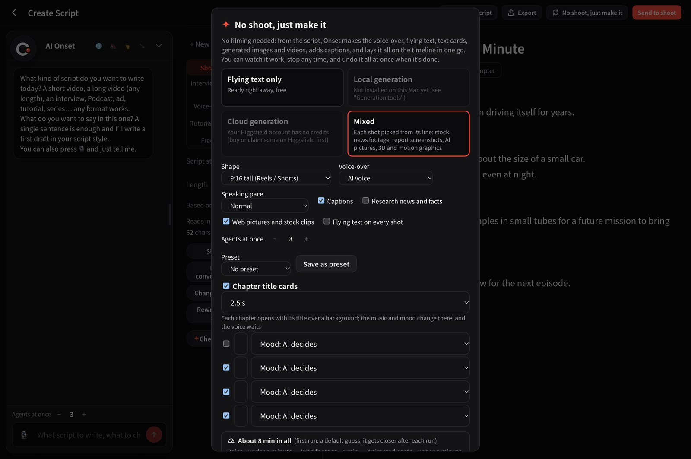
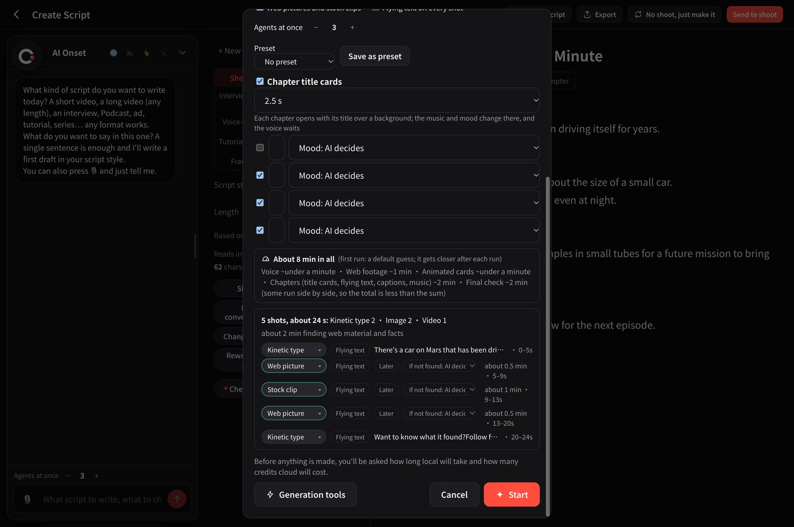
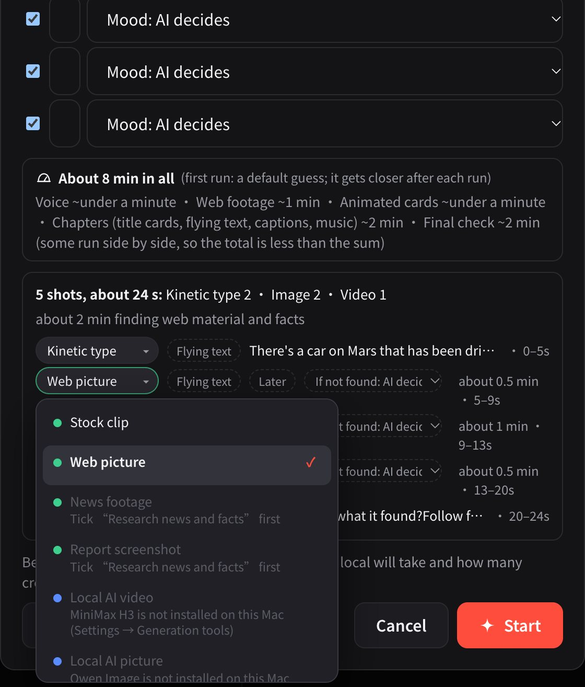

# 5. No shoot, just make it

No time to film, or a subject you simply can't film (like a rover on Mars)? If you have a script, Onset can make the whole video: **voice-over, flying text, text cards, web footage, generated pictures and videos, plus captions**, all laid out on the timeline in one go.

You can watch it work, stop any time, and undo it all at once when it's done.

## 5-1 Where to start

- **"No shoot, just make it"** at the top right of Create Script.
- In **Content**, pick a video and use "No shoot, just make it" under "Next step".
- Or just tell AI Onset: "Don't film this one, make it into a video". It first asks, with buttons, about style, AI generation, length and shape, and voice-over and music (see chapter 4, 4-2).

> The button is greyed out once the video already has filmed takes.

## 5-2 Choose how to make it

Pick one of the four big buttons at the top:

| Option | What it means |
|---|---|
| **Flying text only** | Ready right away, free. The picture is text animation and cards |
| **Local generation** | Pictures and videos made on this Mac. Free, but each shot takes minutes |
| **Cloud generation** | Made with Higgsfield or Theater. Costs money, **with a quote first** |
| **Mixed** | Each shot picked from its line: stock, news footage, report screenshots, AI pictures, 3D and motion graphics |

Options you can't use are greyed out with the reason (for example "Not installed on this Mac yet" or "no credits").

Then set:

- **Shape**: 16:9 wide (YouTube), 9:16 tall (Reels / Shorts), 1:1 square.
- **Voice-over**: AI voice, or no voice-over.
- **Speaking pace**: tight, normal, slow.
- Tick boxes: **"Captions"**, **"Research news and facts"**, **"Web pictures and stock clips"**, **"Flying text on every shot"**.
- **Agents at once**: more is faster (see chapter 4).
- **Chapter title cards**: each chapter opens with its title over a background, and you can set each chapter's mood (tense, curious, moving, calm, reflective).
- Settings you use often can be saved with **"Save as preset"**.

## 5-3 Check the time and the shot list

Scroll down:

- **Time estimate**: "About X min in all", with each stage (voice, web footage, animated cards, local generation, cloud generation, final check). The first run uses a default guess; it gets closer after each run.
- **Shot list**: one line per shot, with its line of script, its length and what it's made with.

## 5-4 Where each shot comes from

The button at the left of each line changes what the shot is made with:

| Source | What it is |
|---|---|
| **Stock clip** | Free stock video from the web |
| **Web picture** | A picture from the web whose licence allows it |
| **News footage / Report screenshot** | News video, or a screenshot of a news page (tick "Research news and facts" first) |
| **Local AI video / picture** | Made on this Mac with MiniMax H3 / Qwen Image |
| **Higgsfield cloud clip / picture** | Made with your Higgsfield account (uses credits) |
| **Theater cloud clip / picture** | Made with your Theater account (quoted first) |
| **Cursor picture / ChatGPT picture** | A picture made on your Cursor or ChatGPT plan (no price per picture, asks first; add them to the cloud list first, see chapter 6) |
| **3D animation** | A 3D animation |
| **Animated card** | An information card that moves |
| **Motion graphic** | A motion graphic made with EffectCraft |
| **Kinetic type** | One big word per beat, background colours flipping, camera pushes and whips |
| **Card** | A still card |

Each line also has:

- **"Flying text"**: whether text goes on top of the picture.
- **"First / Later"**: important shots get made first.
- **"If not found:"**: what to do when nothing suitable turns up on the web (AI decides, free stock, 3D animation / motion graphic, AI picture, animated card).

## 5-5 The main subject's reference picture

If the script has a main subject with a fixed look (a particular rover, your product), every AI picture should show it the same way. Onset handles this for you:

1. The AI finds up to 3 main subjects in the script.
2. It looks for real photos on the web whose licence allows it, cuts out the background and saves them in **Local AI Studio's reference library**, named "Reference: name".
3. From then on, AI pictures, local videos and Theater generations all draw from that reference.

To swap or delete one, go to the reference library in Local AI Studio. The next video on the same subject reuses it.

## 5-6 Local time limit

With "Local generation" or "Mixed", there's an extra **"Local limit"**: 10, 30, 60 or 120 minutes.

Local generation is slow (one video shot can take half an hour). When the time runs out, any shots not made yet **automatically become animated cards** instead of waiting. If this Mac is busy with another local job, it uses animated cards straight away too.

## 5-7 Anything paid asks first

The bottom of the window says: "Before anything is made, you'll be asked how long local will take and how many credits cloud will cost."

- **Higgsfield**: a quote in credits first ("…credits in all, spend them?"). Say no and those shots become flying text instead.
- **Theater**: an estimate first ("about US$…, go ahead?").
- **Cursor / ChatGPT**: no price; it uses your plan's usage, and still asks whether to make them first.

## 5-8 Starting, and after it's done

1. Click **"Start"**.
2. You can go and do something else. The AI works in the background, chapter by chapter: as soon as a chapter's voice-over is read, that chapter's animation, flying text, captions and music start.
3. Everything lands on the editing timeline, just like your own edit, so you can keep changing it.
4. To start over, tell AI Onset **"redo it"**. The old edit is saved first as a version called "Before redo" with the date.
5. Closed Onset halfway through? No problem: next time you open Editing it asks **"Go on"** or **"No thanks"**.

### One voice-over line came out wrong?

Every voice-over line is its own clip. On that line, click **"Speak line #n again"**. It's read again in the same voice, and the clips and captions after it move to fit.

---

Next: [Cloud generation →](06-cloud.md)
