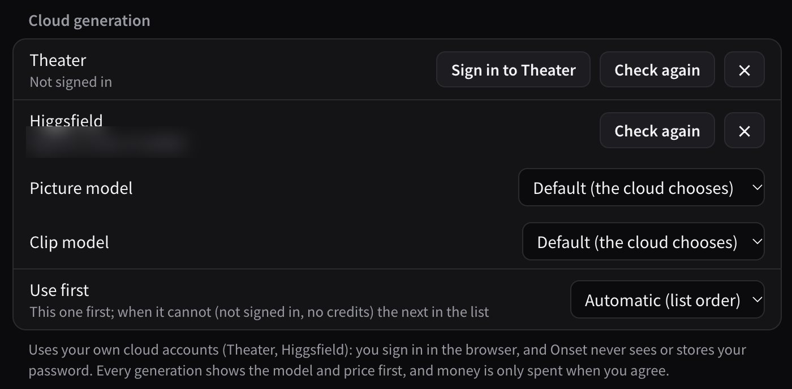

# 6. Cloud generation: Higgsfield and Theater

Local generation is free but slow, and some Macs can't run the video model at all. **Cloud generation** uses your own cloud account to make pictures and videos on someone else's computers. It's much faster, but it costs money.

Onset works with two services: **Higgsfield** and **Theater**. You can add both, and choose which one to use for each shot.

## 6-1 Add a cloud service

1. Avatar at the top right → **"Settings"** → **"Generation tools"**, then scroll down to **"Cloud generation"**. (The "Generation tools" button at the bottom left of "No shoot, just make it" brings you here too.)
2. Click **"＋ Add a cloud service"** and pick Theater or Higgsfield.
3. Click **"Sign in to Theater"** or **"Sign in to Higgsfield"**:
   - **Theater**: nothing to install. The Theater sign-in page opens in your browser.
   - **Higgsfield**: install Higgsfield's small command-line tool first (the page shows the one-line install command; a tech-savvy friend can paste it into Terminal), then click "Sign in to Higgsfield" and sign in in the browser.
4. Back in Onset, click **"Check again"**. When it says signed in, you're set.

Onset never sees or stores your password: you sign in in the browser.

> The Higgsfield account status in this screenshot has been blurred.

To stop using one, click the **✕** on its line ("Remove from the list").

## 6-2 Which one goes first

**"Use first"**:

- **Automatic (list order)**: use the one at the top of the list; if it can't be used (not signed in, no credits), use the next one.
- Or pick a specific service.

## 6-3 Choose the model and resolution

Once you're signed in, each service shows:

- **"Picture model"** and **"Clip model"**: the default is "Default (the cloud chooses)", or pick one yourself.
- After you pick a model, you can choose its **"Resolution"**. Higher resolution usually costs more.

## 6-4 Higgsfield credits vs. Theater quotes

| | Higgsfield | Theater |
|---|---|---|
| How you pay | With **credits** in your account (buy or claim them on Higgsfield first) | By the **quote** each time, charged to your Theater account |
| Can Onset see your balance? | Yes, e.g. "Signed in (plan, N credits)" | No, check your Theater account |
| What it asks before starting | "…credits in all, spend them?" | Videos: "about US$…, go ahead?"; pictures: Theater quotes first |
| If you say no | Those shots become flying text | Nothing is made |

**Neither one spends money until you agree.**

## 6-5 Where cloud generation is used

- **No shoot, just make it**: choose "Cloud generation" or "Mixed", or switch a shot in the shot list to "Higgsfield cloud clip", "Theater cloud picture" and so on (chapter 5).
- **AI note cards**: pick "Higgsfield (paid)" or "Theater (paid)" as the "Tool". Generating shows a quote first, then asks whether to go ahead (chapter 3).
- When the tool is chosen "Automatically", **it never picks a paid one**.

> No real money was spent while testing, so this chapter has no screenshot of an actual quote.

---

Next: [The iPhone app and sync →](07-iphone.md)
