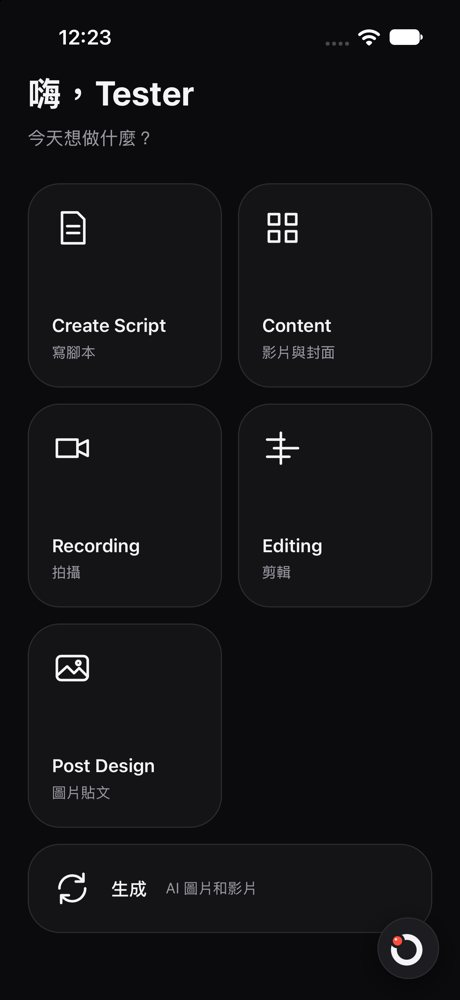
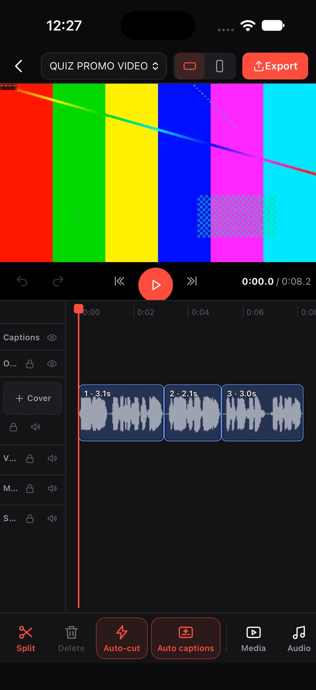
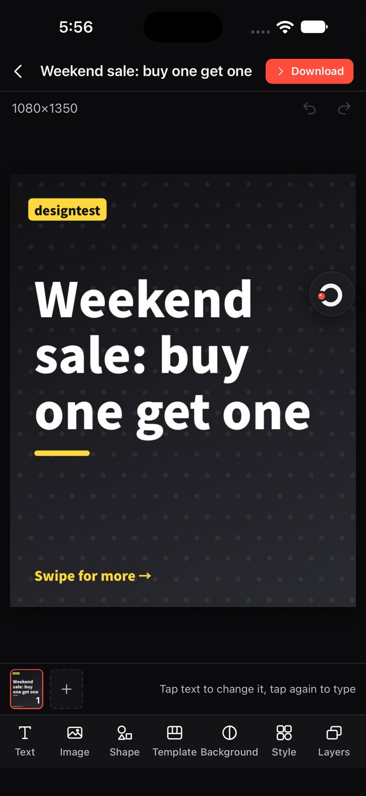
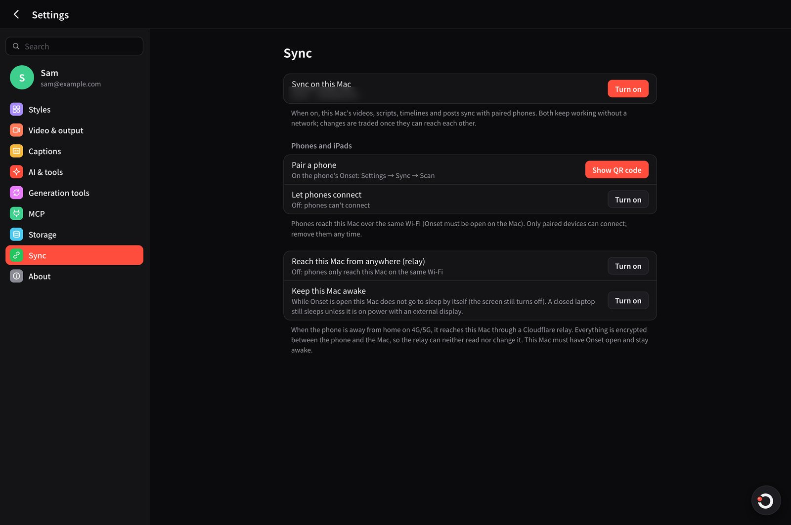
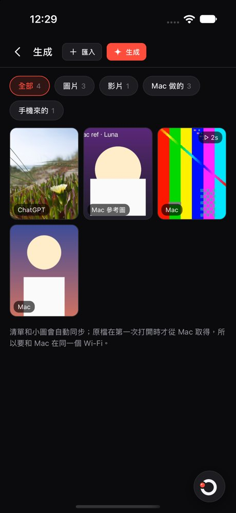

# 7. The iPhone app and sync

Onset also comes for iPhone and iPad. Once the phone is paired with your Mac, videos, scripts, timelines and posts sync both ways.

> The phone screenshots in this chapter were taken earlier in the iPhone Simulator, with the app in Chinese. The layout is the same in English.

## 7-1 What the phone can do

**On the phone itself:**

- Import videos and photos (from Photos, the camera, or Files)
- The whole editor: cut, split, trim, reorder, captions and their look, transitions, layers, music and voice-over, colour
- Speech to text (with Apple's speech recognition)
- Export 9:16 or 16:9 MP4 (saved to Files → Onset and to Photos)
- Recording, with the teleprompter
- Image post design
- AI pictures: browse what the Mac made; draw with Apple's Image Playground; or have the AI write a prompt for ChatGPT / Gemini / Grok, follow the steps to make it there, and import the result (Onset doesn't pay for any of it)

 

**Needs the Mac (the phone hands it over):**

- Most AI Onset actions, and AI Edit
- Very long videos, multi-camera podcasts
- Background removal, masks, retouching, voice tools, HDR conversion
- Other export formats
- Local AI generation

For anything the phone can't do, tap **"Hand to Mac"**. The request stays with the video, and the Mac sees it once they connect.

With no network at all, editing and exporting still work.

## 7-2 Pair with your Mac

The first pairing needs **the same Wi‑Fi**, with Onset open on the Mac.

**On the Mac:**

1. Avatar at the top right → "Settings" → **"Sync"**.
2. Under "Sync on this Mac", click **"Turn on"**.
3. Under "Let phones connect", click **"Turn on"**.
4. Under "Pair a phone", click **"Show QR code"**.

**On the iPhone:**

1. On the first screen, tap **"Pair with your Mac"** (or Settings → Sync).
2. **"Scan the QR code on the Mac"**.

That's it. You won't need to scan again. To remove a phone, do it in Settings → Sync on the Mac.

## 7-3 How sync works

- **Works offline:** every device keeps all its data. Without a network both keep working, and they trade changes when they can reach each other.
- **Changed the same thing on both?** If a script or timeline was changed on both sides, both are kept (the other timeline shows up under "Version").
- **Video files:** the phone first gets 720p preview copies, which edit more smoothly. To export at 1080p, tap **"Download originals"**. Videos filmed on the phone go to the Mac as originals.
- **AI library:** pictures and videos made by Local AI on the Mac sync to the phone. Small previews come first; the full file downloads when you open it. Things made on the phone go back to the Mac too.

## 7-4 Reach the Mac from anywhere (relay)

Away from home on 4G / 5G, the phone can still reach your Mac at home:

- **"Reach this Mac from anywhere (relay)"** turns on by itself after you pair your first phone. You'll see it in Settings → Sync on the Mac.
- The phone connects through Onset's relay. Everything is encrypted between the phone and the Mac, so the relay can neither read nor change it.
- The phone shows "At home (direct)" or "Away (through the relay)".
- **Away from home, only projects, scripts, covers and posts sync.** Big video files wait until you're home on the same Wi‑Fi.
- The Mac at home must **have Onset open and stay awake**. Turn on **"Keep this Mac awake"**. A closed laptop still sleeps (unless it's on power with an external display).

## 7-5 The iPhone as the Mac's camera

For podcasts and interviews, iPhones can be the Mac's second and third cameras:

1. On the iPhone, open Recording in Onset → Settings → **"Be the Mac's camera"**.
2. On the Mac's Recording page, under the picture source, tick this iPhone in **"iPhone cameras"**.
3. Press record on the Mac: both start and stop together.
4. The files come back to the Mac automatically, one per camera, lined up by sound, and put together as a multi-camera video.

This needs **the same Wi‑Fi**; it doesn't go through the relay.

---

Next: [FAQ →](08-faq.md)
