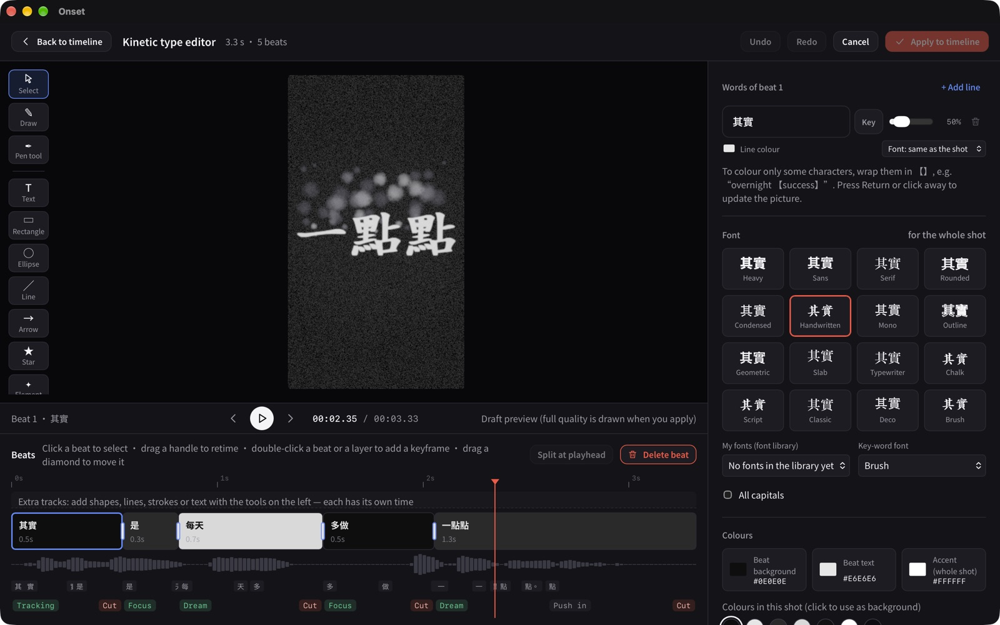

# 8. Kinetic type, the kinetic type editor and packaging styles

This chapter is about the tools that make text move, and about your channel's own "packaging": the intro, outro, name strip and so on.

## 8-1 Kinetic type shots

One big word per beat, background colours flipping, the camera pushing, pulling and whipping, text animation like a movie trailer: Onset calls this a "**kinetic type**" shot.

How to make one:

- Tell AI Onset, for example "Make this line kinetic type: overnight, everything changed".
- Write the kinetic type you want on an AI note card and click Generate (chapter 3, 3-8).
- In "No shoot, just make it", choose "**Flying text only**": every voice-over line becomes a kinetic type shot, with music and sound effects (chapter 5).

Onset has **52 kinetic styles**, each with its own font, colours, entrances and exits, camera, 3D props, background and sound effects. If you don't pick one, it chooses by the mood of the line.

When the words are about water, fire, smoke, ice, electricity, wind, snow, hearts and the like, the matching element is added by itself: say "burning" and you get flames and a heat haze, say "like water" and you get drops and ripples. In a few styles (Particle galaxy, Thunder, Water drops and Pixel mosaic, for example) the background itself moves.

## 8-2 The kinetic type editor: change it yourself, no generating again

For a kinetic type shot you've already made, **double-click** it on the timeline, or click "**Edit kinetic type**" on the AI note card, to open the "**Kinetic type editor**".

- **Words**: the words on each beat, the key word, the size; each line can have its own colour and font (fonts from your font library work too).
- **Timing of each beat**: in the time bar at the bottom, drag an edge to make it longer or shorter, split it, or delete it.
- **Motion**: entrance, camera, exit, elements, layout and 3D props can all be changed.
- **Keyframes**: double-click the time bar to add one, and drag the diamond to move it in time. A keyframe can carry a colour (so the text slowly changes colour).
- **Add things**: text, shapes, lines, arrows, hand-drawn strokes, element particles, each with its own time, entrance and exit, and keyframes.
- When you're done, click "**Apply to timeline**". It's drawn and put back where it was, and one undo takes it back.
- Like how it looks? Save it as a **kinetic style** of your own. You can pick it the next time you make flying text, and put it in a style pack to share.

AI Onset can do everything the editor does too. Just say "make the words on the third beat gold".

## 8-3 Packaging styles: intro, outro, name strip

A "**packaging style**" is your channel's own set of packaging, in six parts: **Intro, Outro, Name strip, Chapter card, Frame, Watermark**.

1. Avatar at the top right → "**Settings**" → "**Styles**" → "**Packaging styles**".
2. Click "**New packaging style**". You get a basic set made with your channel's colours to start from.
3. Click a part to open the designer, and change it to how you want with shapes, text, drawing, elements and keyframes. You can also ask AI Onset to design it for you.
4. Text can have blanks that are filled in with that video's details when it goes on a video: `{title}` the video title, `{name}` your name, `{channel}` the channel name, `{chapter}` the chapter title, `{n}` the chapter number.

To put it on a video: in Editing, click "**Apply packaging…**" at the top and pick one. The intro covers the first few seconds, the outro goes at the end, each chapter opens with a chapter card, and the frame and watermark are there the whole way through. Switch to another set, or click "**Remove packaging**", and the old one comes off with it.

## 8-4 My elements, my layouts, style packs

- **My elements**: a small picture (drawn yourself or imported) plus how it moves (rise, fall, burst, float, spin), for use in flying text and packaging. Manage them in Settings → Styles → My elements.
- **My layouts**: once a cover or post is designed, save it in the "Template" tab, and next time just swap the words and pictures.
- **Style packs**: package your styles, kinetic styles, packaging styles, elements, layouts and fonts to give to someone else. When you open someone else's style pack, it first plays you a preview of how it looks, and only goes into your account when you click "Add".

---

Next: [Animation Board →](09-board.md)
