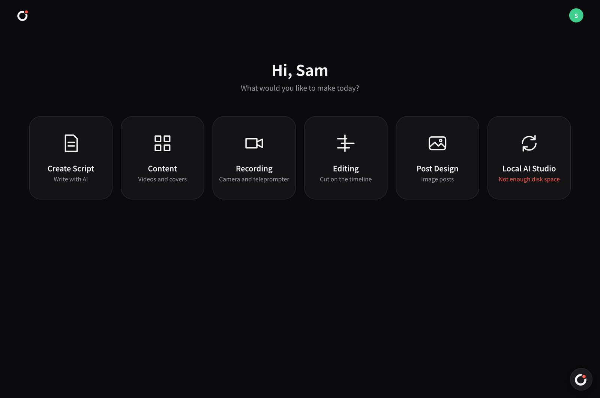

# Onset Beginner's Handbook

**Web version:** https://zero5phh-ops.github.io/onset-handbook/en/

[繁體中文](../README.md) · **English**

For creators using Onset for the first time. No coding needed: just follow along.

Onset is one app for the whole video: writing the script, filming, editing, and making the cover and posts.
It has an AI assistant called **AI Onset**. Type or speak to tell it what to do. You can watch every step it takes and pause it at any time.

## Contents

1. [Installing and opening Onset for the first time](01-install.md)
2. [The six buttons on the home screen](02-home.md): script, content, recording, editing, image posts, local AI
3. [Editing](03-editing.md): timeline, text, transitions, colour, export
4. [AI Onset: let the AI do the work](04-ai-onset.md)
5. [No shoot, just make it](05-no-shoot.md): a finished video from just a script
6. [Cloud generation: Higgsfield and Theater](06-cloud.md)
7. [The iPhone app and sync](07-iphone.md)
8. [FAQ](08-faq.md)

## Three things to know first

- **The round button in the corner of every screen is AI Onset.** Not sure how to do something? Just ask it. You can also press ⌘J.
- **Anything the AI changes can be undone.** After each AI change there's a "↶ Undo this AI change" button.
- **Anything that costs money asks you first.** Cloud generation always shows a quote, and only goes ahead when you agree.

## About the screenshots

The screenshots were taken in a test setup (test account "Sam", a test video voiced by the Mac's text-to-speech, no real AI).
So some text on screen will differ from what you see, for example the save location shows a test folder and the AI's answers are short. The buttons and where they are stay the same.
